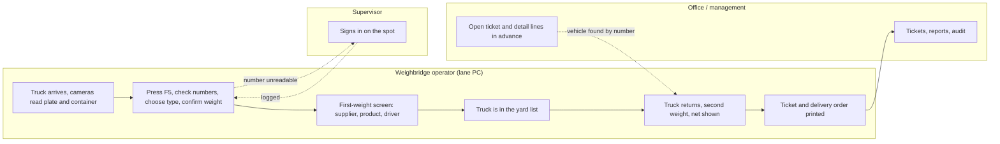
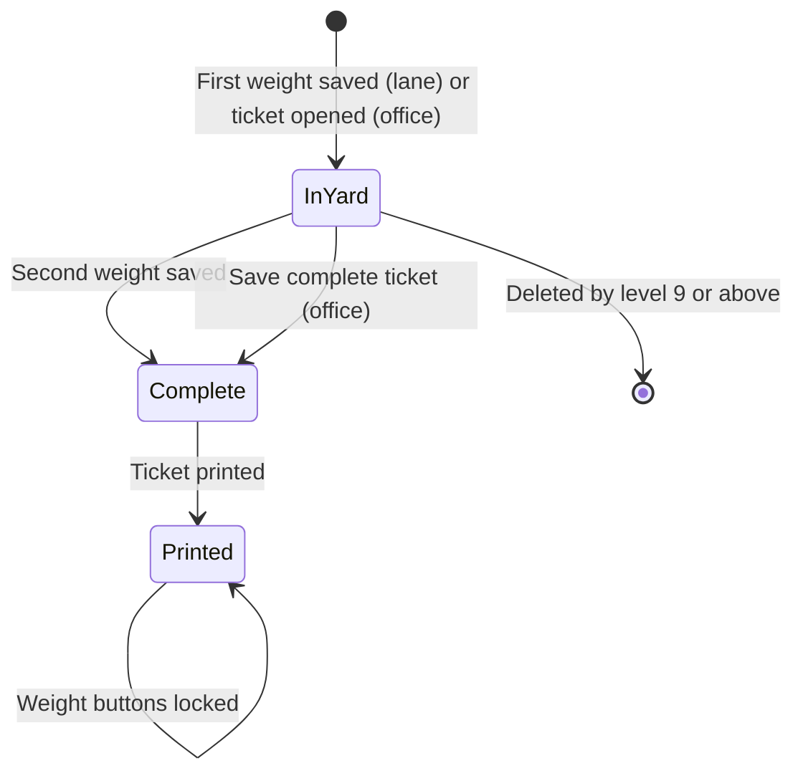
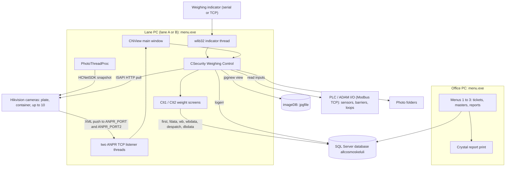
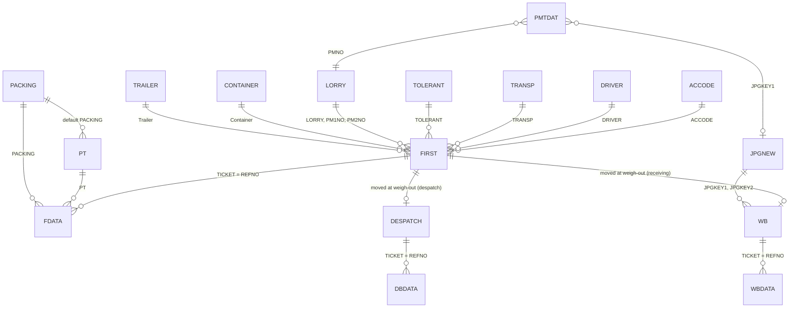
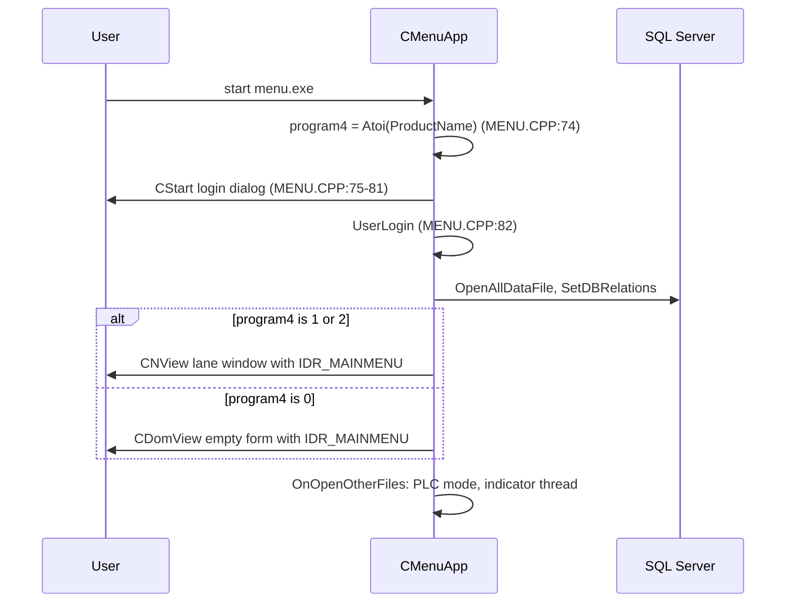
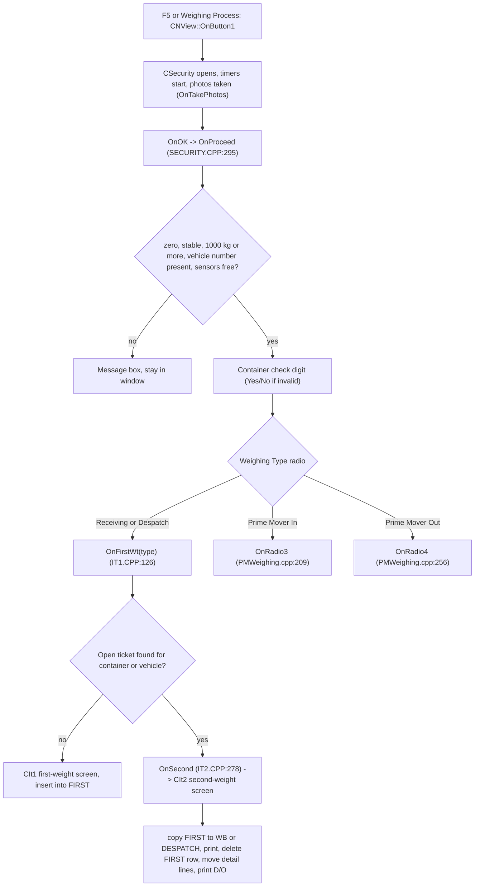
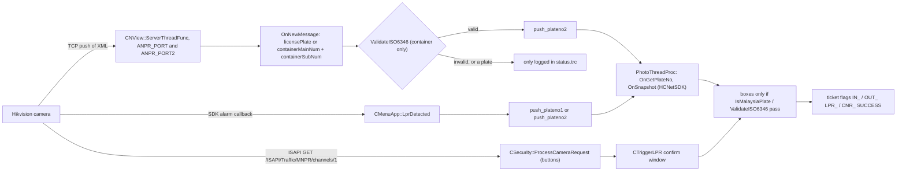
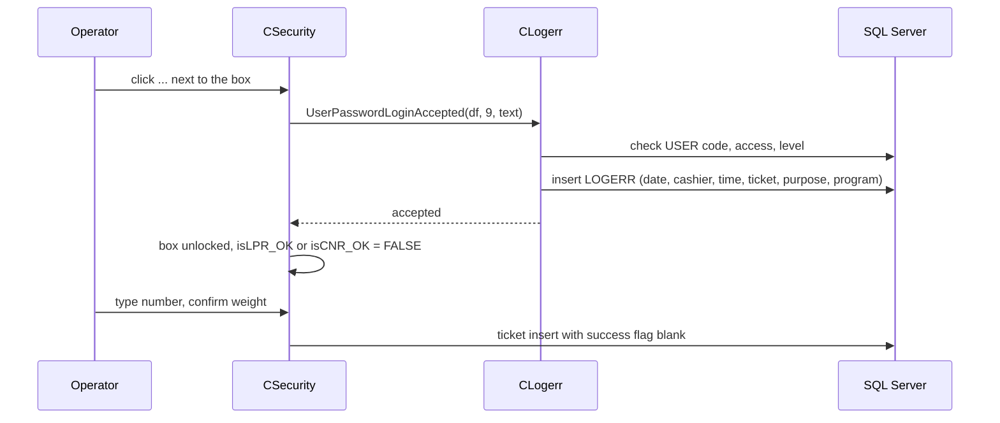
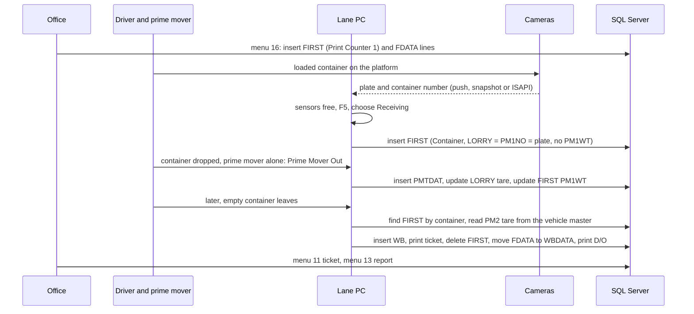
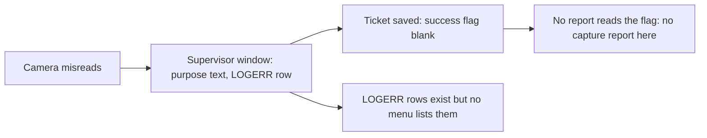

# Application_All_Cosmos - Module Reference

> English edition (authoritative). Last verified against commit `15df32c` ("Rectified some bugs again", 2026-07-20).
> Translation status: zh-CN copy in [MODULE_REFERENCE.zh-CN.md](MODULE_REFERENCE.zh-CN.md), synced 2026-10-28 (commit 8a4cce1).
> Rule: any change to behaviour, tables, fields, screens, reports or calculations must update this reference in the same commit.
> This repository is the **second member of a pair**: `Application_Vance_Bioenergy` is the related program whose reference was used as the structure and style template. The two code lines have **diverged**, so this file is a full rewrite and not a copy (see [Differences from Application_Vance_Bioenergy](#differences-from-application_vance_bioenergy)).

**What this program is.** The weighbridge program of **All Cosmos Industries Sdn Bhd** (the company text is stored scrambled in the code with the plain-text name in a comment, `MENU.CPP:56-57`; the database is called `allcosmoskeluli` in `PROVIDER.SYS`). It is a VC6 / MFC program on the shared wlib32 framework. One exe runs on three kinds of PC: up to two **weighbridge lane PCs** (lane A and lane B), each with a PLC (Advantech ADAM / Modbus) for sensors and barriers and up to **ten cameras**, and one **office PC** that holds the master tables, the ticket screens and the reports. A vehicle is weighed twice (in and out). Tickets are **header and detail** documents: the header holds the vehicle, party, weights and times, and the detail lines hold the delivery-note, purchase-order, product, packing, quantity and **theoretical weight** lines. A camera reads the licence plate and the container number and the operator confirms; a supervisor must sign in before a number can be typed by hand. The program also weighs a **prime mover** (tractor head) on its own so that the container weight can be worked out. The repository has no `User_Guide` folder and no other `docs` file, so no screenshots exist; the program was not run for this document. Database types come from the schema repository `SQL_All_Cosmos` (see [2.3](#23-master-data-catalogue)).

## Contents

- [Menu map and coverage](#menu-map-and-coverage)
- [Part 1: Business view](#part-1-business-view)
  - [1.1 In plain words](#11-in-plain-words) / [1.2 Who uses what](#12-who-uses-what) / [1.3 A day in the life](#13-a-day-in-the-life) / [1.4 Worked example](#14-worked-example)
  - [1.5 Screen tour](#15-screen-tour) / [1.6 Where does this number come from?](#16-where-does-this-number-come-from) / [1.7 Status meanings](#17-status-meanings)
  - [1.8 What happens if...](#18-what-happens-if) / [1.9 Messages you may see](#19-messages-you-may-see) / [1.10 Do and don't](#110-do-and-dont)
  - [1.11 Before you start](#111-before-you-start) / [1.12 Glossary](#112-glossary) / [1.13 Ask the AI](#113-ask-the-ai)
- [Part 2: Technical view](#part-2-technical-view)
  - [Differences from Application_Vance_Bioenergy](#differences-from-application_vance_bioenergy)
  - [2.1 Overview](#21-overview) / [2.2 Architecture and dependencies](#22-architecture-and-dependencies) / [2.3 Master data catalogue](#23-master-data-catalogue)
  - [2.4 Sub-table hierarchy](#24-sub-table-hierarchy) / [2.5 Modules and process flows](#25-modules-and-process-flows) / [2.6 End-to-end flows](#26-end-to-end-flows)
  - [2.7 Report catalogue](#27-report-catalogue) / [2.8 Integrations](#28-integrations) / [2.9 Configuration](#29-configuration) / [2.10 Maintenance](#210-maintenance)
- [Dormant code](#dormant-code) / [User rights](#user-rights) / [Not yet documented](#not-yet-documented) / [Code findings](#code-findings)

## Menu map and coverage

Menu resource `IDR_MAINMENU` (`menu.rc:111-150`) has 3 top-level entries and **25 leaf items** (one of the 8 table entries is a sub-popup "29 More Master Setup" with 3 items). The menu ID `ID000nn` is node `nn` (for example `ID00016` is node 16); `CMenuApp::SubProgram` (`MAIN.CPP:67`) switches on the node. Node numbers are built from `enum menu {M_NORMAL=1, M_CTRL, M_OTHER}` (`MAIN.CPP:10`): menu 1 is `M_NORMAL*10+n`, menu 2 is `M_CTRL*10+n`, menu 3 is `M_OTHER*10+n`; the sub-popup uses the literal nodes 291, 292, 293. **The same `IDR_MAINMENU` is given to the lane window and to the office window** (`MENU.CPP:92`, `:100`), so the menu is on every PC, subject to each user's rights (the library hides items the user may not use). The captions below are copied from `menu.rc`, including the odd "3&8. Camera Profile" with a full stop.

| Menu path | Node | Handler | Where documented |
|---|---|---|---|
| 1. Weighing > 11 Receiving Weighing | 11 | `STCR=1; AdminTicketDb(&wb,&wbdata)` (`MAIN.CPP:72-74`) | [2.5.7](#257-ticket-screens-menus-11-12-and-16) |
| 1 > 12 Despatch Weighing | 12 | `STCR=2; AdminTicketDb(&despatch,&dbdata)` (`MAIN.CPP:76-78`) | [2.5.7](#257-ticket-screens-menus-11-12-and-16) |
| 1 > 13 Receiving Weighing Report | 13 | `STCR=1; OldTableContainer("wbctn")` (`MAIN.CPP:80-82`) | [2.7](#27-report-catalogue) |
| 1 > 14 Despatch Weighing Report | 14 | `STCR=2; OldTableContainer("wbctn")` (`MAIN.CPP:84-86`) | [2.7](#27-report-catalogue) |
| 1 > 15 Audit Report | 15 | `STCR=0; TableContainer("fcctn")` (`MAIN.CPP:88-90`) | [2.7](#27-report-catalogue) |
| 1 > 16 First Weighing | 16 | `STCR=3; AdminTicketDb(&first,&fdata)` (`MAIN.CPP:92-94`) | [2.5.7](#257-ticket-screens-menus-11-12-and-16) |
| 2. Table > 21 Set A/C Code | 21 | `AdminDb(&accode)` (`MAIN.CPP:97-98`) | [2.3.2](#232-supplier-and-customer-accode) |
| 2 > 22 Set Product Code | 22 | `AdminDb(&prodtype)` (`MAIN.CPP:100-101`) | [2.3.3](#233-product-pt) |
| 2 > 23 Set Driver Code | 23 | `AdminDb(&driver)` (`MAIN.CPP:103-104`) | [2.3.4](#234-driver-driver) |
| 2 > 24 Set Transporter Code | 24 | `AdminDb(&transp)` (`MAIN.CPP:106-107`) | [2.3.8](#238-small-code-lists-transp-warehouse-unit-container-trailer-tt) |
| 2 > 25 Set Packing Code | 25 | `AdminDb(&packing)` (`MAIN.CPP:109-110`) | [2.3.6](#236-packing-and-tolerance-packing-tolerant) |
| 2 > 26 Set Tolerant Code | 26 | `AdminDb(&tolerant)` (`MAIN.CPP:112-113`) | [2.3.6](#236-packing-and-tolerance-packing-tolerant) |
| 2 > 27 Set Vehicle Information | 27 | `vehicle.Run()` (`MAIN.CPP:115-116`) | [2.3.5](#235-vehicle-and-prime-mover-lorry) |
| 2 > 28 Set Warehouse Information | 28 | `AdminDb(&warehouse)` (`MAIN.CPP:118-119`) | [2.3.8](#238-small-code-lists-transp-warehouse-unit-container-trailer-tt) |
| 2 > 29 More Master Setup > 291 Set Unit Code | 291 | `AdminDb(&unit)` (`MAIN.CPP:121-122`) | [2.3.8](#238-small-code-lists-transp-warehouse-unit-container-trailer-tt) |
| 29 > 292 Set Container Information | 292 | `AdminDb(&container)` (`MAIN.CPP:124-125`) | [2.3.8](#238-small-code-lists-transp-warehouse-unit-container-trailer-tt) |
| 29 > 293 Set Trailer Information | 293 | `AdminDb(&trailer)` (`MAIN.CPP:127-128`) | [2.3.8](#238-small-code-lists-transp-warehouse-unit-container-trailer-tt) |
| 3. Utility > 31 Set Password | 31 | no case in `SubProgram`; the frame maps `ID00031` to `OnPassword` (`MAINFRM.CPP:28`), the library password screen | [2.5.11](#2511-utility-menu-3) |
| 3 > 32 Backup Data | 32 | `BackupProcess()` (`MAIN.CPP:130-131`) | [2.5.11](#2511-utility-menu-3) |
| 3 > 33 Operator Information | 33 | `SetUser()` (`MAIN.CPP:133-134`) | [2.5.11](#2511-utility-menu-3) |
| 3 > 34 System Update | 34 | `OnSystemUpgrade("WB.EXE","ALLCOS2")` (`MAIN.CPP:136-137`) | [2.5.11](#2511-utility-menu-3) |
| 3 > 35 Company Profile | 35 | `AdminProfileDb(&profile)` (`MAIN.CPP:139-140`) | [2.5.11](#2511-utility-menu-3) |
| 3 > 36 Reset Database | 36 | `CleanDatabase()` (`MAIN.CPP:142-143`) | [2.5.11](#2511-utility-menu-3) |
| 3 > 37 Weighbridge Profile | 37 | `weighbridge.Run()` (`MAIN.CPP:145-146`) | [2.5.10](#2510-weighbridge-profile-menu-37) |
| 3 > 38 Camera Profile | 38 | `camera.Run()` (`MAIN.CPP:148-149`) | [2.5.11](#2511-utility-menu-3) |

**Screens with no menu item.** The weighing itself is not on the menu: it is the main window of the lane PCs (the lane window, then the "Weighing Control" window opened by **F5**, then the first-weight or second-weight screen), documented in [2.5.2](#252-weighing-on-the-lane-pc-weighing-control-first-weight-second-weight) to [2.5.6](#256-prime-mover-weighing). The right-click menu **Vehicle In Yard**, the supervisor confirmation window, the camera confirmation window **Trigger licence plate recognition**, the **Change Weighing Type** window, the search window and the export window are opened from code, not from the menu.

**Coverage statement.** The generated `_inventory/Application_All_Cosmos/inventory.md` is a lead only and was re-checked against the code and `menu.dsp`: it lists the same menu items but shows no field types and misses the header/detail pairs. There is **no menu item** for a prime mover log, capture reports, reasons, bins or tankers. Of the 46 `.cpp` files on disk, 36 are in `menu.dsp`; the other 10 are listed under [Dormant code](#dormant-code).

---

# Part 1: Business view

## 1.1 In plain words

- The program weighs every vehicle that enters and leaves the site. A vehicle is weighed **twice**: once when it comes in (first weight) and once when it goes out (second weight). The difference between the two is the **net weight** of the goods.
- There are lane PCs at the weighbridge and one office PC. A lane PC shows the live weight, the camera pictures and the list of vehicles that are inside the site. The office PC is used for the master lists, for opening and correcting tickets and for reports.
- A ticket is a **header with detail lines**. The header says which vehicle, container, supplier or customer, driver and transporter. The detail lines say what is on the vehicle: delivery-note number, order numbers, product, packing, quantity and the **theoretical weight** that the packing and quantity should add up to.
- A camera reads the **licence plate** and another camera reads the **container number**. The operator confirms the numbers. If a number is wrong or missing, a **supervisor must sign in** before the operator may type it. The supervisor's name and a reason text are written to a log, so management can see how often it happens.
- Besides ordinary lorries the site handles containers pulled by **prime movers** (tractor heads). A prime mover can be weighed on its own, so the program knows its empty weight and can subtract it from the container weight.
- Two **sensors** at the platform tell the operator that something is still on or beside the scale. If a sensor is blocked, the program asks whether to continue.
- Who uses it: weighbridge operators every day; a supervisor who approves hand-typed numbers; the office for tickets and reports; management for the audit reports; IT for cameras, PLC, backups and the database.
- What goes wrong if it is not done: a first weight without a second weight leaves the vehicle in the "in yard" list for ever; a wrong container or plate number is printed on the ticket; a prime mover that was never weighed on its own gives a wrong container net weight.

## 1.2 Who uses what

| Department | Where | Main tasks | Start here |
|---|---|---|---|
| Weighbridge operator / security | Lane PC (lane A or B) | Press F5, check plate and container number, choose Receiving, Despatch, Prime Mover In or Out, confirm the weight, fill the first-weight and second-weight screens | Daily: the whole weighing flow. Start of shift: check the cameras show a picture and the weight shows "Stable" and "Zero Detected" |
| Supervisor (user level 9 or higher) | Lane PC | Signs in when a number must be typed by hand, a ticket variance must be accepted, or a lane mode is changed; changes the weighing type of a vehicle in the yard | As needed |
| Office / logistics | Office PC | Open a ticket before the vehicle arrives (menu 16), complete or correct tickets (menus 11, 12, 16), print the delivery order, run weighing reports (13, 14) | Daily: tickets; month-end: reports |
| Master data owner | Office PC | Keep the lists of suppliers and customers (21), products (22), drivers (23), transporters (24), packing (25), tolerance (26), vehicles (27), warehouses (28), units, containers and trailers (291 to 293) | Weekly or when a new party appears |
| Management / audit | Office PC | Audit reports (15): who changed which ticket | Weekly or month-end |
| IT / admin | Office PC and lane PCs | Operator accounts (33), company profile (35), weighbridge profile (37), camera profile (38), backup (32), system update (34), reset database (36) | On installation and when hardware changes |

### User levels and approvals

- The program uses a numeric **user level** per operator (set in Operator Information, menu 33). The levels the code tests are **9** (supervisor), **10** and **99** (administrator).
- Level 9 or higher can sign in on the supervisor confirmation window ("Please ask supervisor to confirm this transaction."). A lower level gets "not authorised".
- Below level 9 an operator cannot change the weighing type of a vehicle in the yard and cannot delete a vehicle from the yard list.
- Below level 10 the weights, times and prime mover boxes of a ticket are read-only on the ticket screen. At level 10 and above they can be edited.
- Below level 99 the licence-plate number and the tare weight of a vehicle record are read-only.

## 1.3 A day in the life

**Morning, lane PC.** The operator starts the program on the lane PC. It connects to the database and to the PLC. If the PC is not registered as a weighbridge in the weighbridge profile, the program says the lane was not found. The main window shows the weight, the "Zero Detected" and "Stable" lights, the live camera pictures and two lists: **vehicles in the yard** (first weight done, no container) and **containers in the yard**.

**A lorry arrives with a container (receiving).**
1. The lorry stops on the platform. The cameras take pictures and the plate camera and container camera send what they read to the PC.
2. The operator presses **F5** (or the "Weighing Process" button). The **Weighing Control** window opens, shows the weight and takes the photos.
3. The window fills the vehicle number and the container number from the cameras. The program only accepts a plate in the Malaysian format and a container number with a correct ISO check digit. If a number is wrong or missing the box stays empty and locked.
4. If a number is wrong, the operator clicks the "..." button next to the box. A supervisor signs in, and then the operator types the number. This is an **override**; it is written to a log with the supervisor's name.
5. The operator picks **Receiving** (or **Despatch**) and confirms the weight (F5 again). The first-weight screen opens: the operator picks the supplier, product, driver, transporter, warehouse, tolerance code, and may type the supplier's own weight.
6. The operator saves. The vehicle appears in the yard list.

**Prime mover alone.** After the container is dropped, the prime mover is weighed on its own with **Prime Mover Out**. The weight is stored in the prime mover log, becomes the vehicle's empty weight, and is written onto the open ticket of that prime mover as its first prime mover weight. When the prime mover comes back to collect an empty container, **Prime Mover In** records it.

**Later, the same vehicle leaves (second weight).** The cameras read it again. The operator presses F5 and confirms; because the vehicle or container is already in the yard list, the program opens the **second-weight screen**. It shows the net weight and the difference from the supplier's weight, and a list of the detail lines. After saving, the program moves the ticket to the completed tickets and **prints the ticket and the delivery order** straight away.

**Office.** The office PC opens tickets (menus 11, 12), can open a ticket before the vehicle arrives and add its detail lines (menu 16), and runs the reports. Master lists are edited here.



*Diagram: the operator's path runs top to bottom of the left box. The dotted lines show where a supervisor steps in and where the office can prepare a ticket before the vehicle arrives.*

## 1.4 Worked example

All values are made up. The plate, container number and names do not belong to any real person or company. The container number `ABCU1234560` has a valid ISO check digit, so the program accepts it.

**Setup (master data picked).** Supplier `S001 Example Trading Sdn Bhd`; product `P01 Sample goods`; packing `PK25` (net 25 kg, packing 0.2 kg, so one unit weighs 25.2 kg); driver `D001 Ali`; transporter `T01 Example Haulage`; warehouse `W01 Store 1`. Prime mover `WXY1234` is in the vehicle master. Lane A is used.

**Step 0 (office, optional).** The office opens a ticket for the visit with **First Weighing** (menu 16), answers Yes to "Add new ticket for receive (No for despatch) ?" and gets a number such as `K000000123`. It adds one detail line: delivery note `DN100`, product `P01`, quantity 1,000, unit weight 25.2 kg, pallet weight 0 kg. The program calculates the theoretical weight 1,000 x 25.2 + 0 = **25,200 kg**.

**Step 1: first weight (lane A).**
1. The plate camera reads `WXY1234` and the container camera reads `ABCU1234560`. Both are accepted. The operator presses F5, picks **Receiving** and confirms. The scale shows 41,000 kg, stable, after zero.
2. The first-weight screen opens: the operator picks `S001`, `P01`, `D001`, `T01`, `W01` and types supplier weight 25,000 kg.
3. Saved. The ticket number is made from the receiving running number. The vehicle appears in the container list. The first weight is 41,000 kg. The prime mover number on the ticket is `WXY1234`, but its weight is still empty.

**Step 2: prime mover alone.** The container is dropped. The prime mover leaves alone and is weighed with **Prime Mover Out**: the scale shows 9,100 kg (between 5,000 and 10,000, so no warning). The program stores 9,100 kg as the **first prime mover weight** of the open ticket of `WXY1234`, and as the empty (tare) weight of `WXY1234` in the vehicle master.

**Step 3: second weight (lane A).**
1. Later the prime mover returns for the empty container. The cameras read the numbers. The operator presses F5 and confirms; the program finds the container in the yard list and opens the second-weight screen.
2. The scale shows 15,600 kg. The **second prime mover weight** is taken automatically from the vehicle master: 9,100 kg.

**Step 4: what is calculated.**
- Loaded container (without prime mover): 41,000 - 9,100 = 31,900 kg.
- Empty container (without prime mover): 15,600 - 9,100 = 6,500 kg.
- **Net weight** = |6,500 - 31,900| - wastage 0 = **25,400 kg**.
- Variance against the supplier weight 25,000 kg: 25,400 - 25,000 = **+400 kg**. A positive variance needs no approval. If the supplier had said 25,600 kg the variance would be -200 kg and the program would ask a supervisor to confirm ("Supplier weight is more than theoretical weight").

**Step 5: save, print, status.** The operator saves. The program moves the ticket from the yard list to the completed receiving tickets, moves the detail line with it, and prints the ticket and then the delivery order without asking. In the office, menu 11 now shows the ticket and menu 13 (Receiving Weighing Report) includes it.

**Step 6: if the container camera had failed.** At step 1 the container box would be empty. The operator clicks the "..." button next to it, a supervisor signs in, and the operator types `ABCU1234560`. A line "Manual input container number." is written to the supervisor log with the supervisor's name and the time. The ticket itself does not remember that the number was typed by hand (see [code finding 3](#code-findings)).

## 1.5 Screen tour

No screenshots exist in the repository and the program was not run, so none are shown. The field labels below are the captions in the dialogs. Where the program only fills a box, it is marked "automatic". Which boxes are **mandatory** is decided by the framework's save check, not by this program; the extra rules this program adds are in [1.9](#19-messages-you-may-see).

### The lane PC main window (lane A or B)

**Purpose.** The always-open window of a lane PC. It shows the live weight, the lights, the cameras and the lists of what is on site.

| Item | Meaning | Where the value comes from |
|---|---|---|
| Weight (large figure) | Current weight on the platform in kg, or "No signal" | Automatic, from the weighing indicator |
| Zero Detected / Stable | Tick when the scale has been at zero and the weight is steady | Automatic (steady = the last 5 readings agree within 20 kg) |
| Container In Yard | Number of open tickets that have a container | Automatic |
| Tanker In Yard | Number of open tickets that have **no** container (the caption says "Tanker", but every vehicle without a container is counted) | Automatic |
| List with columns No., Lorry., AC Name, Product, Date/Time In, Weight (kg), Ticket, W. Type, Remarks | Open first weights without a container: one row each. W. Type shows Receiving, Despatch or Auto (type not stored) | Automatic |
| List with columns No, Ticket, Vehicle, Container, Trailer, Date/Time In, Weight (kg) | Open first weights that have a container | Automatic |
| Camera pictures | Six picture boxes (the ten camera slots are shown in the weighing screens) | Automatic |

**Buttons.** **F5 -> Weighing Process** (or the Enter key) opens the Weighing Control window. **Refresh Pending List** reloads the two lists. **Restart Camera** reconnects the cameras. **Backup Data** is on the form but has no program code behind it in this repository (menu 32 is the working backup). Four buttons, all captioned **Detail Report**, sit above the weight figure; by their numbers they open the ticket screens (menus 11 and 12) and the weighing reports (menus 13 and 14) from the lane PC. Right-click a row of either list for the **Vehicle In Yard** menu: *View 1st Weight* and *Edit 1st Weight* (everybody), *Change Weighing Type* and *Delete* (level 9 and above only), *Back*.

### Weighing Control window ("Weighing Control")

**Purpose.** Reads the plate and container number, checks the scale and starts a weighing. Opened by F5.

| Field label | Meaning | Where the value comes from |
|---|---|---|
| Weight display, "Zero Detected", "Stable" | Live weight and its checks | Automatic |
| Two sensor lamps (left and right of the weight) | Shown while the sensor is **not** blocked, hidden when it is blocked | Automatic, from the PLC |
| "Licence Plate Number" box and button | Vehicle number | Read by the camera; typed only after a supervisor signs in (or always, in Manual setting) |
| "Container Number" box and button | Container number (11 characters) | Read by the camera; typed only after a supervisor signs in (or always, in Manual setting) |
| Weighing Type | Receiving, Despatch, Prime Mover In, Prime Mover Out | Picked by the operator |
| Take Photos | Takes the camera pictures again | Button |
| Progress bar | Shows the cameras being read | Automatic |
| Barrier lamps (right side) | Relay lamps of barrier 2 | Automatic, from the PLC |
| **F5 -> Confirm Weight** | Starts the weighing | Button |

**Buttons.** The buttons "Licence Plate Number" and "Container Number" ask the camera and open the **Trigger licence plate recognition** window to confirm the reading. The two "..." buttons next to the boxes unlock typing after a supervisor signs in. A **Bin Number** button, a third box and a **Manual** button exist in the dialog but are hidden and disabled.

### Trigger licence plate recognition window

Shows the pictures from two cameras (plate or container, depending on the button) and two buttons with what each camera read. The operator clicks the button with the right reading; that text becomes the vehicle or container number. Closing the window without a click changes nothing.

### First-weight screen ("Receiving Weighing" or "Despatch Weighing")

**Purpose.** Records the first weight, who is delivering or collecting and what. The window title shows "Vehicle Number: ..." or "Container Number: ...".

| Field label | Meaning | Where the value comes from |
|---|---|---|
| Vehicle No. | Number of the vehicle | Automatic, from the Weighing Control window |
| Yes/No, Flag | Status letter and internal-transfer flag of the ticket | Automatic |
| Supplier (Customer in despatch) | Business partner | Picked from the A/C code list |
| Product | Product | Picked from the product list |
| Driver | Driver | Picked from the driver list |
| Tolerant | Tolerance code | Picked from the tolerance list |
| Transporter | Transport company | Picked from the transporter list |
| Warehouse | Where the goods go | Picked from the warehouse list |
| Seals No. From / To | Seal numbers | Typed |
| Supplier Lot No. | Lot number | Typed |
| Remarks | Free text | Typed |
| Container, Trailer | Container number and trailer | Container filled by the program, trailer picked from the trailer list |
| PO No (DO No in despatch) | The AllcosmosSystem purchase order (receiving) or delivery order (despatch) of this lorry | Typed; optional. It becomes detail line 1 of the ticket and is sent to AllcosmosSystem when the weight is saved ([2.8](#28-integrations)) |
| Prime Mover (number, date/time, weight) | The prime mover | Prime mover number automatic when a container is on the vehicle |
| 1st Weight (kg) | Gross weight | Automatic, from the scale every quarter of a second |
| Less wastage | A deduction box | Typed (it **is** subtracted from the net weight) |
| Supplier Weight (Buyer Weight in despatch) | The other party's net weight | Typed |
| Date / Time | Time in | Automatic |

**Buttons.** **Save** stores the first weight. **Re-Capture** takes new photos. Closing the window asks "Exit" with the title "Confirm it ?".

### Second-weight screen

Same boxes as the first-weight screen, plus the second weight, the net weight and the variance, and a **grid of the detail lines** of the ticket (No, D/N No, P/O No 1, P/O No 2, P/O Qty, Item Code, Item Description, Qty, Unit, Packing, Unit Wt., No pallets., Pallet Wt, Theoretical Wt.). Double-click a line to edit it. If the scale now shows more than the first weight, the program decides the vehicle is going out loaded (despatch); if that disagrees with the type chosen it asks "Should be Receiving weighing type" or "...Despatch weighing type".

| Field label | Meaning | Where the value comes from |
|---|---|---|
| 1st Weight / 2nd Weight (with date and time) | The two weights | 1st: from the first-weight screen; 2nd: automatic from the scale; the date/time pickers can be changed |
| Prime Mover No. / Date/Time / Weight (two rows) | Prime mover weights for the first and second weighing | 1st: from Prime Mover Out; 2nd: from the vehicle master |
| Less wastage | Deduction | Typed |
| Nett Wt. (kg) | Net weight | Calculated, see [1.6](#16-where-does-this-number-come-from) |
| Supplier Wt (kg) | The other party's weight | Typed earlier |
| Variance (kg) | Net weight minus supplier weight | Calculated |

**Buttons.** **Save** completes the ticket. **Re-Capture** takes new photos.

### Supervisor confirmation window ("Please ask supervisor to confirm this transaction.")

| Field label | Meaning | Where the value comes from |
|---|---|---|
| Date | Today | Automatic (disabled) |
| Supervisor ID, Supervisor Password | Who confirms | Typed |
| Purpose | The reason text for this window, for example "Manual input vehicle number. Level : 9" | Automatic |

**Buttons.** **OK** checks the user, password and level and writes the log line. **Cancel** closes it and the action is refused. There is **no reason list** in this program.

### Prime mover weight registration ("Weight Registration")

Opened by **Prime Mover In** or **Prime Mover Out**. Shows the prime mover number, the weighing date/time and weight (automatic from the scale), driver 1, driver 2 and transporter (filled from the vehicle master or from the open ticket). **Save** stores one prime mover record. The two "Is Shunting Lorry" and "Is Roro" ticks and the "Front/Back" barrier choice exist in the dialog but are hidden.

### Ticket screen (menus 11, 12 and 16, office)

The same screen shows a received ticket, a despatch ticket or an open ticket (menu 16). **Header:** Ticket No, Vehicle No, Received Date, the Yes/No and Flag boxes, Supplier, Product, Driver, Tolerant, Transporter, Warehouse, Seal Number From / To, Supplier Lot No, Remarks, Container, Trailer; then the weights block (first and second weight with a star when the stored weight differs from the adjusted weight, prime mover 1 and 2 number, date/time and weight, Less wastage, Supplier Wt, Nett (Kg)); then **totals** (Total Received Qty, Total Theoretical Wt, Total Theoretical Variance Wt, Supplier Variance Wt). **Detail grid:** the detail lines. **Buttons:** **1st Weight** and **2nd Weight** (take a weight into the ticket), **1** and **2** (prime mover weights), **Prime Mover Weighing** (opens the vehicle master), **Save complete ticket** (open tickets only, see [1.8](#18-what-happens-if)), and the library buttons for add, edit, delete, search, print and export. Under the grid, when AllcosmosSystem is set up in Company Profile: the result of the ticket's last AllcosmosSystem call (for example "AllcosmosSystem rawmaterialticketout: OK (...)") and **Resend to AllcosmosSystem** (completed tickets only; asks "Send ticket ... to AllcosmosSystem again ?" and shows the answer). The **Print** button asks "Do you want to print ticket : ... ?" and the delivery-order button asks "Do you want to print D/O : ... ?". See [code finding 6](#code-findings): the weight buttons on this screen may not give a reliable weight.

### Detail line screen ("wbdata Detail Information")

| Field label | Meaning | Where the value comes from |
|---|---|---|
| DO No | Delivery note number | Typed |
| PO NO 1, PO NO 2, PO QTY | Purchase order numbers and quantity | Typed |
| Product | Product of the line | Picked from the product list; fills the packing |
| Packing | Packing code | Picked; fills the unit weight |
| Qty | Quantity | Typed |
| Unit | Unit code | Picked from the unit list |
| Unit Weight (Kg) | Weight of one unit | Automatic from the packing, can be typed |
| No of pallet | Number of pallets | Typed (not used in the weight) |
| Pallet Weight (kg) | Total pallet weight | Typed |
| Total Net Theoretical Weight (Kg) | Theoretical weight of the line | Calculated, see [1.6](#16-where-does-this-number-come-from) |
| DO Qty (Kg) | Weight printed on the supplier's delivery order | Typed |
| Bin Location | Where the goods of this line were put | Typed |

### Master screens (menu 2)

| Menu | Screen caption | Main boxes |
|---|---|---|
| 21 | Customer Data Entry | Code no, name, address (3 lines), tel, fax, licence no, expiry date, contact, remarks; a short-name box is hidden |
| 22 | Product Data Entry | Product code, description, remarks, default packing |
| 23 | Driver (caption "Dialog") | Driver code, name, IC no, remarks, H/P no, address (the other identity columns and the blacklist flag are in the table but not on this screen) |
| 24 | TRANSP | Transporter code, name, tel, fax, address, remarks |
| 25 | packing | Packing code, description, net weight, packing weight, gross weight, remarks |
| 26 | tolerant | Tolerant code, description, percent, weight (kg), remarks |
| 27 | Vehicle Data Entry | Truck No or Prime Move No, driver 1, driver 2, transporter, remarks, time of capture, **Tare Weight (Kg)** button (takes the scale weight) |
| 28 | packing (the caption of the warehouse screen) | Ware house code, description, remarks |
| 291 | unit | Unit code, description, remarks |
| 292, 293 | Product Data Entry (the container and trailer screens reuse this dialog) | Code, description |

### Utility screens (menu 3)

- **Camera Profile** (38): camera list (library screen).
- **Weighbridge Profile** (37): weighbridge number, name, ADAM IP address, computer name, sensor 1 and sensor 2 point numbers and two ANPR ports. The barrier and loop points, the dual-mode and manual-setting ticks and their two buttons are in the dialog but hidden.
- **Company Profile** (35): company code, address lines, weight server computer name, the output text file name, **Update Company No**; group **AllcosmosSystem**: API URL, Username, Password and **Site** (Keluli or Suasa).
- **Reset Database** (36): "Please key in reset password"; **Reset All Data Files**; a **Clean Report Files Only** button exists but is hidden.

### Report lists

Menus 13, 14 and 15 open a list of reports (pick one, then give a period).

## 1.6 Where does this number come from?

### Weights on a ticket

- **Gross weight (1st weight)** = the scale reading when the first-weight screen is saved. The screen refreshes it every quarter of a second from the scale after the library's "weight adjustment"; the raw reading is also kept.
- **2nd weight** = the scale reading at the second weighing, in the same way.
- **Prime mover weights.** The first prime mover weight is written onto the open ticket when the prime mover is weighed alone with **Prime Mover Out** (it is the scale reading of the prime mover). The second prime mover weight is the vehicle's empty (tare) weight in the vehicle master at the moment the second weight is saved (that tare was set by the last prime mover weighing of that vehicle). **Nothing warns you when the vehicle has no tare.**

### Net weight

```
loaded      = 1st weight  - prime mover weight 1
empty       = 2nd weight  - prime mover weight 2
net weight  = | empty - loaded | - wastage
```
Worked number: first 41,000, prime mover 1 = 9,100 -> loaded 31,900; second 15,600, prime mover 2 = 9,100 -> empty 6,500; net = 31,900 - 6,500 = 25,400 kg. For a vehicle without a container both prime mover weights are 0, so net = |2nd - 1st| - wastage. Nothing is computed until the second weight time exists. "Less wastage" **is** subtracted here.

### Variance against the supplier

```
variance (kg) = net weight - supplier weight
if variance < 0 -> ask a supervisor: "Supplier weight is more than theoretical weight"
```
Worked number: 25,400 - 25,000 = +400, no question; 25,400 - 25,600 = -200, the supervisor window opens. The check runs when the ticket is saved and a second weight exists.

### Theoretical weight of a detail line

```
unit weight (packing) = packing net weight + packing weight
theoretical weight    = quantity x unit weight + pallet weight
```
Worked number: packing net 25 kg + packing 0.2 kg = 25.2 kg; quantity 1,000 x 25.2 + 0 = 25,200 kg. The "No of pallet" box is not used in the formula. The ticket's totals add the lines up (library grid totals, not traced).

### Tolerance on printing

When a ticket that has a tolerance code is printed, the program compares a "total variance" with the tolerance weight (kg) of that code and asks a supervisor if the variance is larger. **The figure it uses is never calculated in this program, so it is always 0 and the question never appears**; see [code finding 1](#code-findings). The percent of the tolerance code is not used.

### Scale checks before a weighing

- Zero first: the scale must have returned to zero since the last weighing.
- Stable: the last 5 readings agree within 20 kg.
- At least 1,000 kg.
- A prime mover alone should weigh more than 5,000 kg and not more than 10,000 kg (otherwise a Yes/No warning).

### Plate and container checks

- **Malaysian plate (applied to what a camera reads):** spaces are ignored; length 2 to 10; 1 to 3 letters, then 1 to 4 digits, then at most one final letter. `WXY1234` and `VBU8A` pass; `1234`, `ABCD1234` and `W1234AB` do not. A plate typed by hand is **not** checked.
- **Container number (ISO 6346):** 4 letters, 6 digits and 1 check digit. Each letter has a value (A=10, B=12, C=13 ... skipping multiples of 11); the sum of value x 2^position over the first 10 characters, modulo 11, is the check digit (10 counts as 0). Example `ABCU1234560`: 10 + 24 + 52 + 256 + 16 + 64 + 192 + 512 + 1,280 + 3,072 = 5,478; 5,478 mod 11 = 0, so the last digit must be 0. A camera reading that fails is thrown away; a typed number that fails gets a Yes/No question.

## 1.7 Status meanings

| Document | Status | Meaning | Who or what changes it | What can still be edited |
|---|---|---|---|---|
| Open ticket (vehicle in yard) | In yard, type Receiving / Despatch / Auto | First weight done, second weight not yet done. "Auto" means the weighing type was not stored | Saving the first weight (or the office, menu 16) creates it; the second weight, **Save complete ticket** or Delete (level 9) ends it | Everybody can view and edit through the right-click menu; the type can be changed by level 9 and above |
| Completed ticket (receiving or despatch) | Complete | Both weights stored, copied to the receiving or despatch ticket list | Saving the second weight | Level 10 and above can change weights and times; the weight buttons are locked once the ticket has been printed |
| Ticket "status" letter | P | Set when a ticket is created; nothing in this program changes it later | The first-weight step | - |
| Camera result on a ticket (4 flags: plate in, container in, plate out, container out) | Read / Not read | "Read" = the reading was accepted; blank = not read (see [code finding 3](#code-findings)) | The Weighing Control window | Not editable on the screens |
| Prime mover record | In (I) / Out (O) | Direction of the crossing | Prime Mover In / Out | Not reachable from any menu |



*Diagram: a ticket is created in the yard list, becomes a completed ticket at the second weight (or when the office completes it), and has its weight buttons locked once printed.*

## 1.8 What happens if...

| Situation | What happens | Correct handling |
|---|---|---|
| A camera cannot read the plate or the container number | The box stays empty and locked | Click the "..." button next to the box, a supervisor signs in, then type the number. A line is written to the supervisor log |
| The camera reads a wrong plate that is still in a valid format | It is accepted as read | The operator must check the box against the truck. If it is wrong, use the "..." button to override it |
| A typed plate is wrong | No check is made on a typed plate | Look at the plate again before you confirm; the wrong number goes onto the ticket |
| Typed container number fails the check digit | A warning with the reason and Yes/No | Re-read the number on the container; answer Yes only if it is correct |
| A sensor at the platform is blocked | "Sensor blocked / Do you want to continue ?" | Clear the platform. Answer No to leave the window, Yes only if the sensor is faulty |
| Wrong supplier, product or driver chosen on the first-weight screen | It is stored on the ticket | Right-click the vehicle in the yard list and choose *Edit 1st Weight*, or open the ticket in the office |
| Wrong weighing type (Receiving or Despatch) | At the second weight the program notices if the scale is heavier or lighter than the first weight and asks "Should be Receiving weighing type" | Answer Yes to switch, No to keep the chosen type. A supervisor (level 9) can also use *Change Weighing Type*; the ticket number keeps its first letter |
| Weight not from zero, not stable or under 1,000 kg | Messages "Weight without from zero.", "Weight unstable.", "Weight too light." | Wait for the weight to settle; move the vehicle if the scale did not return to zero |
| Supplier weight is larger than the net weight | "Supplier weight is more than theoretical weight" and a supervisor sign-in | The supervisor decides whether to accept it |
| Net weight far from the supplier's weight on the high side | Nothing is asked | Check the delivery note yourself; the tolerance code has no effect (see [1.6](#16-where-does-this-number-come-from)) |
| A prime mover has no empty weight in the vehicle master | No message: the second prime mover weight is 0 and the container net weight is wrong | Weigh the prime mover alone with **Prime Mover Out** (or press **Tare Weight (Kg)** on the vehicle screen) before the second weight |
| Edit a ticket after printing | The weight buttons on the ticket screen are locked | Level 10 and above can still edit the weight boxes; otherwise ask a supervisor |
| Reprint a ticket | Press the **Print** button on the ticket screen (or the delivery-order button) | Each print asks for a confirmation |
| Cancel or void a ticket | There is no cancel function. A first weight can be **deleted** from the yard list by level 9 and above, but its detail lines stay in the database | Delete the first weight before the second weight and tell IT to clear the leftover lines (see [code finding 5](#code-findings)) |
| Complete a ticket from the office | In the office, open the ticket (menu 16 or the yard list), press **Save complete ticket** and answer Yes | Use only when the vehicle has already left; the ticket moves to the receiving or despatch list |
| Power or network cut while weighing | The first weight is saved when you press Save. A cut during the second-weight save can leave the ticket in both the yard list and the completed list, or leave its detail lines behind | After restart check the yard list and the completed tickets; ask IT to remove the duplicate (see [code finding 4](#code-findings)) |
| Duplicate entry | A vehicle or container already in the yard list goes to the second weight, not a new first weight | Delete the old first weight (level 9) if the vehicle really is arriving again |
| PLC or cameras offline | The sensor lamps and barrier lamps do nothing, the camera boxes stay empty | Call IT |
| Wrong lane mode | The weighbridge profile can change Dual mode and Manual setting only through hidden buttons | Ask IT |

## 1.9 Messages you may see

The text is taken from the program. `%s` stands for a value filled in at run time.

| Message (caption in quotes where shown) | Meaning | What to do |
|---|---|---|
| "Weight without from zero." | The scale was not at zero before this weight | Clear the platform and wait for "Zero Detected" |
| "Weight unstable." | The weight is moving | Wait for "Stable" |
| "Weight too light." | Under 1,000 kg | Check the scale and the vehicle |
| "Vehicle Not found." | Vehicle number box is empty | Read or type the vehicle number |
| "Sensor blocked / Do you want to continue ?" ("Error Message") | A platform sensor is blocked | Clear the platform |
| (check-digit message) "Do you want to continue" ("Error Message") | Container number check digit is wrong | Re-read the container; Yes only if correct |
| "Weight too light / Do you want to continue?" (5,000 kg or less) and "Weight too heavy / Do you want to continue?" (above 10,000 kg) ("Error") | A prime mover on its own should weigh between 5,000 and 10,000 kg | Check that the container was dropped |
| "Please key in prime mover no" ("Error") | Prime mover weighing started without a number | Enter or read the plate |
| "Cannot weighing!!! / Do you want to continue?" (caption "Supplier weight is required for tanker") | A receiving ticket without a container has no supplier weight | Type the supplier weight, or continue only if allowed |
| "Should be Receiving / Despatch weighing type" ("Wrong Weighing Type") | The scale shows the opposite direction to the chosen type | Yes to change type |
| "Supplier weight is more than theoretical weight Level : 9" (supervisor window) | Net weight is below the supplier weight | Supervisor decides |
| "Manual input vehicle number. Level : 9" / "Manual input container number. Level : 9" (supervisor window) | A number is about to be typed by hand | Supervisor signs in |
| "Closing will remove detected container number from motion detect" ("Confirm it") | Closing Weighing Control with a container number waiting | Yes to clear it |
| "User ID not found", "Password incorrect", "not authorised" | Supervisor window checks | Correct the entry, use a user of level 9 or above |
| "Change to %s mode." and "Change to %s setting." (supervisor window), then "Restart Domain system to take effect. Please yes to restart, no to cancel." | Changing lane mode or Manual setting | Confirm; the program closes and must be restarted |
| "Change weighing to %s?" ("Confirm it") | Change Weighing Type window | Yes to change |
| "Change Weighing Type for vehicle no.:%s" / "Delete vehicle no:%s in yard" ("Confirm it") | Yard list right-click menu | Confirm |
| "Add new ticket for receive (No for despatch) ?" ("Confirm it") | New ticket in menu 16 | Yes receiving, No despatch |
| "Confirm to complete ticket %s to %s Entry ?" ("Confirm it") | Save complete ticket | Yes to move it |
| "Cannot convert ticket in this entry" | Save complete ticket pressed on a ticket that is not an open one | Open the ticket from menu 16 |
| "Do you want to print ticket : %s ?" / "Do you want to print D/O : %s ?" ("Confirm it") | Print question | Yes to print |
| "Incomplete data" ("Error Message") | Printing the delivery-order form before the second weight | Finish the weighing |
| "Exit" ("Confirm it ?") | Closing a first-weight or second-weight screen | Yes to leave without saving |
| "HMI %s not found" | The PC is not in the weighbridge profile | IT adds the computer name |
| "HMI %s line %s PLC ip %s" | The computer name is in the weighbridge profile more than once | IT removes the duplicate |
| "Database not open" | A master table failed to open | Call IT |
| "Failed to create TCP server socket", "Failed to listen on port", "Failed to accept incoming client" | The camera listener could not start | Check the ANPR port in the weighbridge profile |
| "Please key in reset password:" and "Incorret password" (spelt like this on the screen) | Reset Database | Do not use; see [Dormant code](#dormant-code) |

## 1.10 Do and don't

**Weighing**
- Do confirm that the plate and container number on the screen match the truck before you press F5.
- Do use the "..." button and a supervisor for every typed number; never skip it.
- Do not press Save twice on the first-weight screen; a vehicle already in the yard list goes to the second weight.
- Do not leave a vehicle in the yard list after it has gone: the list and the counters stay wrong.

**Prime movers**
- Do weigh a prime mover on its own with **Prime Mover Out** after it drops a container, so the first prime mover weight and the vehicle's empty weight are right.
- Do not use **Prime Mover In** to set the weight of an open ticket: it only records the crossing and updates the vehicle master.

**Master data**
- Do check the master lists for duplicates before adding a code.
- Do set the packing weights (net and packing) before using the packing in a detail line, because the unit weight comes from them.
- Do not rely on the driver blacklist or the **Tolerant** code on a ticket: this program does not act on them.

## 1.11 Before you start

- The vehicle master (menu 27) holds the prime mover; its tare is filled by weighing it alone.
- Suppliers and customers (21), products (22), drivers (23), transporters (24), packing (25), tolerance codes (26), warehouses (28) and units (291) exist; container (292) and trailer (293) codes exist if they are picked.
- The operator accounts (33) have the right levels: 9 or above for supervisors.
- The weighbridge profile (37) has a row for each lane PC with its computer name, PLC IP address, sensor points and camera listener ports.
- The camera profile (38) lists the cameras of each lane: the plate cameras and container cameras, with their addresses and logins.
- The weighing indicator is configured in the lane PC's `win.ini` and the PLC is reachable.
- The ticket numbers have a running number set up for receiving and for despatch.
- The ticket and delivery-order report files are in the program folder.

## 1.12 Glossary

| Term | English meaning | Malay | Chinese |
|---|---|---|---|
| Weighbridge | Truck scale | Jambatan timbang | 地磅 |
| First weight / second weight | The weights when the vehicle enters and leaves | Timbang pertama / kedua | 第一次称重 / 第二次称重 |
| Net weight | Goods weight = difference of the two weights | Berat bersih | 净重 |
| Gross weight | Vehicle plus goods | Berat kasar | 毛重 |
| Tare | Empty weight of the vehicle | Berat kosong | 皮重 |
| Receiving | Goods coming in | Terimaan | 收货 |
| Despatch | Goods going out | Penghantaran | 发货 |
| Header and detail | The ticket (header) and its lines (detail) | Pengepala dan butiran | 单头与明细 |
| Theoretical weight | Quantity times unit weight plus pallet weight | Berat teori | 理论重量 |
| Packing | Type of pack with its net and packing weight | Pembungkusan | 包装 |
| Tolerance | Allowed difference code | Toleransi | 允差 |
| LPR | Licence plate recognition (camera reads the plate) | Pengecaman plat nombor | 车牌识别 |
| CNR | Container number recognition | Pengecaman nombor kontena | 集装箱号识别 |
| Override | A number typed by hand after a supervisor signs in | Pindaan manual | 手动覆盖 |
| Supervisor | User of level 9 or above | Penyelia | 主管 |
| Prime mover | Tractor head that pulls a container | Kepala treler | 牵引车头 |
| Container | ISO shipping container with an 11-character number | Kontena | 集装箱 |
| Trailer | Trailer pulled by the prime mover | Treler | 拖车 |
| Sensor | Detector that shows something is on or beside the platform | Pengesan | 传感器 |
| Barrier | Gate arm at the platform | Palang | 栏杆 |
| PLC | Controller that reads the sensors and switches the barriers | PLC | 可编程控制器 |
| Dual mode | Lane mode where the barrier at the other end opens by itself | Mod dual | 双向模式 |
| Ticket | Weighing document | Tiket | 磅单 |
| Delivery order (D/O) | Form handed to the driver | Pesanan penghantaran | 送货单 |
| Yard list | Vehicles with a first weight and no second weight | Senarai dalam kawasan | 场内车辆清单 |

## 1.13 Ask the AI

**Weighing**
1. How do I weigh a lorry that carries a container, from the first weight to the printed ticket?
2. What does it mean when the plate box on the Weighing Control window is empty?
3. How do I enter a container number by hand?
4. Why does the program say a sensor is blocked?
5. What does "Prime Mover Out" change on the ticket?

**Tickets**
6. How do I open a ticket in the office before the truck arrives and add the delivery lines?
7. How is the theoretical weight of a delivery line worked out?
8. How is the net weight of a container ticket worked out?
9. When does the program ask a supervisor to accept a weight difference?
10. How do I reprint the ticket or the delivery order?

**Prime movers and containers**
11. How do I weigh a prime mover on its own, and what does it change?
12. What happens if the prime mover has no empty weight in the vehicle master?
13. How do I add a new container or trailer to the lists?

**Master data and setup**
14. How do I add a packing type and what are net weight and packing weight?
15. Who can change the weighing type of a vehicle in the yard?
16. How do I add a new camera or change a PLC address?
17. How do I remove a vehicle that has already left from the yard list?
18. How do I complete a ticket from the office?
19. What does "Reset Database" delete?
20. Which reports can I print for receiving and for despatch?

---

# Part 2: Technical view

## Differences from Application_Vance_Bioenergy

**Summary.** `Application_Vance_Bioenergy` and this repository share the lane design (Weighing Control window, first and second weight screens, camera push and ISAPI pull, photo thread, prime mover radio buttons, supervisor window) but the two code lines have **diverged**. Vance has capture-success reports, override links on tickets, bins and tankers, a blacklist check, a tolerance audit, a supplier-gross check and a `ReportEngine`; this repository has **none** of them (the commit "Remove Bin, Blacklist and Barrier changes for this project" of 2026-01-05 took the bin, blacklist and barrier code out; no capture-report code exists here). In return this repository has **header/detail tickets**, up to **ten cameras**, a **sensor module**, packing, tolerance, unit, container and trailer masters, a "First Weighing" menu and a "Save complete ticket" function. This reference was written from this repository's own code; nothing was copied from the Vance text without re-opening the code.

**Comparison (re-run on 2026-10-27, working trees, line endings normalised, file names matched case-insensitively).**

| | This repo | Application_Vance_Bioenergy |
|---|---|---|
| Git history | 27 commits, latest `15df32c` (2026-07-20) | 36 commits, latest `548c388` (2026-10-27, docs) |
| Tracked files | 394 | 536 |
| Names present in both | 380 | 380 |
| Only here / only there | 14 / 156 | |
| Names with different content | 61 of the 380 | |
| `.cpp` on disk / in `menu.dsp` | 44 / 34 | 51 / 36 |
| Dialogs in `menu.rc` | 34 | 35 |
| Menu leaf items | 25 | 23 |
| Company, database, folder, `ProductName` | All Cosmos Industries, database `allcosmoskeluli`, `internetFolder` "ALLCOS" (`MENU.CPP:52`), `ProductName` `WB01` (`menu.rc:1672`), empty `CompanyName` | Vance Bioenergy, `VanceBioenergy`, "vance", `WB02` |
| Schema repository | `SQL_All_Cosmos` (100 table scripts, 65 view scripts, 8 functions) | `SQL_Vance_Bioenergy` |
| Cameras per lane | 10 slots (`TotalCameras = 10`, `NVIEW.CPP:44`) | 3 |
| Role of the exe | trailing digits of `ProductName`: 1 lane A, 2 lane B, 0 office (`MENU.CPP:74`); the menu is on every role | same rule, but lane PCs have no menu |

**Files only here:** `PACKING.CPP`, `SENSOR.CPP` / `SENSOR.H`, `UNIT.CPP` (not built), `WBDATA.CPP`, `RPT2`, `menu.pdb` (a debug database), `detail4.rpt`, `despatch_mix.rpt`, `packing.rpt` and three icons. **Files only in Vance** (not here): `ANPRListener.*`, `CaptureReports.cpp`, `IdValidation.*`, `ReportRunner.*`, `DRIVER.*`, `TRANSP.*`, `WARE.*`, `PT.H`, `ACCODE.H`, `bin.*`, `l.cpp`, `w.CPP`, `weighbrige.cpp`, the `ReportEngine` folder and most of the `report\` folder. **Byte-identical `.cpp` / `.h`:** `BARRIER`, `CLIENT`, `tcpServer`, `LORRY.CPP`, `PMTDAT`, `PROFILE`, `FastSearch`, `ChangeWeighingType`, `CATEGORY`, `EXPDATA`, `GST`, `GwEdit`, `PRODTYPE`, `PTYPE`, `Slip2`, `SV`, `Tscr`, `STDAFX.CPP` and the headers `adamtcp.h`, `Receive.h`, `weighbridge.h`, `resetpassword.h`, `pmtdat.h`, `PMWeighing.h`, `PROFILE.H`, `Export4ASCII.h`, `FastSearch.h`, `GwEdit.h`, `ChangeWeighingType.h`, `tcpServer.h`, `BARRIER.H`, `EXPDATA.H`, `TSCR.H`. Everything else with the same name differs.

| Topic | Application_Vance_Bioenergy | This repository |
|---|---|---|
| Menu | 3 groups, 23 items; includes prime mover log (15), LPR/CNR success rate (17, 18), reasons (27), bin/tanker (28), image database (36) | 3 groups, 25 items; **First Weighing (16)**, packing (25), tolerant (26), warehouse (28), unit/container/trailer (291-293), **Set Password (31)**, **System Update (34)**; no 15, 17, 18, no reason, no bin, no image database item |
| Ticket tables | `first`, `wb`, `despatch`, flat; the lane window is the only way to open a ticket | **Header and detail**: `first`+`fdata`, `wb`+`wbdata`, `despatch`+`dbdata` (`MENU.CPP:23-46`, `:178-180`); ticket number prefix K/D from the office (`WB.CPP:566-586`) |
| Ticket extra columns | `BIN`, override links, `SUP_GROSS_WT` | `Container`, `Trailer` (enum `WB_Container`, `WB_Trailer`, `MENU.H:155`); no override or supplier-gross columns |
| Office actions on a ticket | 1st/2nd weight buttons, A5 print | 1st/2nd weight buttons, **Save complete ticket**, print and D/O print without any A5 choice, search window, export button |
| Weighing Control | Barrier checks, plate format warning, blacklist, supplier gross, tolerance, bins | Zero, stable, 1,000 kg, **sensor blocked** (`SECURITY.CPP:318-326`) only; no barrier check, no plate format warning, no blacklist |
| Supervisor window | Asks for a reason code and links the log row to the ticket | User, password, level only; logs the purpose text; no reason list, no link to the ticket (`LOGERR.CPP:55-95`) |
| Net weight | `wastage` fixed at 0; variance and variance % | **Wastage is subtracted**; variance = net - supplier weight; no variance % (`INIT_WB.CPP:124-148`) |
| Tolerance | `TOLERANCE_RANGE` percentage check at second weight | Per-ticket tolerance code checked at print, but the figure is never computed (finding 1); `TOLERANCE_RANGE` is not used |
| Prime mover | Auto-update tick, tare from master at first weight, "Tare weight non exist" message, 24-hour shunting rule | No tick; first prime mover weight written by **Prime Mover Out**, second weight from master tare, no warning, no shunting rule |
| Bins and tankers | Full bin/tanker cycle | Removed; "Tanker In Yard" now counts tickets without a container |
| Cameras | 3 slots, plate / container / overview, `IdValidation.cpp` | 10 slots, two plate and two container cameras per lane for the pull buttons, validators inside `MENU.CPP:473-535`, a second listener port |
| PLC | Barrier open after weighing, opposite barrier logic, `LogManualOpenBarrier`; ports 502 read and 503 write | **Sensors** `Sensor1/2`; no barrier opening after a weighing (`OnOpenBarrier` is empty, `SECURITY.CPP:696`); only dual-mode opening; all Modbus on 502; `CheckManualOpenBarrier` is never called |
| Reports | Crystal + RDL capture reports through `ReportEngine` | Crystal only: 6 detail/summary reports (menus 13, 14), 2 file-change reports (menu 15), ticket forms; no RDL, no engine |
| Driver screen | IC scan (MyKad), blacklist | Plain list screen with six boxes; the blacklist column exists in the table but is neither shown nor read |
| Reset Database | Deletes ticket and master tables and truncates two log tables | Also deletes the detail tables, `packing`, `prdata` and `pr`; no truncate; the password rule is the same fixed prefix plus date (`ResetPassword.cpp:56`) |
| Secondary server rule, PLC connecting dialog | Present | Absent (`IsHasSingleTask` returns FALSE, `MENU.CPP:455-458`) |
| Schema repository | Behind the code | Closer to the code, but the `wbdata` / `weighbridge` scripts still differ from the enums (finding 8) |

**How to re-check this section.** Run `git ls-files` in both repositories and compare the names case-insensitively; compare contents with line endings removed (for example `cmp <(tr -d '\r' < a) <(tr -d '\r' < b)`); open `menu.dsp` for the built `.cpp` list; compare the two `IDR_MAINMENU` resources with the two `SubProgram` functions; grep this repository for `BLACKLIST`, `LOGERR_PKKEY`, `SUP_GROSS`, `ReportEngine`, `bindat`, `IdValidation` and `isOverToleranceWeight` (all absent except the unused `bindat` enum in `MENU.H:70`). Update the numbers above when either repository moves.

## 2.1 Overview

- **What it is.** One MFC program, `menu.exe` (project `menu.dsp`, workspace `Menu.dsw`), built with Visual C++ 6 on the shared wlib32 framework. Release links `wlib32.lib` and `wininet.lib`; Debug links `dlib32.lib` (`menu.dsp:56`, `:83`). The headers come from the library trees `wlib32`, `winlib` and `wtlib32` (the code includes `<Tan.h>`, `db_ado.h`, `comm.h`, `mycctv.h`). The class `CMenuApp` derives from `CMyCctvApp` (`MENU.H:195`), so the camera SDK calls come from the library class, but `MYCCTV.CPP` is also **built from this folder** as a local copy that differs from the library file by about 300 diff lines (login, snapshot and plate-request code).
- **Customer.** All Cosmos Industries Sdn Bhd: `company` is a scrambled string with the plain-text name in the comment above it (`MENU.CPP:56-57`); `CompanyName` in `menu.rc:1664` is empty; a leftover comment "LD Green (M) Sdn. Bhd" is at `MENU.CPP:47`. `internetFolder = "ALLCOS"` (`MENU.CPP:52`). The system update menu looks for `WB.EXE` under the name `ALLCOS2` (`MAIN.CPP:137`) while the project builds `menu.exe`.
- **One exe, three roles.** The role comes from the exe's version resource: `program4 = Atoi(strVersionInfo)` (`MENU.CPP:74`), where `strVersionInfo` is the `ProductName` string (`menu.rc:1672` is `WB01`, so the trailing-digit rule gives 1). `program4` = 1 is lane A, 2 is lane B (it also selects the `camera2` table, `MENU.CPP:127-131`), 0 is the office build. Lanes open `CNView` (a form with the camera previews, the yard lists and the F5 button), the office opens `CDomView` with the empty form `IDD_MENU_FORM0` (`MENU.CPP:90-104`). Both use the resource `IDR_MAINMENU`. The committed `ProductName` is `WB01`, so the exe as committed is the lane-A build; the other roles are made by changing the resource.
- **Frame title.** "`<company> Weighing System Ver 1.00`" (`MAINFRM.CPP:38`). Version resource is 1.0.0.1 (`menu.rc:1666`).
- **Build facts.** `ReadMe.txt` is listed in the project (`menu.dsp:322`) but is not in the repository. `.gitignore` excludes `*.bak`, `*.dat`, `*.log`, `*.txt`, `*.trc`, `*.csv` and more, so logs and backups are not committed.
- **Size.** 44 `.cpp` files on disk (34 built), 29 `.h` files, about 9,400 lines of C++, `menu.rc` with 2,416 lines and 34 dialogs, 130 tracked `.rpt` files (72 in the root, 2 in `report\`, 56 in `rpt\`; 73 distinct names), 9 `.FMT` / `.REP` files, and 68 vendor DLLs and libs (Hikvision, Jovision, Advantech, OpenSSL, curl, libxml2).

### File status (all 44 `.cpp` files)

| File | Built (`menu.dsp`) | What it holds |
|---|---|---|
| `MENU.CPP` | yes | `CMenuApp`: start-up, table opening, relations, camera callbacks, plate and container validators, ANPR XML helper |
| `MAIN.CPP` | yes | Menu dispatch `SubProgram`, ticket launchers |
| `MAINFRM.CPP` | yes | Frame: PLC simulator switch, indicator thread start, Set Password command |
| `NVIEW.CPP` | yes | Lane main window `CNView`: yard lists, two ANPR TCP listeners, dual-mode barrier, right-click menu |
| `SECURITY.CPP` | yes | `CSecurity` "Weighing Control": validation, photo thread, ISAPI pull, supervisor typing, F5 |
| `IT1.CPP` | yes | First-weight screen `CIt1`, `CSecurity::OnFirstWt`, `OnRadio1` / `OnRadio2` |
| `IT2.CPP` | yes | Second-weight screen `CIt2`, `CSecurity::OnSecond` |
| `PMWeighing.cpp` | yes | Prime mover weighing `CPMWeighing`, `OnRadio3` / `OnRadio4`, vehicle master update |
| `TriggerLPR.cpp` | yes | Camera confirmation window `CTriggerLPR` |
| `LOGERR.CPP`, `PASS.CPP` | yes | Supervisor confirmation window and its wrapper `UserPasswordLoginAccepted` |
| `WB.CPP`, `INIT_WB.CPP` | yes | Ticket screen `CWb` (header/detail), ticket table rules, net weight |
| `WBDATA.CPP`, `PACKING.CPP` | yes | Detail line rule (theoretical weight), packing weight rule |
| `SENSOR.CPP` | yes | Sensor lamp `CSensor` |
| `LORRY.CPP`, `ACCODE.CPP`, `PROFILE.CPP`, `weighbridge.CPP` | yes | Vehicle, supplier (grid layout only), company profile and weighbridge profile screens |
| `ADAM.CPP`, `BARRIER.CPP` | yes | PLC input/output (Modbus TCP or ADAM driver), sensor status, barrier timers |
| `CLIENT.CPP`, `tcpServer.cpp` | yes | Winsock simulator client (port 5001) and the ANPR TCP server wrapper |
| `MYCCTV.CPP` | yes | Local copy of the library camera application class |
| `ResetPassword.cpp` | yes | Reset Database (menu 36) |
| `PMTDAT.CPP` | yes | Prime mover log screen `Cpmtdat`; **no menu item opens it** |
| `ChangeWeighingType.cpp`, `FastSearch.cpp`, `Export4ASCII.cpp` | yes | Reachable: right-click menu of the yard list, search button of the ticket screen, export button of the ticket screen |
| `LOGO.CPP` | yes | `CMenuApp::SetStdCompanyLogo`: copies the title, company code and addresses into `logo` (called at `MENU.CPP:166`) |
| `CATEGORY.CPP`, `MENUVIEW.CPP` | yes | Built but dead: see [Dormant code](#dormant-code) |
| `STDAFX.CPP` | yes | Precompiled header |
| `EXPDATA.CPP`, `GST.CPP`, `GwEdit.cpp`, `PT.CPP`, `PRODTYPE.CPP`, `PTYPE.CPP`, `SV.CPP`, `Slip2.cpp`, `Tscr.cpp`, `UNIT.CPP` | **no** | 10 files not in `menu.dsp`: see [Dormant code](#dormant-code) |

## 2.2 Architecture and dependencies



*Diagram: both PC types talk to the same SQL Server database. Only the lane PC talks to the indicator, the PLC and the cameras. There is no report engine: reports are Crystal files printed through the library.*

**Libraries.** wlib32 supplies the screen classes (`CStaff` for single-record master screens, `CParent` for the header/detail ticket screen `CWb`, `CFEdit` for `CIt1` and `CIt2`, `CReqitem` for the detail-line and prime mover pop-ups, `CFM20Dlg` for `CSecurity`, `CCctvView` for `CNView`), the `DB` cursor class and ADO access (`ado`, `tado`, `ReplaceRecord`, `qd`, `Search`), the indicator thread (`SetCommThread`, global `cweight`), the camera application class `CMyCctvApp` with the Hikvision and Jovision SDK calls, the Crystal Reports print path, the user, backup and file-change screens and the supervisor user list. Use the `wlib32-kb` skill for those internals; they are summarised only where this program depends on them.

**Database.** SQL Server, database `allcosmoskeluli`, reached through the OLE DB provider string in `PROVIDER.SYS` (line 1: provider, SQL login, password field, initial catalog, data source; the login is in the file, the password field is empty, and no value is repeated here). `ExitInstance` closes three extra connections 3, 4 and 5 (`MENU.CPP:447-453`); the `weighbridge` table is opened on connection 5 (`MENU.CPP:132`). The picture table `jpgnew` is a **view over another database**, `imageDB.dbo.jpgfile` (script `JPGNEW.sql`).

**Reports.** Crystal `.rpt` files read from the program folder (`m_ReportFolder` is left empty, library default is the empty string) and printed through the library; dot-matrix `.FMT` / `.REP` forms are present but not called (see [2.7](#27-report-catalogue)).

**External services and hardware** (details in [2.8](#28-integrations) and [2.5.8](#258-barriers-plc-and-weighing-indicator)): the weighing indicator (serial or TCP, `win.ini` section `[Indicator]`); the PLC (Advantech ADAM family through `ADAMTCP.dll` or Modbus TCP, `ADAM.CPP`); Hikvision cameras through `HCNetSDK` and the ISAPI HTTP interface, and an alternative Jovision driver `JCSDK`; photo storage in the image database and in a backup folder. The AllcosmosSystem weighbridge API (HTTPS, [2.8](#28-integrations)) is the only outside web service; there is no e-invoice, e-mail, MyKad reader or report engine in this code.

**Relations to other systems.** `Application_Vance_Bioenergy` is the related program (see [Differences](#differences-from-application_vance_bioenergy)). The schema repository `SQL_All_Cosmos` also contains `WEB_*` tables and `WEIGHT_BRIDGE_DATA*` tables used by a web portal that is not part of this repository. The shared libraries are `wlib32`, `winlib`, `wtlib32`.

## 2.3 Master data catalogue

The schema repository `SQL_All_Cosmos` (`SQL_All_Cosmos/dbo/Tables/*.sql`, `dbo/Views/*.sql`, `dbo/Functions/*.sql`) is used for every type below. It is **closer to the code than the Vance schema** (the ticket tables already have `Container` and `Trailer`), but not exact: the `WBDATA` / `FDATA` / `DBDATA` and `weighbridge` scripts differ from the code's field-number enums (details in the tables and in finding 8). Where an enum number does not match the script position the table says so; the live database is the authority.

### 2.3.1 All tables the program opens (`CMenuApp::OpenAllDataFile`, `MENU.CPP:119-181`)

| `DB` object | SQL table or view | Opened with | Screen / use |
|---|---|---|---|
| `container`, `trailer` | `container`, `trailer` | `ado` (`:121-122`) | Container (menu 292) and trailer (menu 293) lists |
| `first` | `first` | `ado(...,init_wb)` (`:123`) | Open tickets ("vehicle in yard"), menu 16, lane lists |
| `pmtdat`, `pm1`, `pm2` | `pmtdat`; views `PM1` (`DIRECTION='O' AND TICKET IS NULL`), `PM2` (`DIRECTION='I' AND TICKET IS NULL`) | `tado(...,init_pmtdat)`, `ado` (`:124-126`) | Prime mover log (written by the lane, **no menu item reads it**); `PM1` and `PM2` are opened but not used by any code here |
| `camera` | `camera` (or `camera2` when `program4 == 2`) | `ado` (`:127-131`) | Camera profile (menu 38); lane B has its own camera table |
| `weighbridge` | `weighbridge` | `ado(...,init_weighbridge,NULL,cnn__5)` (`:132`) | Lane settings and the weighbridge profile (menu 37), on connection 5 |
| `despatch_ticket_info`, `receive_ticket_info` | views of the same names | `tado` (`:133-134`) | Running-number sources for despatch and receiving tickets (see [2.4.1](#241-ticket-tables-first-wb-despatch)) |
| `unit`, `tt` | `unit`, `tt` | `ado` (`:143-144`) | Units (menu 291); ticket flag list (no menu item) |
| `wbdata`, `dbdata`, `fdata` | `wbdata`, `dbdata`, `fdata` | `tado(...,init_wbdata)` (`:145-147`) | Detail lines of the three ticket headers |
| `tolerant` | `tolerant` | `ado` (`:148`) | Tolerance codes (menu 26); read at ticket print |
| `profile` | `profile` | `ado` + `readrec(1)` (`:149-152`) | Company profile (menu 35) |
| `wb`, `despatch` | `wb`, `despatch` | `tado(...,init_wb)` (`:153-154`) | Completed receiving and despatch tickets (menus 11, 12) |
| `accode` | `accode` | `ado(...,init_accode)` (`:155`) | Suppliers and customers (menu 21) |
| `prodtype` | `pt` | `ado(...,init_stdlist)` (`:156`) | Products (menu 22) |
| `driver` | `driver` | `ado(...,init_stdlist)` (`:157`) | Drivers (menu 23) |
| `lorry`, `vehicle`, `pm1no`, `pm2no` | `lorry`; views `PM1NO`, `PM2NO` (both `SELECT * FROM LORRY`) | `ado(...,init_lorry)` (`:158-161`) | Vehicles and prime movers (menu 27); `lorry` is the cursor the weighing code uses, `vehicle` the one the menu opens, `pm1no` / `pm2no` let the ticket screen look up prime mover 1 and 2 independently |
| `stype`, `Status` | `stype`, `status` | `ado` (`:162-163`) | Small code lists, not used by a screen here |
| `logo` | `logo` | `ado` (`:165-168`) | Company name for printing; `SetStdCompanyLogo` fills it; backup photo folder |
| `one`, `two`, `wbsetup` | dBase `one.scr`, `two.scr`, `wbsetup.scr` | `ropen`, `dopen` (`:170-172`) | Date-range work files used by the library prompts |
| `packing` | `packing` | `ado(...,init_packing)` (`:174`) | Packing codes (menu 25) |
| `warehouse`, `transp` | `warehouse`, `transp` | `ado` (`:175-176`) | Warehouses (menu 28), transporters (menu 24) |

`wb.e->chain = &wbdata`, `despatch.e->chain = &dbdata`, `first.e->chain = &fdata` (`:178-180`) declare the header/detail pairs. `reason`, `bin` and `bindat` are only **declared** (`MENU.H:38`, `:70-71`); nothing opens them.

Other tables are opened by the library: `user` and `login` (operators), `logerr` (the supervisor log, opened on demand in `CLogerr::OnOK`, `LOGERR.CPP:57-58`), `jpgnew` (photos), `ticketno` (running numbers), `rptlog` (report log), the file-change tables `fc_wb`, `fc_wbdata`, `fc_despatch`, `fc_dbdata`, `fc_lorry` and the SQL-log tables.

### 2.3.2 Supplier and customer (`accode`)

- **Purpose, owner, screen.** Business partners (suppliers on receiving tickets, customers on despatch). Maintained by the master data owner. Menu 21: `AdminDb(&accode)` opens the library single-record screen `CStaff` with dialog `IDD_ACCODE` (caption "Customer Data  Entry"); `init_accode` sets only the browse grid, which shows code, name, tel and fax (`ACCODE.CPP:20-54`). The short-name box is hidden in the dialog (`menu.rc:540`).
- Script: `SQL_All_Cosmos/dbo/Tables/ACCODE.sql`.

| # | Field (enum `accode`, `MENU.H:175-176`) | SQL column | Type | Null | Key | Meaning |
|---|---|---|---|---|---|---|
| 1 | `CU_CODENO` | `CODENO` | NVARCHAR(10) | N | PK | A/C code |
| 2 | `CU_CUSTOMER` | `CUSTOMER` | NVARCHAR(40) | Y | | Name |
| 3 | `CU_SNAME` | `SNAME` | NVARCHAR(20) | Y | | Short name (hidden on the screen) |
| 4-6 | `CU_ADD1..3` | `ADD1..ADD3` | NVARCHAR(40) | Y | | Address |
| 7 | `CU_TEL` | `TEL` | NVARCHAR(14) | Y | | Telephone |
| 8 | `CU_FAX` | `FAX` | NVARCHAR(14) | Y | | Fax |
| 9 | `CU_POLAR` | `PORLA` | NVARCHAR(50) | Y | | Licence number (label "LICENCE NO") |
| 10 | `CU_EXPIRY` | `EXPIRE` | SMALLDATETIME | Y | | Licence expiry |
| 11 | `CU_CONTACT` | `CONTACT` | NVARCHAR(20) | Y | | Contact person |
| 12 | `CU_REMARKS` | `REMARKS` | NVARCHAR(40) | Y | | Remarks |

Links: `first.ACCODE`, `wb.ACCODE`, `despatch.ACCODE` (the code names the field `CUST`, `#define ACCODE CUST`, `MENU.H:168`) point here; foreign keys `FK_FIRST_ACCODE` and `FK_DPDATA_ACCODE` exist (scripts `FIRST.sql`, `DESPATCH.sql`; `WB.sql` has none).

### 2.3.3 Product (`pt`)

Menu 22, dialog `IDD_PT` (caption "Product Data Entry"), library `CStaff` with `init_stdlist`. Script `PT.sql`.

| # | Field (enum `prodtype`, `MENU.H:174`) | SQL column | Type | Null | Key | Meaning |
|---|---|---|---|---|---|---|
| 1 | `PT_CODE` | `CODE` | NVARCHAR(30) | N | PK | Product code |
| 2 | `PT_DECRIPT` | `DECRIPT` | NVARCHAR(50) | Y | | Description (spelling as in the table) |
| 3 | `PT_REMARKS` | `REMARKS` | NVARCHAR(40) | Y | | Remarks |
| 4 | `PT_PACKING` | `PACKING` | NVARCHAR(25) | Y | FK `FK_PT_PACKING` | Default packing |
| 5 | (not in enum) | `time@in` | DATETIME | Y | | Not used by this code |

Used by: `first.PT`, `wb.PT`, `despatch.PT` (NVARCHAR(30)) and the detail lines `fdata.PT`, `wbdata.PT`, `dbdata.PT` (foreign keys `FK_FDATA_PT`, `FK_WBDATA_PT`, `FK_DPDATA_PT`). Picking a product on a detail line copies its default packing and the packing's unit weight ([2.4.2](#242-detail-lines-fdata-wbdata-dbdata)).

### 2.3.4 Driver (`driver`)

Menu 23, dialog `IDD_DRIVER` with **six boxes** (code, name, IC no, remarks, H/P no, address; `menu.rc:1040-1062`), library `CStaff` with `init_stdlist`. There is no `DRIVER.CPP` here and no IC scan. Script `DRIVER.sql`.

| # | SQL column | Type | Null | Meaning |
|---|---|---|---|---|
| 1 | `CODE` | NVARCHAR(14) | N, PK | Driver code |
| 2 | `NAME` | NVARCHAR(35) | Y | Name |
| 3 | `NRIC` | NVARCHAR(14) | Y | IC number |
| 4 | `REMARKS` | NVARCHAR(35) | Y | Remarks |
| 5 | `HPNO` | NVARCHAR(14) | Y | Mobile number |
| 6 | `ADDRESS` | NVARCHAR(200) | Y | Address |
| 7-24 | `GENDER` CHAR(1), `DOB` SMALLDATETIME, `POB`, `ETHNICITY`, `CITIZENSHIP`, `RELIGION`, `ADD1..ADD3`, `TOWN`, `POSTCODE`, `STATE` NVARCHAR(50), `JOIN` SMALLDATETIME, `OLDIC` NVARCHAR(50), `EXPIRY` SMALLDATETIME, `NATIONALITY` NVARCHAR(3), `PASSPORT_NO` NVARCHAR(50), `BLACKLISTED` BIT | | Y | Identity columns and a blacklist flag. **Not on this screen and not read by any code here** |

Used by: `first/wb/despatch.DRIVER` (NVARCHAR(14); foreign keys `FK_FIRST_DRIVER`, `FK_DPDATA_DRIVER`), `pmtdat.DRIVER1/2`, `lorry.DRIVER1/2`.

### 2.3.5 Vehicle and prime mover (`lorry`)

Menu 27: `vehicle.Run()` runs the table's `AdminDb` hook `Lorry_AdminDb` (`LORRY.CPP:100-104`), which opens `CLorry` (`IDD_LORRY`, caption "Vehicle Data Entry") on `CStaff`. The same table holds ordinary lorries and prime movers. The screen takes the live scale weight into **Tare Weight (Kg)** with a button (`CLorry::OnButton1`, `LORRY.CPP:132-141`), refreshes the weight display every 500 ms (`:75-87`) and shows the lane letter of the last weighing (`ShowInformation`, `:50-57`). `lorry_save` copies the vehicle number into `LPRNO` when it is blank (`:117-123`). `Lorry_initial` makes `Lo_INDICATOR` read-only for everybody and `Lo_LPRNO` and `Lo_TARE` read-only below level 99 (`:106-115`). Script `LORRY.sql`.

| Enum (`MENU.H:183-184`) | # in code | SQL script column and position | Type | Null | Meaning |
|---|---|---|---|---|---|
| `Lo_LORRY` | 1 | `LORRY` (1) | NVARCHAR(20) | N, PK | Vehicle or prime mover number |
| `Lo_DRIVER1` | 2 | `DRIVER1` (2) | NVARCHAR(14) | Y | Driver 1 |
| `Lo_DRIVER2` | 3 | `DRIVER2` (3) | NVARCHAR(14) | Y | Driver 2 |
| `Lo_TRANSP` | 4 | `TRANSP` (4) | NVARCHAR(10) | Y | Transporter |
| `Lo_TIME` | 5 | `TIME` (5) | DATETIME | Y | Time the tare was captured |
| `Lo_TARE` | 6 | `TARE` (6) | DECIMAL(6) | Y | Empty weight in kg |
| `Lo_REMARKS` | 7 | `REMARKS` (7) | NVARCHAR(40) | Y | Remarks |
| `Lo_USER` | 8 | `USER` (8) | NVARCHAR(5) | Y | |
| `Lo_LPRNO` | 9 | `LPRNO` (9) | NVARCHAR(20) | Y | Number the plate camera reads, when it differs from the vehicle number (`TriggerLPR.cpp`, search by `Lo_LPRNO`) |
| `Lo_INDICATOR` | 10 | script position 10 is `IS_SHUNTING_LORRY` BIT; `Indicator` INT is position 12 | | Y | Lane (1 or 2) that last weighed it. **Mismatch**: see finding 8 |
| (by name) | - | `IS_SHUNTING_LORRY` (10) | BIT | Y | Copied from the prime mover record (`OnUpdateLorry`, `PMWeighing.cpp:314`); no screen shows it |
| (by name) | - | `LAST_WEIGHT_BY` (11) | NVARCHAR(12) | Y | User who last weighed it (`PMWeighing.cpp:315`); read as the user of the second prime mover weight (`IT2.CPP:295`) |

Updated automatically by every prime mover crossing ([2.5.6](#256-prime-mover-weighing)). Foreign keys: none. Used by `first/wb/despatch.LORRY` (a vehicle number, or the **vehicle that pulls the container** when a container is present, see [2.4.1](#241-ticket-tables-first-wb-despatch)) and `PM1NO`, `PM2NO`.

### 2.3.6 Packing and tolerance (`packing`, `tolerant`)

**`packing`** - menu 25, dialog `IDD_PACKING` (caption "packing"). `tell_packing` recalculates the gross weight on every change: `Pk_WEIGHT = NETWT + PW` (`PACKING.CPP:18-28`). Script `PACKING.sql`.

| # | Field (enum `packing`, `MENU.H:185`) | SQL column | Type | Null | Meaning |
|---|---|---|---|---|---|
| 1 | `Pk_PACKING` | `PACKING` | NVARCHAR(25) | N, PK | Packing code |
| 2 | `Pk_DES` | `DESCRIPTION` | NVARCHAR(50) | Y | Description |
| 3 | `Pk_NETWT` | `NETWT` | FLOAT(53) | Y | Net weight of the contents, kg |
| 4 | `Pk_PW` | `PW` | FLOAT(53) | Y | Packing weight, kg |
| 5 | `Pk_WEIGHT` | `WEIGHT` | FLOAT(53) | Y | Gross weight of one unit = net + packing (calculated); this is the **unit weight** used on detail lines |
| 6 | `Pk_REMARKS` | `REMARKS` | NVARCHAR(230) | Y | Remarks |

Used by: `pt.PACKING` (default packing) and `fdata/wbdata/dbdata.PACKING` (foreign keys).

**`tolerant`** - menu 26, dialog `IDD_TOLERANT` (caption "tolerant"), library `CStaff`, no code of its own. Script `TOLERANT.sql`: `CODE` NVARCHAR(10) PK, `NAME` NVARCHAR(50), `PERCENT` DECIMAL(6,2), `WEIGHT` DECIMAL(6), `REMARKS` NVARCHAR(50). Referenced by the ticket field `TOLERANT` (foreign keys `FK_FIRST_TOLERANT`, `FK_DESPATCH_TOLERANT`; `WB.sql` has none). The only code that reads it is `CWb::OnPrint`, which takes field 4 (`WEIGHT`) as the maximum variance (`WB.CPP:462-465`); `PERCENT` is not read. The check never fires (finding 1). Script `WBTol.sql` (`UW` INT, `Tol` FLOAT) is not used by the code.

### 2.3.7 Company, weighbridge and camera profiles (`profile`, `weighbridge`, `camera`)

**`profile`** (script `PROFILE.sql`; enum `profile`, `MENU.H:179-181`): one row, screen `CProfile` (`IDD_PROFILE`, caption "Company Profile", `AdminProfileDb`, `MAIN.CPP:55-64`, with `OneRecordOnly`). `CODE` NVARCHAR(10) PK (company code), `ADD1..ADD3` NVARCHAR(80), the library's `User Field 1..4` NVARCHAR(50) (enum names `Pro_WtServer`, `Pro_OutputTxtName`, `Pro_STTIME`, `Pro_MinWt`), `stable`, `zero`, `SW`, `DRIVER` BIT NOT NULL (library flags), `BACKUP_PHOTO_FOLDER`, `EXPORT_PDF_FOLDER` NVARCHAR(110), `TOLERANCE_RANGE` DECIMAL(18), `IS_SECONDARY_SERVER`, `ENABLE_SECONDARY_SERVER` BIT. The dialog shows only the code, the three address lines, the weight server computer name and the output text file name; the last four columns are **not on the screen and not read by this code**. **Update Company No** asks for a registration number and runs `Update profile set [CODE] = ...` (`PROFILE.CPP:92-107`); the **Set GWST** handler is empty (`:109`).

**`weighbridge`** (script `weighbridge.sql`; enum `WEIGHBRIDGE`, `MENU.H:156-163`): one row per lane. Screen `IDD_WEIGHBRIDGE`, `CWeighbridge` (`weighbridge.CPP`), opened by menu 37. The lane PC finds its own row by `COMPUTER_NAME` (`MENU.CPP:201-223`).

| # | SQL column | Type | Meaning (as the code uses it) |
|---|---|---|---|
| 1 | `WEIGHBRIDGE` | NVARCHAR(2) PK | Lane number |
| 2 | `NAME` | NVARCHAR(50) | Lane name |
| 3 | `IP` | NVARCHAR(20) | PLC IP address (`SetADAM_IPAdd`, `ADAM.CPP:62-72`) |
| 4 | `COMPUTER_NAME` | NVARCHAR(50) | The lane PC |
| 5 | `BR1` | INT | Digital input point: barrier 1 status |
| 6 | `LOOP1` | INT | Digital input point: loop sensor 1 |
| 7, 8 | `BR1_UP`, `BR1_DOWN` | INT | Digital output points to open and close barrier 1 |
| 9 | `BR1DISABLED` | BIT | Barrier 1 disabled flag (but see finding 9) |
| 10-14 | `BR2`, `LOOP2`, `BR2_UP`, `BR2_DOWN`, `BR2DISABLED` | INT, INT, INT, INT, BIT | Same for barrier 2 |
| 15 | `ALT` | INT | Digital output "weight DO point": turned on while the weight is above 30 kg (`NVIEW.CPP:373-381`) |
| 16, 17 | enum `weighbridge_MOB1`, `MOB2` | script columns `DO`, `DI` INT | Physical manual-open-barrier buttons (`NVIEW.CPP:47-48`, `ADAM.CPP:364`). **Names differ** between the code and the script (finding 8) |
| 18 | `WEIGHT` | DECIMAL(6) | Last weight (library) |
| 19 | `RUNNING` | INT | Library |
| 20 | `MANUAL_MODE` | BIT | **Dual mode** on (`isWBDualMode`, `SECURITY.CPP:167-170`); read by name |
| 21 | `ANPR_PORT` | INT | TCP port of the first camera listener (`NVIEW.CPP:339`) |
| 22 | `Set_Manual_Flag` | BIT | **Manual setting** on (`isManualSetting`, `SECURITY.CPP:172-175`, read as `SET_MANUAL_FLAG`) |
| 23, 24 | `Sensor1`, `Sensor2` | INT | Digital input points of sensor 1 and 2 (`SensorStatus`, `ADAM.CPP:39-56`) |
| 25 | `ANPR_PORT2` | INT | TCP port of the second camera listener (`NVIEW.CPP:341`) |
| 26-32 in the enum | `REC_STATUS`, `NEWUSER`, `NEWTIME`, `MODIFYUSER`, `MODIFYTIME`, `Print Counter`, `PKKEY` | | Audit block that the **script does not have** (it ends with `PKKEY` INT at position 26): finding 8 |

Points are 1-based indexes into the PLC bit images; `DiData[point-1]` is read for inputs (`BarrierStatus`, `ILoopStatus`, `ADAM.CPP:326-348`). `initial_weighbridge` makes `MANUAL_MODE` and `SET_MANUAL_FLAG` read-only (`weighbridge.CPP:191-198`); they change only through two buttons that are **hidden** in the dialog ([2.5.10](#2510-weighbridge-profile-menu-37)).

**`camera` / `camera2`** (library screen `IDD_CAMERA2`, menu 38; script `CAMERA.sql`): `CAMERA` NVARCHAR(2) PK (codes `'01'` to `'10'`), `NAME`, `REMARKS` NVARCHAR(50), `NO` INT (channel), `FAILTIME`, `OKTIME` DATETIME, `STATUS` CHAR(1), `IPADD` NVARCHAR(20), `PORT` INT, `USER`, `PASSWORD` NVARCHAR(10), `BRAND` NCHAR(50), `LPR` BIT, `direction` VARCHAR(20), `srno` INT, `inactive` BIT, `video_clip` BIT. A camera with `PORT` or `NO` equal to 0 is treated as inactive (`MYCCTV.CPP:225-246`). The camera passwords are stored in this table in clear text (finding 10).

### 2.3.8 Small code lists (`transp`, `warehouse`, `unit`, `container`, `trailer`, `tt`)

| Table (menu) | Screen | Columns (type, script) |
|---|---|---|
| `transp` (24) | `IDD_TRANSP` (caption "TRANSP"), library `CStaff` | `CODE` NVARCHAR(10) PK, `NAME` NVARCHAR(40), `TEL`, `FAX` NVARCHAR(16), `ADD1..ADD3` NVARCHAR(30), `REMARKS` NVARCHAR(230) |
| `warehouse` (28) | `IDD_WAREHOUSE` (caption "packing") | `WAREHOUSE` NVARCHAR(10) PK, `DESCRIPTION` NVARCHAR(50), `REMARKS` NVARCHAR(230) (the Vance script also has an address column; this one has not) |
| `unit` (291) | `IDD_UNIT` (caption "unit") | `CODE` NVARCHAR(5) PK, `NAME` NVARCHAR(50), `REMARKS` NVARCHAR(50). Used by `fdata/wbdata/dbdata.UNIT` (NVARCHAR(5), no foreign key) |
| `container` (292) | `IDD_STATUS` (caption "Product Data Entry", reused) | `Container` NVARCHAR(20) PK, `Description` NVARCHAR(50). Picked into the ticket field `Container` (NVARCHAR(20)) |
| `trailer` (293) | `IDD_STATUS` (same reuse) | `Trailer` NVARCHAR(20) PK, `Description` NVARCHAR(50). Picked into the ticket field `Trailer` |
| `tt` (no menu) | `IDD_TT` | `TT` NVARCHAR(1) PK, `TTNAME` NVARCHAR(40), `REM` NVARCHAR(40): the flag list for the ticket's `TT` |
| `stype`, `status` (no menu) | `IDD_STATUS` | Code lists, not used by a screen here |
| `logerr` | none (written by `CLogerr`) | See [2.5.4](#254-supervisor-confirmation-and-hand-typed-numbers-logerr) |
| `LogManualOpenBarrier` | none | `DATETIME` DATETIME PK, `WB` CHAR(1), `BarrierNo` TINYINT. **Never written**: its writer `CheckManualOpenBarrier` (`ADAM.CPP:364`) has no caller |
| `logo` | library | Company name and addresses for printing (`CODE` NVARCHAR(7) PK, `NAME`, `ADD1..ADD4` NVARCHAR(80) and report-selection work fields; enum `logo`, `MENU.H:186-189`) |
| `user`, `login` | library `SetUser` (menu 33) | `USER`: `CODE`, `DECRIPTION`, `ACCESS` (the password, finding 10), `LEVEL`, rights columns |
| `ticketno` | library | Running numbers: `recordset` NVARCHAR(20) PK, `Next No` INT, `Prefix` NVARCHAR(50), `Len` SMALLINT, `Suffix` and about 80 library option columns (script `TicketNo.sql`) |
| `jpgnew` | view | `select * from imageDB.dbo.jpgfile` (script `JPGNEW.sql`): the picture store, columns `jpg11` upwards written by `SaveImages` |

## 2.4 Sub-table hierarchy

This program has **three real header/detail pairs**, declared in `OpenAllDataFile` with `chain` (`MENU.CPP:178-180`): `first` + `fdata`, `wb` + `wbdata`, `despatch` + `dbdata`. The office launcher gives the screen its detail table: `AdminTicketDb(DB *df, DB *sub)` sets `p1.sub = sub` (`MAIN.CPP:12-23`), and the yard-list *Edit 1st Weight* does the same with `p1.sub = &fdata` (`NVIEW.CPP:699`). The detail rows are shown in the `MGRID` of the ticket screen (`WB.CPP:147-173`) and, at the lane, in the read-only grid of the second-weight screen (`IT2.CPP:169-231`). The other `MGRID` uses are the two yard lists of `NVIEW.CPP:432-458` and the browse grids of `INIT_WB.CPP:13-32` and `ACCODE.CPP:20-48`. Every tree ends at "Nested sub-tables: none".

```
FIRST  (open ticket; key TICKET)  1---* FDATA   (REFNO = TICKET, line SQNO)    Nested sub-tables: none
   |  moved at the second weight (CSecurity::OnSecond) or by "Save complete ticket" (CWb::OnSetCompleteTicket)
   +--> WB       (Print Counter was 1: receiving)  1---* WBDATA  (REFNO = TICKET)   Nested sub-tables: none
   +--> DESPATCH (Print Counter was 2: despatch)   1---* DBDATA  (REFNO = TICKET)   Nested sub-tables: none
Each of FIRST / WB / DESPATCH has:
   LORRY             -> LORRY.LORRY       (the vehicle)                        Nested sub-tables: none
   PM1NO / PM2NO     -> LORRY.LORRY       (prime mover 1 and 2)                Nested sub-tables: none
   ACCODE, DRIVER, TRANSP, WAREHOUSE, PT, TOLERANT -> master tables           Nested sub-tables: none
   Container, Trailer -> CONTAINER.Container, TRAILER.Trailer                  Nested sub-tables: none
   JPGKEY1 / JPGKEY2 -> JPGNEW (view of imageDB.jpgfile, columns jpg11 ...)   Nested sub-tables: none
Each detail line has:
   PT -> PT.CODE (FK), PACKING -> PACKING.PACKING (FK), UNIT -> UNIT.CODE (no FK)
PMTDAT (prime mover crossing; key REFNO) -> JPGNEW via JPGKEY1; its TICKET is never filled here
```



*Diagram: the ticket moves from FIRST to WB or DESPATCH at the second weight, taking its detail lines with it (FDATA to WBDATA or DBDATA). Tables in capitals are SQL tables. Master links are drawn for FIRST only; WB and DESPATCH have the same links.*

### 2.4.1 Ticket tables (`first`, `wb`, `despatch`)

- **Purpose.** `first` holds the vehicles that have a first weight and no second weight (the "yard list"); the office can also create a `first` row in advance (menu 16). `wb` and `despatch` hold the completed receiving and despatch tickets. The three tables have **almost the same columns** (scripts `FIRST.sql`, `WB.sql`, `DESPATCH.sql`), and the code addresses them with one enum, `wb` (`MENU.H:149-155`), which is why the same screen code serves all three.
- **Screens.** `first`: lane window yard lists, the first-weight screen `CIt1` (`IDD_IT1`) and, in the office, `CWb` (menu 16, `IDD_WB`). `wb` and `despatch`: second-weight screen `CIt2` (`IDD_IT2`) at the lane, and `CWb` (`IDD_WB` for receiving, `IDD_DESPATCH` for despatch, menus 11 and 12) in the office.
- **Key.** `TICKET` NVARCHAR(10) clustered primary key (`PK_FIRST`, `PK_WB`, `PK_DPDATA`). At the lane the number comes from the library `FindAddInfoTicketNo` against the running-number record named after the info view (`receive_ticket_info` for type 1, `despatch_ticket_info` for type 2, `IT1.CPP:166-179`; the initial assignments are at `MENU.CPP:135-142`). In the office, **New** on a `first` ticket builds the number itself: prefix `K` (receiving) or `D` (despatch) plus the `Next No` of the `TicketNo` row, formatted `%09d` (`WB.CPP:566-586`, `:616-624`). `receive_ticket_info` is the top 100 tickets of `WB` by ticket descending **plus** the `FIRST` rows with `Print Counter = 1` (`FIRST_RCV`); `despatch_ticket_info` is the same for `DESPATCH` and `FIRST_DES` (`Print Counter = 2`) (scripts `receive_ticket_info.sql`, `despatch_ticket_info.sql`, `FIRST_RCV.sql`, `FIRST_DES.sql`). The real `Prefix` values live in the `ticketno` table (not in the repository); `CWb::OnSetCompleteTicket` reads them with `select top 1 [prefix] from [ticketno] ...` and defaults to `D` and `K` (`WB.CPP:497-509`).
- **Type of a ticket.** `FIRST` has no receiving/despatch column: the code stores the type in `Print Counter` (1 receiving, 2 despatch) while the ticket is open (`IT1.CPP:166-179`, `WB.CPP:619-623`) and clears it to 0 when the ticket is completed at the lane (`IT2.CPP:322`). A completed ticket's type is the table it is in. `TT` (enum `TT`) is the "Internal Transfer" flag and is `N` at creation, with `STATUS` = `P` (`INIT_WB.CPP:86-92`).
- **What `LORRY` holds.** For an ordinary vehicle `LORRY` is the vehicle number. For a **container** the first weight stores `Container` = container number, `LORRY` = the vehicle and `PM1NO` = the vehicle (`IT1.CPP:148-153`); the second weight sets `Container`, `PM2NO` and the other prime mover 2 fields (`IT2.CPP:281-296`).
- **Link key.** None to a parent; foreign keys on `FIRST` and `DESPATCH` (`ACCODE`, `DRIVER`, `TOLERANT`, `TRANSP`); `WB` has none.
- **How rows are saved.** The first weight is inserted by `df->AddNew()` after the first-weight screen is accepted (`IT1.CPP:195`). At the second weight the program copies the row to `wb` or `despatch` (`fetch(pf, df)`, `IT2.CPP:323`), appends it (`pf->AddNew()`, `:327`), prints the ticket (`:330-332`), deletes the `FIRST` row with a separate SQL statement (`:335-336`) and then moves the detail lines (`:337-360`) and prints the delivery order (`:363-368`) - several statements, not one transaction (finding 4). `CWb::OnSetCompleteTicket` does the same from the office, in a different order: append the header, delete the `first` row, then move the lines one by one and delete the `fdata` rows (`WB.CPP:525-549`). Editing a ticket on the office screens goes through the library's `ReplaceRecord`.
- **Cardinality.** One open ticket per container or vehicle at a time: `OnFirstWt` searches `FIRST` by container (11-character number) or else by vehicle and goes to the second weight when it finds one (`IT1.CPP:135-146`). A vehicle that pulls a container ticket also matches the vehicle search when no container number is present.
- **Nested sub-tables: none** (the detail lines of [2.4.2](#242-detail-lines-fdata-wbdata-dbdata) are the only children).

| # | Field (enum `wb`) | SQL column | Type | Null | Meaning |
|---|---|---|---|---|---|
| 1 | `TICKET` | `TICKET` | NVARCHAR(10) | N, PK | Ticket number |
| 2 | `LORRY` | `LORRY` | NVARCHAR(20) | Y | Vehicle number |
| 3 | `Date` (`TDATE`) | `DATE` | SMALLDATETIME | Y | Date; set to the time of the first-weight save (`IT1.CPP:194`) |
| 4 | `STATUS` | `STATUS` | NVARCHAR(1) | Y | `P` at creation |
| 5 | `TT` | `TT` | NVARCHAR(1) | Y | Internal transfer flag, Y or N |
| 6 | `CUST` (`ACCODE`) | `ACCODE` | NVARCHAR(10) | Y | Supplier or customer |
| 7 | `PT` | `PT` | NVARCHAR(30) | Y | Product |
| 8 | `DRIVER` | `DRIVER` | NVARCHAR(14) | Y | Driver |
| 9 | `TOLERANT` | `TOLERANT` | NVARCHAR(10) | Y | Tolerance code |
| 10 | `TRANSP` | `TRANSP` | NVARCHAR(10) | Y | Transporter |
| 11 | `WAREHOUSE` | `WAREHOUSE` | NVARCHAR(10) | Y | Warehouse (label "Destination" on the second-weight screen) |
| 12 | `PGROSS` (`FIRST`) | `FIRST` | NUMERIC(6) | Y | First (gross) weight, kg |
| 13 | `PTARE` (`SECOND`) | `SECOND` | NUMERIC(6) | Y | Second weight, kg |
| 14 | `WASTAGE` | `WASTAGE` | NUMERIC(6) | Y | Wastage; **subtracted** from the net weight |
| 15 | `SWT` | `SWT` | NUMERIC(6) | Y | Supplier (or buyer) weight |
| 16, 17 | `SEALFR`, `SEALTO` | same | VARCHAR(50) | Y | Seal numbers |
| 18 | `LOTNO` | `LOTNO` | VARCHAR(20) in `FIRST`, VARCHAR(10) in `WB` and `DESPATCH` | Y | Supplier lot number; the **shorter column in the completed tables can truncate** (finding 8) |
| 19, 20 | `TIMEIN`, `TIMEOUT` | same | DATETIME | Y | Time of first and second weight |
| 21 | `REM` | `REM` | NVARCHAR(50) | Y | Remarks |
| 22-24 | `PM1NO`, `PM1TIME`, `PM1WT` | same | NVARCHAR(20), DATETIME, DECIMAL(6) (NUMERIC(6) in `WB`) | Y | Prime mover 1 number, time, weight |
| 25-27 | `PM2NO`, `PM2TIME`, `PM2WT` | same | NVARCHAR(20), DATETIME, DECIMAL(6) (NUMERIC(6) in `WB`) | Y | Prime mover 2 |
| 28-31 | `I1`, `I2`, `I3`, `I4` | same | CHAR(1) in `FIRST`, CHAR(10) in `WB` and `DESPATCH` | Y | Lane letter (A or B) of first weight, second weight, PM 1 and PM 2 (`strIndicator`, `ADAM.CPP:351-358`); `I3` and `I4` are never filled (finding 7) |
| 32, 33 | `W1`, `W2` | same | FLOAT(53) | Y | Raw scale reading at first and second weight |
| 34, 35 | `Z1`, `Z2` | same | INT | Y | Adjusted weight kept for audit |
| 36 | `FWNO` | `FWNO` | NVARCHAR(3) | Y | Library field |
| 37-42 | `USER1..USER6` | same | NVARCHAR(12) | Y | Operator at first weight (1), second (2), PM 1 (3), PM 2 (4) |
| 43 | `REFNO` | `REFNO` | NVARCHAR(6) | Y | Library field |
| 44, 45 | `JPGKEY1`, `JPGKEY2` | same | INT | Y | Photo set of the first and second weighing (key into `JPGNEW`) |
| 46-49 | `IN_LPR`, `IN_CNR`, `OUT_LPR`, `OUT_CNR` | `IN_LPR_SUCCESS`, `IN_CNR_SUCCESS`, `OUT_LPR_SUCCESS`, `OUT_CNR_SUCCESS` | BIT | Y | 1 = camera reading accepted; blank = not read (finding 3) |
| 50 | `BIN` | `BIN` | NVARCHAR(20) | Y | Left over from the bin code; nothing writes it, but `PMWeighing.cpp:176` still reads it |
| 51 | `WB_Container` | `Container` | NVARCHAR(20) | Y | Container number (the yard list splits on this column) |
| 52 | `WB_Trailer` | `Trailer` | NVARCHAR(20) | Y | Trailer; picked on the ticket screens |
| (not in enum) | | `CONFIRMED_DATE` DATETIME, `CONFIRMED_BY` VARCHAR(50), `APPROVED_DATE` DATETIME, `APPROVED_BY` VARCHAR(50), `REMARK` NVARCHAR(500) | | Y | Positions 53-57 of the script; **no code here uses them** (probably the web portal) |
| (audit) | | `REC_STATUS` CHAR(1), `NEWUSER` CHAR(12), `NEWTIME` SMALLDATETIME, `MODIFYUSER` CHAR(12), `MODIFYTIME` SMALLDATETIME, `Print Counter` INT | | Y | Audit block; `Print Counter` also carries the ticket type while open (see above) |

Views (scripts in `dbo/Views`): `ALL_TICKET` (`WB` plus `FIRST` rows), `REP_WB`, `REP_DESPATCH`, `REP_WBPT`, `REP_DBPT`, `REP_ALL_TICKET_DESPATCH`, `DETAIL`, `detail_ac`, `detail_pt` (report sources), `Container_In_Yard` (`select SUM(totalCount) AS Final_Count` of `FIRST` rows where `Container` is not null; the lane window reads it, `UpdatePrimeMoverWeighingData` formats a query on it but never runs it), `CNR_SUCCESS`, `LPR_SUCCESS` and the `*_RATE` views (older capture-rate views of the Vance line; nothing in this program reads them) and 30 `K_*` views of another system. Function `fn_IsValidContainerNo` implements the ISO 6346 check in SQL (used only by the dead `UpdatePrimeMover2ndWeight`, `PMWeighing.cpp:142`).

### 2.4.2 Detail lines (`fdata`, `wbdata`, `dbdata`)

- **Purpose.** The delivery lines of a ticket: what is on the vehicle, with the packing and the theoretical weight. `fdata` belongs to an open ticket, `wbdata` to a received ticket, `dbdata` to a despatch ticket. The three scripts have the same columns (`DBDATA.REMARK` is NVARCHAR(500), `WBDATA` and `FDATA` VARCHAR(500)).
- **Screens and grids.** Office ticket screen grid (`CWb::ShowInitFrame`, `ReplaceSubGrid`, `WB.CPP:147-173`) with the library add/edit/delete buttons for the detail; the popup dialog is `IDD_WBDATA` (caption "wbdata Detail Information") or `IDD_DBDATA`, run by the library `CReqitem`. At the lane the second-weight screen shows the same columns in a read-only grid, and a double-click opens `IDD_DBDATA` on the row (`CIt2::OnDblClickMsflexgrid1`, `IT2.CPP:48-74`).
- **Link key.** `REFNO` = the header's `TICKET`. The library sets `sub->dat[1] = df->dat[1]` when a line is added (`CParent::OnAddSub`) and reads the lines with `select * from [sub] where [REFNO]=<ticket> order by [SQNO]` (`CParent::GetAutoDetailSqlString`); the lane code uses the same condition (`IT2.CPP:192`, `:346`). `SQNO` is the line number; the lane double-click finds the line by `REFNO` and `sqno = grid row` (`IT2.CPP:58`).
- **How rows are saved.** On their own: `CParent::OnAddSub` first saves the header (`db_save(df,0)`), then runs the line dialog and inserts the row. The lane double-click does `adoTmp.Update()` (`IT2.CPP:69-72`). At the second weight and at "Save complete ticket" the program copies each line with `fetch` and `AddNew` into the target detail table and then deletes the `fdata` rows (`IT2.CPP:346-360`, `WB.CPP:532-547`). Deleting a vehicle from the yard list **does not delete its `fdata` rows** (finding 5).
- **Line rules** (`tell_wbdata`, `WBDATA.CPP:18-42`): choosing the product copies the product's default packing and the packing's `WEIGHT` into `UW`; choosing a packing copies its `WEIGHT`; the total `TW = QTY x UW + PalletWt` is recomputed on every change (`NoPallet` is not used). `DO_QTY` and `BIN_LOCATION` are typed and are not used in any calculation or sent to AllcosmosSystem. The grid columns of the office and lane screens come from one list, `SetDetailGridTitles` / `SetDetailGridRow` (`WBDATA.CPP`), ending with DO Qty (Kg) and Bin Location. All three detail tables keep the same columns because lines are copied by `fetch` from `fdata` at the second weight (script `sql/001_detail_add_do_qty_bin.sql`).
- **Cardinality.** Many lines per ticket. **Nested sub-tables: none.**

| # | Field (enum `wbdata`, `MENU.H`) | SQL column | Type | Null | Meaning |
|---|---|---|---|---|---|
| 1 | (REFNO, not in enum) | `REFNO` | NVARCHAR(10) | N | Ticket number of the header |
| 2 | `Wd_SQNO` | `SQNO` | FLOAT(53) | N | Line number |
| 3 | `Wd_DO` | `DO` | NVARCHAR(10) | Y | Delivery note number (label "DO No") |
| 4, 5 | `Wd_PO1`, `Wd_PO2` | `PO1`, `PO2` | NVARCHAR(15) | Y | Purchase order numbers |
| 6 | `Wd_PQTY` | `PQTY` | DECIMAL(12) | Y | Purchase order quantity |
| 7 | `Wd_PT` | `PT` | NVARCHAR(30) | Y | Product (FK to `PT`) |
| 8 | `Wd_QTY` | `QTY` | DECIMAL(6) | Y | Quantity |
| 9 | `Wd_UNIT` | `UNIT` | NVARCHAR(5) | Y | Unit code |
| 10 | `Wd_PACKING` | `PACKING` | NVARCHAR(25) | Y | Packing (FK to `PACKING`) |
| 11 | `Wd_UW` | `UW` | DECIMAL(9,3) | Y | Unit weight, kg |
| 12 | `Wd_NoPallet` | `NoPallet` | DECIMAL(5) | Y | Number of pallets |
| 13 | `Wd_PalletWt` | `PalletWt` | DECIMAL(7,2) | Y | Pallet weight, kg |
| 14 | `Wd_TW` | `TW` | DECIMAL(9,2) | Y | Theoretical weight of the line, kg (calculated) |
| 15-23 | `Wd_GROSS_WEIGHT` ... `Wd_REMARK` | `GROSS_WEIGHT` DECIMAL(10,3), `TOTAL_LOADING_TONNAGE` DECIMAL(10,3), `PALLET_QTY` INT, `BAG_QTY` INT, `EMPTY_IMAGE_KEY` NVARCHAR(100), `LOADED_IMAGE_KEY` NVARCHAR(100), `ADDED_DATE` DATETIME, `ADDED_BY` VARCHAR(50), `REMARK` | | Y | Named in the enum so the field numbers below are right; no code here uses them |
| 24 | `Wd_DO_QTY` | `DO_QTY` | DECIMAL(10,2) | Y | Delivery Order Quantity: the weight on the supplier's D/O, kg (`IDC_EDIT24`) |
| 25 | `Wd_BIN_LOCATION` | `BIN_LOCATION` | NVARCHAR(40) | Y | Bin location of the goods (`IDC_EDIT25`) |
| 26 | (found by name) | `PKKEY` | INT IDENTITY | N, PK | Clustered primary key (`PK_WBDATA_1`, `PK_DPDATA_1`, `PK_FDATA_1`); index on `REFNO` |

### 2.4.3 Prime mover log (`pmtdat`, views `PM1`, `PM2`)

- **Purpose.** One row for each time a prime mover is weighed on its own (Prime Mover In or Out). The screen class `Cpmtdat` (`PMTDAT.CPP`, dialog `IDD_PMTDAT`) exists, but **no menu item opens it**; the rows are only written (by `OnRadio3` / `OnRadio4`) and read by reports outside this program.
- **Link key.** `PMNO` = the vehicle; `TICKET` is intended to link to the container ticket but nothing in this repository fills it (the views `PM1` and `PM2` select the rows where it is null).
- **How rows are saved.** `pmtdat.AddNew()` from `OnRadio3` and `OnRadio4` (`PMWeighing.cpp:246`, `:293`), on its own, with a running `REFNO` from `FindAddInfoTicketNo` (`:245`, `:292`).
- **Nested sub-tables: none.**

| # | Field (enum `pmtdat`, `MENU.H:165`) | SQL column | Type | Null | Meaning |
|---|---|---|---|---|---|
| 1 | `Pm_REFNO` | `REFNO` | NVARCHAR(10) | N, PK | Serial number |
| 2 | `Pm_PMNO` | `PMNO` | NVARCHAR(18) | Y | Prime mover number |
| 3 | `Pm_DATE` | `DATE` | SMALLDATETIME | Y | Date (default `getdate()`) |
| 4 | `Pm_TICKET` | `TICKET` | NVARCHAR(10) | Y | Ticket (not filled here) |
| 5 | `Pm_TIMEIN` | `TIMEIN` | DATETIME | Y | Weighing time |
| 6 | `Pm_WEIGHT` | `WEIGHT` | DECIMAL(6) | Y | Weight |
| 7 | `Pm_DIRECTION` | `DIRECTION` | CHAR(1) | Y | `I` in or `O` out |
| 8 | `Pm_REMARKS` | `REMARKS` | NVARCHAR(250) | Y | Remarks |
| 9, 10 | `Pm_W1`, `Pm_Z1` | `W1`, `Z1` | DECIMAL(6) | Y | Raw and adjusted weight |
| 11 | `Pm_JPGKEY1` | `JPGKEY1` | INT | Y | Photo set |
| 12, 13 | `Pm_DRIVER1`, `Pm_DRIVER2` | `DRIVER1`, `DRIVER2` | NVARCHAR(14) | Y | Drivers |
| 14 | `Pm_TRANSP` | `TRANSP` | NVARCHAR(10) | Y | Transporter |
| 15, 16 | `Pm_IS_SHUNTING`, `Pm_IS_RORO` | `IS_SHUNTING_LORRY`, `IS_RORO` | BIT | Y | Flags (their tick boxes are hidden in the weighing pop-up) |

The script has exactly these 16 columns; the capture columns of the Vance line do not exist here.

### 2.4.4 Supervisor log (`logerr`) and photos (`jpgnew`)

`LOGERR` (script `LOGERR.sql`): `DATE` SMALLDATETIME, `CASHIER` NCHAR(12) (the supervisor), `ACCESS` NCHAR(8), `TICKET` NCHAR(9), `TIME` NCHAR(8), `PASS_TYPE` NCHAR(40) (the purpose text), `PROGRAM` NCHAR(5), `Remarks` NVARCHAR(100) (never written here), `PKKEY` INT IDENTITY primary key. Enum `logerr` (`MENU.H:182`, 7 fields). Written by `CLogerr::OnOK` ([2.5.4](#254-supervisor-confirmation-and-hand-typed-numbers-logerr)). `TICKET` takes the key of whatever record the caller passed (`df->dat[1]`), which for the lane is the `first` cursor and so not necessarily the ticket being weighed. Nested sub-tables: none.

`jpgnew` is a view over the **image database** (`imageDB.dbo.jpgfile`). `CSecurity::SaveImages` creates a new picture row (`app->CreateNewJpgFile`) and stores each camera picture of slots 1 to 10 in a column `jpg11` to `jpg20` (`SECURITY.CPP:568-589`), writes the key into `JPGKEY1` (first weight, `IT1.CPP:190`) or `JPGKEY2` (second weight, `IT2.CPP:324`) of the ticket or into `JPGKEY1` of the prime mover row, then `CNView::CopyPhotoToServer` copies the ten files to `<BACKUP_PHOTO_FOLDER>\<8-digit key>\` and deletes the local copies (`NVIEW.CPP:536-572`; it returns FALSE as soon as the folder or one file fails). It reads the folder from the `logo` table (`NVIEW.CPP:539-545`), and the `logo` script has **no** `BACKUP_PHOTO_FOLDER` column (the column is on `profile`), so on a database built from the script the copy returns FALSE at once (finding 14).

## 2.5 Modules and process flows

### 2.5.1 Start-up, roles and menu dispatch



*Diagram: the same start-up path runs on every PC; only the window class differs by role.*

1. `CMenuApp::CMenuApp` sets `internetFolder`, the scrambled company string, `IsSqlFile = TRUE`, reads `PROVIDER.SYS` (`GetSystemProviderString`) and sets `ReportSortUserLevel = 9` (`MENU.CPP:50-62`).
2. `Domain()` runs the login dialog `CStart` with `INIT_ADO_USER | INIT_ADO_PROGRAM_PASSWORD | INIT_DISABLE_AUTO_SPACE_LPNO` (`MENU.CPP:75-79`) and quits on cancel (`:81`). There is **no secondary-server check and no "Connecting to PLC" dialog** (`IsHasSingleTask` returns FALSE, `:455-458`).
3. The document template is `CNView` for lanes and `CDomView` (with `IDD_DOMVIEW = IDD_MENU_FORM0`, an empty form) for the office, both with `IDR_MAINMENU` (`MENU.CPP:90-104`). `HideStaffMenu = 9999` (`:115`).
4. `OpenAllDataFile` ([2.3.1](#231-all-tables-the-program-opens-cmenuappopenalldatafile-menucpp119-181)) and `SetDBRelations` (`MENU.CPP:183-224`) follow. `SetDBRelations` sets the library print flags for `wb`, `despatch` and `pmtdat` (`m_pdf`, `m_PrintOneFormOnly`, `m_WithoutPrintWithoutFC`; Crystal preview only in Debug, `:185-198`). On a lane (`program4 != 0`) it looks up the PC in `weighbridge` by computer name: no row gives "HMI %s not found" and stops; more than one row shows "HMI %s line %s PLC ip %s"; then `SetADAM_IPAdd()` (`:200-223`).
5. `CMainFrame::OnOpenOtherFiles` sets `ADAMSimulator` to 1 in Debug and **2 (Modbus TCP)** in Release; it forces 1 on five named developer PCs; sets `ADAM_flag = 0` and `current_indicator = program4`, and starts the indicator thread `SetCommThread` (`MAINFRM.CPP:43-63`). The frame also sets `m_auto_purge_logfiles_after_days = 30` (`:39`). `CNView::OnInitialUpdate` sets the picture folder `c:\data` (`NVIEW.CPP:329-330`), the 250 ms video timer, the lists and the two camera listener threads (`:326-343`).
6. **Menu dispatch.** A menu click raises `ID000nn`; the frame calls `CMenuApp::SubProgram(key)` (`MAIN.CPP:67`), which sets `STCR` (1 for receiving, 2 for despatch, 3 for First Weighing, 0 otherwise) and calls the screen. `STCR` drives the title colour (receiving pink, despatch green, `SetTitleColor`, `MENU.CPP:260-287`) and `RptResetFiles` / `ConfirmCrystalTableFile` swap `wb` for `despatch`, `rep_wb` for `rep_despatch` and `wbdata` for `dbdata` in report table names when `STCR > 1` (`MENU.CPP:226-258`).

### 2.5.2 Weighing on the lane PC: Weighing Control, first weight, second weight

**Functions.** F5 or the button on `CNView` opens `CSecurity` with `df = &first` (`CNView::OnButton1`, `NVIEW.CPP:588-605`; F5 and Enter are caught in `PreTranslateMessage`, `:404-407`). In `CSecurity`: take the photos, validate, choose the type, confirm (`OnOK` -> `OnProceed`, `SECURITY.CPP:295-363`; F5 again at `:764-766`).



*Diagram: one window, four radio choices. A vehicle or container with an open ticket always goes to the second weight.*

**Validation in `OnProceed`** (`SECURITY.CPP:295-354`): `IsZeroWt` must be true ("Weight without from zero."), the weight must be stable ("Weight unstable."), `cweight` at least 1,000 ("Weight too light."), the vehicle number must not be blank ("Vehicle Not found."); if `SensorStatus(1)` or `SensorStatus(2)` is on, a Yes/No "Sensor blocked" question, where No ends the window (`:317-326`); an 11-character container number failing the library `CheckContainerDigit` gives a Yes/No warning (`:333-340`). **There is no barrier check and no plate format check** (the plate is only filtered when a camera supplies it). Stability is `IsHistoryWtStable(20, 5)` (`:237-239`); the Zero and Stable boxes and the weight text are refreshed from `OnGW` every timer tick (`:222-244`). The window title and the F5 caption are changed while it works (`OnOK`, `:356-363`).

**First weight** (`CSecurity::OnFirstWt`, `IT1.CPP:126-198`):
1. `lsetblank(df)` and `(*df->e->start)(df)` (`start_receive`: date, `STATUS` = `P`, `TT` = `N`, `INIT_WB.CPP:86-92`) (`IT1.CPP:128-131`).
2. Search the open tickets: by container (`WB_Container`) when the number has 11 characters, else by vehicle (`LORRY`); if found, go to `OnSecond` and return (`:135-146`).
3. Otherwise a new ticket: for a container `Container` = container number, `LORRY` = vehicle, `PM1NO` = vehicle (the `qd` on the vehicle master has its result discarded, so **`PM1WT` stays empty**); for no container `LORRY` = vehicle (`:148-156`). Then `PGROSS`, `W1`, `Z1` = `cweight`, `USER1`, `TIMEIN`, `I1` = lane letter (`:158-164`).
4. The ticket-number source is set to the receiving or despatch info view, `FindAddInfoTicketNo` assigns the number, and `Print Counter` = type (`:166-179`).
5. `CIt1` runs; its 250 ms timer rewrites `PGROSS` = `adjust_wt(cweight)`, `W1` = raw, `Z1` = adjusted (`:105-124`). Its `OnOK` (`:53-66`) runs `ReplaceRecord`, `IsSaveConditionOk` (which calls the table's save rule `receive_save`, [2.5.7](#257-ticket-screens-menus-11-12-and-16)), clears the pushed container number and ends the dialog (`IDOK` on lane B, `IDC_BUTTON1` on lane A; both mean "accepted"). **There is no blacklist check and no bin step.**
6. On accept: `SaveImages(df,"JPGKEY1")`, the two `IN_*_SUCCESS` flags (the values of `isLPR_OK` / `isCNR_OK`), `TIMEIN` and `Date` set to now, `df->AddNew()` (insert into `FIRST`) (`:190-196`). `OnRadio1` / `OnRadio2` then reset both flags to TRUE and close Weighing Control (`:201-221`). The barrier is **not** opened (finding 9).

**Second weight** (`CSecurity::OnSecond`, `IT2.CPP:263-358`):
1. For a container, `Container` is set, the vehicle is looked up in the vehicle master and `PM2WT` = its `TARE`, `PM2NO` = the vehicle, `PM2TIME` = `Lo_TIME`, `USER4` = `LAST_WEIGHT_BY`; the lane letter is written to a field named `IT4`, which does not exist (finding 7). Otherwise `LORRY` = vehicle (`:281-299`).
2. The type is read from `Print Counter`; `PTARE`, `W2`, `Z2` = `cweight`, `I2`, `USER2`, `TIMEOUT` = now, and `df->SqlUpdate()` writes the open row **before** the screen opens (`:300-308`; finding 12).
3. `CIt2` opens. `OnInitDialog` compares `cweight` with `PGROSS` and asks "Should be Receiving/Despatch weighing type" if it disagrees with the stored type (`:126-141`); it shows the detail grid (`:163`, `:188-214`); the timer rewrites `PTARE`, `W2`, `Z2` and refreshes net and variance through `compute_weight` (`:254-276`). `OnOK` (`:86-120`): the "supplier weight is required for tanker" question for a receiving ticket without a container and without a supplier weight (`:88-94`), `compute_weight`, `ReplaceRecord`, `IsSaveConditionOk` (which runs the supplier variance check) and ends the dialog.
4. On accept: the target table is `wb` (type 1) or `despatch` (type 2); `Print Counter` of the open row is set to 0, `fetch(pf, df)` copies the row, `SaveImages(pf,"JPGKEY2")`, `OUT_LPR_SUCCESS` / `OUT_CNR_SUCCESS`, `pf->AddNew()` (`:318-327`); the ticket form `<TABLE>.rpt` is printed with `PrintOneFormOnly` and **no Yes/No question** (`:329-332`); the open row is deleted (`:335-336`); the detail lines move to `wbdata` or `dbdata` and `fdata` rows are deleted (`:337-360`); the delivery order `wbdo.rpt` / `dbdo.rpt` is printed (`:363-368`). The ticket date stays the first-weight date.

**Tables read and written.** `first` (insert, update, delete), `wb` / `despatch` (insert), `fdata` (read, update, delete), `wbdata` / `dbdata` (insert), `lorry` (read tare), `logerr` (insert, via the supervisor window), `jpgnew` (insert). Key types: ticket `NVARCHAR(10)`, vehicle `NVARCHAR(20)`, weights `NUMERIC(6)` / `DECIMAL(6)`.

**Running numbers.** Ticket numbers come from `FindAddInfoTicketNo` (library) against the info views ([2.4.1](#241-ticket-tables-first-wb-despatch)); the prime mover `REFNO` uses the same call (`PMWeighing.cpp:245`, `:292`).

**Reports printed.** The ticket forms `WB.rpt` / `DESPATCH.rpt` and the delivery orders `wbdo.rpt` / `DBDO.RPT` ([2.7](#27-report-catalogue)).

**Dependencies.** Cameras ([2.5.3](#253-camera-capture-lpr-and-cnr)), supervisor window ([2.5.4](#254-supervisor-confirmation-and-hand-typed-numbers-logerr)), sensors ([2.5.5](#255-sensors)).

### 2.5.3 Camera capture (LPR and CNR)

Ten camera slots per lane (`TotalCameras = 10`, `NVIEW.CPP:44`; also `IT1.CPP:225`, `IT2.CPP:218`, `SECURITY.CPP:189`, `:683`). Slot use as the code treats it: **1 and 3 are plate cameras, 2 and 4 are container cameras** (`SECURITY.CPP:434-435`, `:629-640`), 5 to 8 hold the crop and full pictures returned by the pull (`:538-549`), 9 and 10 are snapshot-only (`:126-130`). Camera records come from the `camera` table (`camera2` on lane B). Photos go to `c:\data\lprNN.jpg` (`NVIEW.CPP:195-200`, `:329`).



*Diagram: a number reaches the boxes by one of three paths (camera push or SDK callback, SDK snapshot, ISAPI pull). The automatic paths are format-checked first; a plate pushed by XML is only logged.*

- **Push path.** `CNView::OnCreateTCPServer` starts one listener thread per port field, `ANPR_PORT` and `ANPR_PORT2` of the `weighbridge` row (`NVIEW.CPP:215-281`, called from `:339-341`); a port of 0 or less means no listener. `ServerThreadFunc` accepts one connection at a time, writes everything received to `<port name>_lpr.xml` (overwritten per connection) and posts each chunk to the window (`:118-188`). `OnNewMessage` buffers the text (cleared at 100,000 characters) and calls `ProcessAnprXml`, which extracts `<licensePlate>` and, when both are present, `<containerMainNum>` + `<containerSubNum>` (`MENU.CPP:537-576`). A **plate is only written to `status<yymmdd>.trc`** (the branch that would push it is empty, `NVIEW.CPP:95-98`); a **container** that passes `ValidateISO6346` becomes `push_plateno2` (`:102-112`). `CMenuApp::LprDetected` (the SDK alarm callback) keeps a reading when it has a digit, is not "unknown", has at least 4 characters, passes the library `IsPlateNo` and is not blank; camera index 1 becomes `push_plateno1`, index 2 `push_plateno2` (`MENU.CPP:377-445`; Debug builds replace "unknown" by a test number, `:392-397`).
- **Snapshot path.** `CSecurity::OnTakePhotos` (called from `OnInitDialog`, `SECURITY.CPP:188`, and by the **Take Photos** button) starts `PhotoThreadProc` (`:593-614`): for each camera it deletes `plate0N.jpg`, calls the library `OnGetPlateNo(i,...)` (blocking), takes the picture with `OnSnapshot` for camera 1 or 2 when a pushed number exists and always for camera 3, and for cameras 9 and 10, and posts the result to the window (`:87-141`). `OnPhotoProcessed` fills `IDC_L1` (cameras 1 and 3, through `IsMalaysiaPlate`) or `IDC_L2` (cameras 2 and 4, through `ValidateISO6346`) **only if** the value passes (`:616-643`). In the thread only cameras 1 and 2 deliver a number; cameras 3 and 4 give none, and cameras 4 to 8 are not snapshotted here.
- **Pull path.** The buttons "Licence Plate Number" and "Container Number" call `ProcessCameraRequest(1|2)` (`:425-553`): for each of two cameras (LPR: slots 1 and 3, CNR: slots 2 and 4) an HTTP GET on port 80 with the camera's login from the `camera` row (`'01'` to `'04'`) to `/ISAPI/Traffic/MNPR/channels/1` (`:447-472`); the reply is read up to 2 MB, the first 20,000 characters are parsed as XML and the pictures `detectionPicture.jpg` (full) and `licensePlatePicture.jpg` (crop) are cut out of the multipart body (`:369-423`, `:488-516`). `CTriggerLPR` shows both cameras' pictures and readings; a click on a reading returns it (`:528-551`; `TriggerLPR.cpp`, `OnL1`, `OnL2`). The lorry's `LPRNO` alias maps a camera plate to the master vehicle number (search by `Lo_LPRNO`, `TriggerLPR.cpp`).
- **Validators** (`MENU.CPP`): `IsMalaysiaPlate` (`:473-505`: spaces removed, length 2 to 10, 1 to 3 letters, 1 to 4 digits, at most one trailing letter) and `ValidateISO6346` (`:507-535`: exactly 11 characters, check digit modulo 11). They live in `MENU.CPP`, not in a separate file.
- **Storage.** `SaveImages` stores the ten pictures in `jpgnew` and `CopyPhotoToServer` copies them ([2.4.4](#244-supervisor-log-logerr-and-photos-jpgnew)). `LprLog` can copy plate pictures to `<pic folder>\<number>\` and log them in `LogTraceLPRPhoto` when the library flag `m_lpr_trace_type` is on (`MENU.CPP:312-338`).

### 2.5.4 Supervisor confirmation and hand-typed numbers (`logerr`)

**What an override is.** The weighing window locks the licence-plate and container boxes (read-only) unless the lane is in **Manual setting** (`SECURITY.CPP:199-216`). To type a number the operator clicks "..." next to the box; the program calls `UserPasswordLoginAccepted(df, 9, "Manual input vehicle number." or "Manual input container number.")` (`SECURITY.CPP:700-724`). `UserPasswordLoginAccepted` appends " Level : 9" to the text and runs `CLogerr` (`IDD_LOGERR`, caption "Please ask supervisor to confirm this transaction.", `PASS.CPP:7-21`), which checks the user (also by library search), the password (plain text compare) and that the user's level is at least the argument, then writes **one `logerr` row**: date, user, time, `df->dat[1]` as ticket, the purpose text and the program number (`LOGERR.CPP:55-95`). The caller then unlocks the box and sets `isLPR_OK` or `isCNR_OK` to FALSE. When the ticket is saved the flag is stored in the `*_SUCCESS` column (blank). **There is no reason list, no reason code and no key on the ticket linking it to the log row** (finding 3).



*Diagram: the supervisor's record is written before the number is typed; the ticket only carries a blank success flag.*

**Uses of `UserPasswordLoginAccepted`:** plate or container override (`SECURITY.CPP:705`, `:718`); supplier weight larger than the net weight (`INIT_WB.CPP:107`); out-of-tolerance weight at print (`WB.CPP:469`, never reached); change of Manual setting or Dual mode (`weighbridge.CPP:63`, `:96`). The commented-out copy in `IT2.CPP:105` is dead.

**Manual setting.** When `weighbridge.SET_MANUAL_FLAG` is on, both boxes are writable from the start (`SECURITY.CPP:208-215`) and `isLPR_OK` / `isCNR_OK` stay TRUE, so typing then does **not** raise a supervisor window and counts as a successful capture. The buttons that switch Manual setting are hidden ([2.5.10](#2510-weighbridge-profile-menu-37)).

**Status.** `logerr` rows are never updated or deleted by this program. The Audit Report (menu 15) is the file-change log of tickets, not a list of these rows ([2.7](#27-report-catalogue)).

### 2.5.5 Sensors

- **What exists.** Two platform sensors, `Sensor1` and `Sensor2` in the `weighbridge` row, are PLC input points (1-based). `SensorStatus(no)` returns 0 when the PLC connection flag `ADAM_flag` is non-zero or the point is 0, otherwise `adamData[point-1]`; numbers 3 and 4 would use the point + 32 (`ADAM.CPP:39-56`). Only 1 and 2 are used.
- **Refresh.** `adamData` is filled by `readADAMData(adamData, 0)` from the Weighing Control timer 3 every 200 ms (`SECURITY.CPP:269-274`), so sensors are only read **while Weighing Control is open**.
- **Lamps.** `CSensor` (`SENSOR.CPP`, a `CDynamicLED`) draws the lamps `IDC_S1` and `IDC_S2`; `Show()` shows the lamp while the sensor is **not** blocked and hides it when blocked, and remembers the time the sensor was first hit while the weight is above 500 kg (`SENSOR.CPP:40-58`; the stored `hitTime` is not used elsewhere). `SetupIcons` creates both lamps red and square with a 500 ms blink (`SECURITY.CPP:279-288`).
- **Use.** `OnProceed` asks "Sensor blocked / Do you want to continue ?"; No ends the Weighing Control window (`SECURITY.CPP:317-326`). Nothing is stored in the database about sensors.
- **Profile.** The two points are set in the weighbridge profile (columns `Sensor1`, `Sensor2`, [2.3.7](#237-company-weighbridge-and-camera-profiles-profile-weighbridge-camera)).

### 2.5.6 Prime mover weighing

- **Functions.** Radio **Prime Mover In** (`OnRadio3`, `PMWeighing.cpp:209-254`) and **Prime Mover Out** (`OnRadio4`, `:256-301`) in the Weighing Control window. There is **no menu item** for the prime mover log.
- **Flow.** Both check the weight (5,000 kg or less asks "Weight too light", above 10,000 kg asks "Weight too heavy", each with Yes/No), require a vehicle number, and open `CPMWeighing` (`IDD_PMWeighing`, class on `CReqitem`), which pre-fills drivers, transporter and the shunting flag from `lorry`, or the driver and transporter from the latest `first` row where the vehicle is `PM1NO` (`PMWeighing.cpp:51-94`). On accept it writes one `pmtdat` row: `PMNO`, `DIRECTION` ('I' or 'O'), date, time, `WEIGHT`, `W1`, `Z1`, photos, a running `REFNO`, then `AddNew` (`:235-246` and `:282-293`). The camera flags `isLPR_OK` / `isCNR_OK` are **not** stored for prime mover rows.
- **Effects.** `OnUpdateLorry` writes the vehicle master: `TIME`, `TARE` = the scale weight, `INDICATOR` = `program4`, drivers, transporter, `IS_SHUNTING_LORRY`, `LAST_WEIGHT_BY` (`:303-324`). `UpdatePrimeMoverWeighingData`: for **In** it returns at once; for **Out** it finds the latest open ticket (the latest where the vehicle carried a `BIN`, else the latest where the vehicle is `PM1NO`) and `UpdatePrimeMover1stWeight` fills `PM1NO`, `PM1WT` = scale weight, `PM1TIME`, `USER3` and calls `first.Update()` (`:125-136`, `:166-197`); the lane letter is written to a field named `IT3`, which does not exist (finding 7). Finally `OnOpenBarrier` is called, which is an empty function (`SECURITY.CPP:696`).
- **Screen rules.** The pop-up `OnTimer` rewrites time and weight every 250 ms (`:102-111`); its `OnOK` clears the pushed container number (`:113-123`). The Front/Back barrier radios in the dialog are hidden; `OnInitDialog` still picks one by direction and lane (`:70-75`).
- **State.** `Pm_DIRECTION` I or O; no other status.
- **Unused function.** `UpdatePrimeMover2ndWeight` (`:138-164`) is declared and defined but called nowhere.

### 2.5.7 Ticket screens (menus 11, 12 and 16)

`AdminTicketDb` builds `CWb(df->ID, df, df->f[1].idx & 0x01)` with `p1.sub = sub` and `LptNo = 1` (`MAIN.CPP:12-23`); the table pair is `wb`+`wbdata` (menu 11, `STCR = 1`), `despatch`+`dbdata` (menu 12, `STCR = 2`) or `first`+`fdata` (menu 16, `STCR = 3`). `CWb` (`WB.CPP`) derives from the library `CParent` (header + detail grid). The constructor sets the print captions "Ticket" and "D/O", `m_Print2`, `m_SaveAfterPrint`, `m_WhileEditNoPrint` and the library's export button caption "export" (`WB.CPP:24-40`). The older launcher `AdminTicketFirstDb` (`MAIN.CPP:25-53`, asks the receive/despatch question itself) is not called; its call is commented out at `MAIN.CPP:95`.

- **Header display.** `ShowInformation` calls `compute_weight`, shows net (`m[11]`) in the Nett box, `m[14]` in "Total Theoretical Variance Wt" (always 0, finding 1) and `m[15]` in "Supplier Variance Wt", puts a star next to the first or second weight when it differs from the adjusted weight (`FIRST` vs `Z1`, `SECOND` vs `Z2`), and enables or disables the weight buttons (`WB.CPP:76-145`): all of `IDC_BUTTON2` to `IDC_BUTTON6` are disabled when `Print Counter` is above 0 (a printed ticket, **but also any open ticket, whose `Print Counter` holds the type 1 or 2**), the first-weight, prime mover 1 and 2 buttons are disabled once the matching weight exists, and **Save complete ticket** (`IDC_BUTTON7`) is enabled only on the `FIRST` table.
- **Weight buttons.** **1st Weight** / **2nd Weight** (`OnFirstWt` `:349-366`, `OnSecondWt` `:368-390`) set time, `PGROSS` / `PTARE`, `W1` / `W2`, `Z1` / `Z2`, the operator and `I1` / `I2` from `current_weight`; **1** and **2** (`OnPM1WT` `:405-425`, `OnPM2WT` `:427-447`) do the same for the prime mover weights. `current_weight` is only assigned in `CWb::OnTimer`, whose timer start (`SetTimer`) is commented out in `OnInitDialog` (`:198-266`), so **these buttons store an unset value** (finding 6). `OnConfirmWeight` (button `IDC_BUTTON2`, hidden) is not reachable.
- **Detail grid.** See [2.4.2](#242-detail-lines-fdata-wbdata-dbdata); the grid columns are No, D/N No, P/O No 1, P/O No 2, P/O Qty, Item Code, Item Description, Qty, Unit, Packing, Unit Wt., No pallets., Pallet Wt, Theoretical Wt. (`WB.CPP:147-164`).
- **New.** `CWb::OnNew` on `first` asks "Add new ticket for receive (No for despatch) ?", builds the number `K` or `D` + `%09d` of the matching `TicketNo.Next No`, and stores 1 or 2 in `Print Counter` (`WB.CPP:563-666`). The number is read from `ticketno`, not reserved by this code; the library assigns it when the row is saved (finding 12).
- **Print.** `OnPrint` (`:449-475`): nothing without a second weight; asks "Do you want to print ticket : %s ?", then the **tolerance check** (`qd(df->dat[TOLERANT], &tolerant)`, maximum variance = `tolerant.val(4)`, `var = abs(m[14]) - maxvar`, supervisor sign-in when `var > 0`), then `CStaff::OnPrint`. `m[14]` is never calculated, so the check cannot fire (finding 1). `OnPressPrint2` (`:42-61`) prints `wbdo.rpt` for `STCR == 1` and `dbdo.rpt` for `STCR == 2` after "Incomplete data" / "Do you want to print D/O : %s ?".
- **Save complete ticket** (`OnSetCompleteTicket`, `WB.CPP:486-558`): only on `FIRST`; picks the target by the first character of the ticket against the `ticketno` prefixes (`WB.CPP:494-521`; for a multi-character prefix neither test matches and the target pointer is not set, finding 12); after "Confirm to complete ticket %s to %s Entry ?" it appends the row to `wb` or `despatch` (**`Print Counter` is copied as it is, 1 or 2**), deletes the `first` row and moves the `fdata` lines. Any other table gets "Cannot convert ticket in this entry".
- **Search.** `OnSearch` opens `CFastSearch` (`IDD_FASTSEARCH`, caption "Vehicle In Yard"): a date picker, a list of the tickets of that table since the date, and the check "Uncompleted Transaction", which restricts to rows with `[second]` = 0 or null (`FastSearch.cpp:64-96`, `WB.CPP:336-347`); the Advance button hands over to the library search.
- **Export.** `OnFtpUpload` opens `CExport4ASCII` (`IDD_Export4ASCII`, "Export To Text File"): two dates, a file name, and exports `select * from [table] where [date] >= ... and [date] <= ... and tt = 'Y'` (internal-transfer tickets) through the template files `export.xls` / `wb.xls` (`Export4ASCII.cpp:201-228`); the three format radios are hidden in the dialog.
- **Table rules** (`INIT_WB.CPP`): `WB_initial` makes `I1` to `I4` read-only for everybody and, below level 10, `PM1TIME`, `PM1WT`, `PM2TIME`, `PM2WT`, `PGROSS`, `PTARE`, `TIMEIN`, `TIMEOUT` (`:34-52`); `tell_receive` recomputes the weights on every field change and, when a prime mover number is picked, fills its time, weight (the vehicle's tare) and user from `pm1no` / `pm2no` (`:54-84`); `start_receive` sets the date, `STATUS` `P` and `TT` `N` (`:86-92`); `receive_save` blanks `PM1TIME` / `PM2TIME` when the weight is 0, recomputes, and when `m[15] < 0` asks a supervisor "Supplier weight is more than theoretical weight" (`:94-111`). The browse grid shows date, supplier name, vehicle, product description and net weight (`:13-32`).
- **Net weight** `compute_weight` (`INIT_WB.CPP:124-148`): nothing is computed while `TIMEOUT` is blank; `m[7] = PM1WT`, `m[8] = PM2WT`, `m[2] = PGROSS - m[7]`, `m[5] = PTARE - m[8]`, `m[3] = WASTAGE`, `net = m[11] = |m[5] - m[2]| - wastage`, `m[0] = SWT`, `m[15] = m[11] - m[0]`. `m[12]` to `m[14]` stay 0.

### 2.5.8 Barriers, PLC and weighing indicator

- **Indicator.** `SetCommThread` (library, started in `MAINFRM.CPP:62`) reads the weighing indicator from the serial port or, when `win.ini [Indicator]` has `ipadd` and `port`, from TCP; the value is the global `cweight`, `adjust_wt` applies the deduction preset, and `IsHistoryWtStable` tests stability. The `device=` mask is configured per PC (skill `wlib32-indicator-mask`).
- **PLC (Advantech ADAM family / Modbus TCP).** `ADAM.CPP`: `ADAMSimulator` 1 = TCP simulator at `localhost` port 5001 (`CLIENT.CPP:21`, `ADAM.CPP:62-72`, commands `ADAMR:` and `ADAMW:`), **2 = Modbus TCP: coil read function 1 of 24 bits from address 0 on port 502 (`:259-295`) and coil write function 5 on port 502, up to 5 tries (`:176-212`)**, 3 = Modbus RTU on port 1 (`:214-243`, `:297-312`); any other value uses `ADAMTCP.dll` (port 502, timeouts 2,000 ms, `:27-31`, 10 write retries then an assert in Debug, `:123-133`). Release builds use 2 (`MAINFRM.CPP:45-49`).
- **Reading.** `readADAMData(adamData, 0)` is called **only from the Weighing Control timer** (`SECURITY.CPP:271`), and in Modbus TCP mode it fills `adamData` (`ADAM.CPP:285-293`), which `SensorStatus` reads. `DiData` is declared (`ADAM.CPP:33`) and read by `BarrierStatus`, `ILoopStatus`, `InitiateDualMode` and `CheckManualOpenBarrier`, but **no code in this repository ever writes it** (finding 9).
- **Points.** `BarrierStatus(n)` = `!DiData[BRn - 1]` (inverted), `ILoopStatus(n)` = `DiData[LOOPn - 1]` (`ADAM.CPP:326-348`); outputs are written with `WriteCoil(point, on)` (`:164-246`).
- **Barrier object** `CBarrier` (`BARRIER.CPP`): `OpenBarrier` clears the close coil and pulses the open coil from a 500 ms timer until the status reads open or 12 retries (`RetryCounter`, `:18`, `:80-142`, `:200-232`); `CloseBarrier` is the mirror (`:244-274`). `FindIOAddress` looks the disabled flag up as `BR1DISABLE` / `BR2DISABLE`, but the column is `BR1DISABLED` / `BR2DISABLED`, so a disabled barrier is never skipped (`:149-170`, finding 9).
- **What opens barriers.** Nothing in the weighing flow: `CSecurity::OnOpenBarrier` is empty (`SECURITY.CPP:696`), the **Open** / **Close** buttons are hidden, and the only caller of `OpenBarrier` is `CNView::InitiateDualMode` (`NVIEW.CPP:312-324`, called from `OnGw` at `:382`): with weight 0 and both barriers and loops in the "closed and free" state it opens barrier 1 on lane A (no dual-mode check on that branch) or barrier 2 on lane B (only when `MANUAL_MODE` is on). Because `DiData` stays 0 the condition `DiData[...]` can never be true.
- **Physical manual-open buttons.** `CheckManualOpenBarrier` (`ADAM.CPP:364`) would insert a row into `LogManualOpenBarrier`, but it has **no caller**; `CNView` only reads the two point numbers (`NVIEW.CPP:47-48`).
- **Weight lamp.** Output `ALT` is switched on while `cweight > 30` and off below it, written only when the state changes (`NVIEW.CPP:373-381`). This one works because it only writes.

### 2.5.9 Yard list and Change Weighing Type

`CNView::ShowInformation` reloads the two lists with `select * from FIRST where container is null ORDER BY TIMEIN ASC` and `... where container is not null ...`, and sets the counters from `Container_In_Yard` and `select count(*) from first where container is null` (`NVIEW.CPP:490-526`); the first counter writes to a control (`IDC_TOTAL_VEHICLE_IN_YARD`) that the lane form does not contain. A right-click (`RightClickGrid`, `:651-743`) loads the menu `IDR_MFIRST_MULTI_WEIGHING` (`menu.rc:152-161`: Edit 1st Weight, View 1st Weight, Change Weighing Type, Delete, Back) and removes Change Weighing Type and Delete below level 9 (`:664-668`).
- **Edit** opens `CWb` on `first` with `p1.sub = &fdata` (`:687-703`), after `UpdateTableLastTransaction` / `UpdateBrowseLastTransaction`.
- **View** sets `first.m_ViewOnly` and calls the library `Enq` (`:732-736`).
- **Change Weighing Type** (`:704-717`) asks "Change Weighing Type for vehicle no.:%s", then opens `CChangeWeighingType` (`IDD_ChangeWeighingType`; `ChangeWeighingType.cpp:45-83`), whose `OnOK` runs `update [first] set [Print Counter] = <1|2> where [TICKET] = ...` after "Change weighing to %s?". The ticket number keeps its first letter.
- **Delete** (`:718-731`) asks "Delete vehicle no:%s in yard" and runs `Delete from [first] where [TICKET] = ...`. The `fdata` lines are left behind (finding 5).
- The lists are refreshed after every choice (`:742`).

### 2.5.10 Weighbridge profile (menu 37)

`weighbridge.Run()` opens `CWeighbridge` on the `weighbridge` table ([2.3.7](#237-company-weighbridge-and-camera-profiles-profile-weighbridge-camera)). The handlers **Change to Dual/Normal mode** (`OnChangeWeighbridgeMode`, `weighbridge.CPP:90-122`) and **Change to Manual/Auto setting** (`OnSetManualWeighing`, `:57-89`) each ask for a supervisor (level 9, purpose "Change to ... mode/setting."), then "Restart Domain system to take effect...", flip the bit, `Update()`, set `m_SystemExitNow` and close the program, so the change is live on restart. **The two buttons and the two tick boxes are hidden and disabled in `IDD_WEIGHBRIDGE` (`menu.rc:1170-1212`) and the code that would show them is commented out (`weighbridge.CPP:124-136`)**, so in the committed build these functions cannot be reached from the screen. `ShowInformation` still sets the button captions (`:139-151`).

### 2.5.11 Utility menu 3

- **31 Set Password.** The frame maps `ID00031` to `OnPassword` (`MAINFRM.CPP:28`), the library's `ChangeProgramPassword`; there is no case in `SubProgram`.
- **32 Backup Data.** `BackupProcess()`, library backup screen. The lane window also has a **Backup Data** button (node 61) with no case in `SubProgram`, and a hidden **Exit and Backup Data (C:\Backup)** button.
- **33 Operator Information.** `SetUser()`, library user screen (users, levels and rights; the levels 9, 10 and 99 used here are set there).
- **34 System Update.** `OnSystemUpgrade("WB.EXE","ALLCOS2")` (`MAIN.CPP:137`), library self-update from a share; the exe name `WB.EXE` differs from the built `menu.exe`.
- **35 Company Profile.** `AdminProfileDb(&profile)` opens `CProfile` with `OneRecordOnly` (`MAIN.CPP:55-64`); **Update Company No** changes the primary key of the single row.
- **36 Reset Database.** `CleanDatabase()` -> `CResetPassword` (`ResetPassword.cpp:50-121`). After a password prompt it runs `delete from` on `fc_wbdata`, `wbdata`, `fc_dbdata`, `dbdata`, `prdata`, `fc_wb`, `wb`, `fc_despatch`, `despatch`, `pr`, `accode`, `pt`, `driver`, `transp`, `packing`, `login`, `warehouse`, and `update [ticketno] set [next no] = 1` for **every** running-number row; **it does not touch `first`, `fdata`, `lorry`, `pmtdat`, `container`, `trailer`, `tolerant`, `unit`, `profile`, `weighbridge`, `camera` or `logerr`**. The password is a fixed prefix plus today's date (`:56`, finding 11). A hidden **Clean Report Files Only** button deletes `rptlog` (`:130-145`; `menu.rc:492-494`). No transaction and no second confirmation.
- **38 Camera Profile.** `camera.Run()`: the library camera screen for table `camera` / `camera2`.

## 2.6 End-to-end flows



*Diagram: a container receiving from the office's advance ticket to the office report. Replace WB / WBDATA by DESPATCH / DBDATA for a despatch. The office step is optional.*

**Receiving of a loaded container, step by step.** Weighing Control ([2.5.2](#252-weighing-on-the-lane-pc-weighing-control-first-weight-second-weight)) -> first weight saved in `first` -> container dropped -> **Prime Mover Out** writes `PM1WT` ([2.5.6](#256-prime-mover-weighing)) -> second weight, row moved to `wb`, lines moved to `wbdata` -> ticket and delivery order printed -> office views it (menu 11) and runs reports (menu 13).

**Office-prepared ticket.** Menu 16 creates the open ticket and its lines; at the lane `OnFirstWt` finds it by container or vehicle number and goes straight to the second weight, so the first weight must already be on the ticket (typed with the office weight buttons, which are unreliable, finding 6, or by the lane's own first weight). The office can also finish such a ticket with **Save complete ticket**.

**Vehicle without a container.** Same flow without the prime mover steps: first weight, vehicle in the left yard list, second weight, ticket moved. Net = |second - first| - wastage.

**Supervisor override to log.**



*Diagram: in this program an override leaves a log row and a blank flag only; there is no capture report and no link between them.*

## 2.7 Report catalogue

Report files are read from the program folder (`m_ReportFolder` is empty); report **container** sets (`*.SET` dBase files, read with the DBF layout `REFNO`, `NAME`, `REPORT`, `MODE`, `PREF`, `GROUP`, `FILETYPE`) are read from the program folder too. A container shows a list; a pick asks for a period and prints. The Crystal layouts are binary and were not opened, so the source tables below are inferred from the report names, the table-swap rule and the schema repository, not read from the files.

| Report | Menu | Container / file | Parameters | Source (inferred) | Department |
|---|---|---|---|---|---|
| Summary Report For Product | 13 (receiving), 14 (despatch) | `wbctn.SET` -> `summary_pt.rpt` | Period | `wb` or `despatch` (`RptResetFiles` swaps `wb` for `despatch`, `rep_wb` for `rep_despatch`, `wbdata` for `dbdata` when `STCR > 1`, `MENU.CPP:226-258`) | Office |
| Detail Listing Report | 13, 14 | `detail2.rpt` | Period | same | Office |
| Product Delivery Record | 13, 14 | `PRODUCTSDELIVERY.rpt` | Period | same | Office |
| Detail Report | 13, 14 | `detail_old.rpt` | Period | same | Office |
| Summary Product Report | 13, 14 | `detail3.rpt` | Period | same | Office |
| Weighing Detail Listing Report | 13, 14 | `detail4.rpt` (only in this repository) | Period | same | Office |
| Receiving File Change | 15 | `fcctn.SET` -> `FC_WB.RPT` | Period | `fc_wb` (library file-change log) | Management |
| Despatch File Change | 15 | `FC_DESPATCH.RPT` | Period | `fc_despatch` | Management |

`wbctn.GRP` defines one group "Report" for user level 1 and `fcctn.GRP` one group "Audit Trial Report" for level 9. Menus 13 and 14 open the **same** container `wbctn`; only `STCR` differs. `PRCTN.SET`, `PRCTN.GRP`, `TABCTN.SET`, `TABCTN.GRP` and `LPSET.SCR` are not reached from any menu item. There are **no capture-success reports, no LPR/CNR reports and no manual-barrier report**.

**Ticket print forms** (`IT2.CPP:329-332`, `:363-368`, `WB.CPP:42-61`): `<TABLE>.rpt` (`wb.rpt`, `despatch.rpt`) printed with `PrintOneFormOnly` after the second weight, with no choice of paper, and the delivery orders `wbdo.rpt` and `DBDO.RPT`. All four exist in the program folder. `wb_A5.rpt` and `despatch_A5.rpt` do not exist here.

**Dot-matrix forms.** `SLIP.FMT/.REP`, `BTSUM`, `DSUM`, `FCHANGE`, `FILTER.rep` (4 `.FMT`, 5 `.REP`): no built code calls them (`CATEGORY.CPP` refers to `pcat.rep` and `PT.CPP`, not built, to `ppt.rep`).

**Unreferenced report files.** There are 73 distinct `.rpt` file names (case-insensitive) in the root, `report\` and `rpt\`; 12 are referenced (the six above, the two file-change reports and `wb`, `despatch`, `wbdo`, `DBDO`); **61 are not referenced** (for example `accode.rpt`, `customer.rpt`, `detail.rpt`, `driver.rpt`, `lorry.rpt`, `psum.rpt`, `slip.rpt`, `transp.rpt`, `wb2.rpt`, `wb_mix.rpt`, `despatch_mix.rpt`, `packing.rpt`, `Copy of wb.rpt`). `rpt\` is an old copy folder (56 files); `report\` holds `fc_wb.rpt`, `fc_despatch.rpt` and the old `LOGO.DBF`.

**RDL files.** None. There is no ReportEngine and no `.rdl`.

## 2.8 Integrations

| Trigger | Endpoint or system | Payload | Audit tables | Failure handling |
|---|---|---|---|---|
| Camera event (always listening on a lane PC) | TCP servers on `weighbridge.ANPR_PORT` and `ANPR_PORT2` (`NVIEW.CPP:215-281`) | Hikvision XML with `licensePlate` or `containerMainNum` + `containerSubNum` | None; text log `status<yymmdd>.trc`, files `<port name>_lpr.xml` | Invalid container discarded; a plate is only logged; message boxes "Failed to create TCP server socket" etc. (`tcpServer.cpp:8-25`); a listener stops if its port cannot be opened |
| Weighing Control opens | Hikvision SDK `HCNetSDK` (`NET_DVR_Login_V40`, `NET_DVR_ManualSnap`) via `CMyCctvApp` (local `MYCCTV.CPP`) | JPEG snapshots, plate text | `jpgnew` | A camera that cannot log in leaves its box empty; the library logs |
| Operator clicks Licence Plate / Container button | Hikvision ISAPI over HTTP: `GET /ISAPI/Traffic/MNPR/channels/1` with the camera login from the `camera` row (`SECURITY.CPP:447-472`) | Multipart: XML plus `detectionPicture.jpg` and `licensePlatePicture.jpg` | none | Exception swallowed (`:519-521`); the confirm window shows an empty reading |
| While Weighing Control is open (200 ms) | PLC (Modbus TCP 502, or ADAM driver or simulator) | 24 input bits | none | Library message; `ADAM.CPP:123-133` retries a write 10 times and then asserts (Debug) |
| Indicator | Serial or TCP weighing indicator (`win.ini [Indicator]`) | Weight text parsed by the library mask | none | "No signal" on the screens |
| After each weighing | Photo copy to `<BACKUP_PHOTO_FOLDER>\<key>\`, read from the `logo` table (`NVIEW.CPP:539`) | 10 JPEG files | none | Returns FALSE at once when the column is missing: the script's `logo` has no such column, it is on `profile` (finding 14); the local copies stay |
| Ticket changes | Library file-change log tables (`fc_*`) | Before and after record | `fc_wb`, `fc_wbdata`, `fc_despatch`, `fc_dbdata`, `fc_lorry` | Library |
| First weight saved with a PO No (receiving) | AllcosmosSystem `POST <API_URL>/api/rawmaterialticketin`, HTTP Basic (`AllcosmosWbApi.cpp`, called from `CSecurity::OnFirstWt`, `IT1.CPP`) | `po_number` (line 1 `PO1`), `item_code` (`PT`), `date_in` (`TIMEIN`, yyyy-MM-dd HH:mm:ss), `site_code` (`profile.SITE_CODE`), `lorry_no`, `ticket_no` | `AllcosmosApiRequestLog`, `AllcosmosApiResponseLog` | Success only on HTTP 200 and `isSuccess: true`; otherwise the message is logged and shown on the ticket screen; the weighing is never blocked |
| First weight saved with a DO No (despatch) | `.../api/dotimein` | `do_no` (line 1 `DO`), `date_in` | same | same |
| Second weight saved (`CSecurity::OnSecond`, `IT2.CPP`, after the ticket and D/O print) | `.../api/rawmaterialticketout` or `.../api/dotimeout`; the matching In call is sent first if it never succeeded | receiving: `ticket_no`, `actual_weight`, `date_out`; despatch: `do_no`, `date_out`, `actual_weight` (net weight of `compute_weight`, whole kg) | same | Out is not sent if that In fails; **Resend to AllcosmosSystem** on the ticket screen repeats the same calls |

A ticket without a PO No / DO No on its first detail line is not sent, and nothing is sent while `profile.API_URL` is blank. The API is specified by the Postman collection *AllcosmosSystem - Weighbridge API (Normal Cases)*; the weighbridge-only fields DO Qty and Bin Location are not part of it. `menu.exe /testallcosmosapi <tickets>` sends listed completed tickets without the login and writes `apitest.log` (test databases only).

**No other integration.** There is no other REST or vendor API, no e-invoice, Telegram call, e-mail, FTP, MyKad reader or report engine in the code of this repository. `libcurl`, `libxml2`, OpenSSL and `Microsoft.Data.SqlClient.SNI.dll` are committed as binaries; the C++ here does not call curl or libxml2 directly.

## 2.9 Configuration

- **Role of the exe**: `ProductName` in the version resource (`menu.rc:1672`), read as `program4` (`MENU.CPP:74`). 1 = lane A, 2 = lane B (selects `camera2`), 0 = office.
- **Database**: `PROVIDER.SYS` (OLE DB string; keys: provider, persist security info, user id, password, initial catalog, data source; **values not repeated here**), read by `GetSystemProviderString`. The committed file's first line holds the login (finding 10).
- **`win.ini [Indicator]`** (library): `device=` (port, baud, lead character, mask), optional `ipadd` and `port` for a TCP indicator, `MinWt`, `Var`, `ByteSize`, `DataBits`, `GSE460`, `XK3118`. No other section is read by this repository's code.
- **Fixed folders and files**: pictures `c:\data` (`NVIEW.CPP:329`), backup `C:\Backup` (button caption), text logs `status<yymmdd>.trc` (`NVIEW.CPP:55-62`, `:575-586`), `<port name>_lpr.xml` (`:142`), `ctrl.log` (`ADAM.CPP:20`), `pref.log` (library), the library `trc` log.
- **Hard-coded thresholds**: weight at least 1,000 kg (`SECURITY.CPP:307`); steady = 5 readings within 20 kg (`:237-239`); prime mover alone 5,000 to 10,000 kg (`PMWeighing.cpp:211-219`, `:258-266`); supervisor level 9, ticket weight edit level 10, administrator level 99; weight lamp above 30 kg (`NVIEW.CPP:376`); sensor hit time above 500 kg (`SENSOR.CPP:47`); barrier retries 12 (`BARRIER.CPP:18`); push buffer 100,000 characters (`NVIEW.CPP:77`); ISAPI reply 2 MB and 20,000 characters parsed (`SECURITY.CPP:477`, `:490`); PLC timeouts 2,000 ms and simulator port 5001 (`ADAM.CPP:27-31`, `CLIENT.CPP:21`); `Print Counter` 1 receiving, 2 despatch.
- **Debug versus Release**: Debug uses the PLC simulator (`ADAMSimulator = 1`, `MAINFRM.CPP:45-49`), previews Crystal reports (`MENU.CPP:189-198`) and substitutes a test plate for "unknown" (`MENU.CPP:392-397`, `TriggerLPR.cpp`). The simulator is also forced on five named developer PCs (`MAINFRM.CPP:50-58`).
- **AllcosmosSystem**: `profile.API_URL` (base address; `/api/<name>` is added), `API_USERNAME`, `API_PASSWORD` (plain text, like the camera logins), `SITE_CODE` (`KELULI` or `SUASA`), set on Company Profile; connect timeout 10 s, send/receive 15 s (`AllcosmosWbApi.cpp`).
- **Tables that act as settings**: `profile` (company, weight server name, output file, AllcosmosSystem connection), `weighbridge` (PLC points, ANPR ports, sensors, modes), `camera` / `camera2`, `ticketno` (running numbers), `packing`, `tolerant`, `unit`, `container`, `trailer`.
- **Profile flags `PF_*`**: none are used in this code. **Columns present but unused:** `profile.TOLERANCE_RANGE`, `IS_SECONDARY_SERVER`, `ENABLE_SECONDARY_SERVER`, `profile.BACKUP_PHOTO_FOLDER` and `EXPORT_PDF_FOLDER` are not read (the photo copy reads `logo.BACKUP_PHOTO_FOLDER`).

## 2.10 Maintenance

- **How to update this document.** Change it in the same commit as the code. Re-run `check_doc.py` and `check_mermaid.mjs` (see the skill `domain-module-reference`). Keep the schema notes in sync with `SQL_All_Cosmos` when that repository is updated. Re-run the comparison in [Differences](#differences-from-application_vance_bioenergy) when either repository moves.
- **Last verified against commit `15df32c`.** Translation status: zh-CN written, synced 2026-10-28.

| Date | Commit | Who | What changed |
|---|---|---|---|
| 2026-10-27 | (docs, not yet committed) | Claude | First module reference for this repository |
| 2026-07-20 | `15df32c` | KelvinThung | Rectified some bugs again |
| 2026-04-30 | `cd032db` | KelvinThung | Rectified bugs from missing features |
| 2026-02-27 | `93f73b2` | BrianTay9323 | Enhancement |
| 2026-02-09 | `00165a2` | BrianTay9323 | Enhancement (refer desc) |
| 2026-02-04 | `f22e36a` | BrianTay9323 | Trailer column added |
| 2026-01-26 to 2026-01-28 | `947a277`, `2a2def1`, `6670c20`, `4ba9075` | BrianTay9323 | Sub-grid editable, code refer desc, latest delivery-order and ticket reports |
| 2026-01-19 / 2026-01-20 | `2523648`, `96eba0c`, `72d61f3`, `b91fa17`, `672c229`, `2c419ca` | BrianTay9323, KelvinThung | Top view and indicator view, sensor checking, camera view size, ADAM port changed |
| 2026-01-14 | `3e4749d` | KelvinThung | Camera master UI; weighing server checking removed |
| 2026-01-08 / 2026-01-09 | `04292e1`, `1443647`, `415ae3d`, `3430fce` | KelvinThung | Container and trailer masters, extra CNR camera, same call path for motion and manual capture, multiple trigger images, container count on the dashboard |
| 2026-01-05 | `e83d6ea`, `bff13b8` | KelvinThung | LPR and CNR enhancement from Vance Bioenergy; bin, blacklist and barrier changes removed for this project |
| 2026-01-02 | `85caf81`, `e41ec0d`, `d0eb165` | KelvinThung | Initial import |

---

## Dormant code

- **Not in `menu.dsp` (10 files).** `EXPDATA.CPP` (export to `wbdata.xls` / `.dbf`), `GST.CPP`, `GwEdit.cpp` (G.W.S.T deduction-key edit box), `PT.CPP` and `PRODTYPE.CPP` / `PTYPE.CPP` (print hooks that refer to `ppt.rep` and similar), `UNIT.CPP` (print hook for `punit.rep`; the unit screen works without it), `Slip2.cpp`, `SV.CPP` (old sales-value report), `Tscr.cpp` (old period screen). All of them are byte-identical to the same-named files in `Application_Vance_Bioenergy` except `PT.CPP` and `UNIT.CPP`.
- **Built but unreachable.** `CATEGORY.CPP` (`init_category` is never attached to a table); `MENUVIEW.CPP` (`CMenuView`, the button-grid view; the document template that used it is commented out at `MENU.CPP:84-89`); `PMTDAT.CPP` (`Cpmtdat`: no menu item opens the prime mover log screen, only its table rules `init_pmtdat` are used when the lane writes a record).
- **Dead functions.** `AdminTicketFirstDb` (`MAIN.CPP:25-53`, call commented out at `:95`), `CSecurity::UpdatePrimeMover2ndWeight` (`PMWeighing.cpp:138`), `OnBin_WeightIn_Info` (`IT1.CPP:267-270`, returns TRUE), `CSecurity::OnOpenBarrier` (`SECURITY.CPP:696`), `OnButton5`, `OnButton7` (`:145-147`, `:565-567`), `ManualModeActive` (`:691`), `CNView::OnRadio1/2/3`, `OnGo`, `OnSecond`, `OnW2`, `SetCompanyName` (empty, `NVIEW.CPP:412-434`, `:528-534`), `CMenuApp::AddLog` and `SetAlarmChannel` (stubs, `MENU.CPP:340-348`), `CTriggerLPR::Save2loglpr` (body commented out), `CheckManualOpenBarrier` (`ADAM.CPP:364`, no caller), `CWb::OnInitDialog` and `OnTimer` (the weight-server logic is commented out, `WB.CPP:198-320`), `CProfile::OnGWST` (commented out). The enums `bindat` and `bin` and many `extern` declarations in `MENU.H` (for example `DetailReport4AC`, `SalesContractUpdateReport`, `PorlaReport`) have no definition or no user in this repository.
- **Screens with no entry.** `IDD_TT`, `IDD_STATUS` (reused for container and trailer), `IDD_PMTDAT`, `IDD_GWST`, `IDD_FC`, `IDD_FASTSEARCH` and `IDD_Export4ASCII` (opened from the ticket screen only), `IDD_ChangeWeighingType` (opened from the yard-list menu only).
- **Hidden functions.** (1) **Reset Database** is protected only by a password built from fixed text and today's date (`ResetPassword.cpp:56`; value not repeated here), and a hidden **Clean Report Files Only** button deletes `rptlog` (`menu.rc:492-494`). (2) The weighbridge profile's **Change to Dual/Normal mode** and **Change to Manual/Auto setting** buttons and ticks are hidden (`menu.rc:1170-1212`). (3) On Weighing Control a **Manual** button (`IDC_BUTTON5`), a **Bin Number** button with its box and "..." (`IDC_BUTTON7`, `IDC_L3`, `IDC_BUTTON8`) and the barrier **Open** / **Close** buttons are hidden and disabled. (4) **Exit and Backup Data (C:\Backup)** and a list box are hidden on the lane form. (5) The export dialog's three format radios, the prime mover pop-up's "Is Shunting Lorry", "Is Roro" and Front/Back barrier choice, and the ticket screen's **Confirm** button are hidden. (6) Change Weighing Type and Delete in the yard-list menu exist for level 9 and above only.
- **Data files.** Old dBase-era files: `LPSET.SCR`, `GRID.SCR`, `GSE460.SCR`, `SLIP.SCR`, `FCHANGE.SCR`, `wbsetup.scr`, `U.LST`, `logo.dbt`, `report/LOGO.DBF`, `PRCTN.*`, `TABCTN.*` are of that kind; with `IsSqlFile = TRUE` only `one.scr`, `two.scr` and `wbsetup.scr` are opened (`MENU.CPP:170-172`) and the `.SET` containers `wbctn` and `fcctn` are read.

## User rights

| Rule | Where | Level |
|---|---|---|
| Supervisor sign-in accepted | `LOGERR.CPP:78` (`level` argument, always 9 from callers) | 9 or higher |
| Change Weighing Type and Delete in the yard list | `NVIEW.CPP:664-668` | 9 or higher |
| Edit 1st Weight and View 1st Weight in the yard list | `NVIEW.CPP:687-736` (no level test) | everybody |
| Ticket weights, times and prime mover boxes editable | `INIT_WB.CPP:41-50` | 10 |
| Ticket lane letters `I1` to `I4` | `INIT_WB.CPP:37-40` | read-only for everybody |
| Vehicle LPR number and tare editable | `LORRY.CPP:110-113` | 99 |
| Vehicle lane letter | `LORRY.CPP:109` | read-only for everybody |
| Prime mover log fields (time, weight, direction, ticket, date) | `PMTDAT.CPP:119-133` (screen not reachable) | 9 |
| Report sort rule | `ReportSortUserLevel = 9` (`MENU.CPP:61`) | 9 |
| Report group "Report" (menus 13, 14) / "Audit Trial Report" (menu 15) | `wbctn.GRP` / `fcctn.GRP` | 1 / 9 |
| Menu items visible per user | library user rights (`SetUser`, menu 33) | per user |

## Not yet documented

| Item | Reason |
|---|---|
| wlib32 internals (`CStaff`, `CParent`, `CFEdit`, `CReqitem`, `DB`, `ado` / `tado`, comm thread, `CMyCctvApp`, camera screen, backup, user screen, login, file-change log, ticket numbering, `PrintOneFormOnly`, the `m_pdf` print flag) | Shared library; summarised only. See the `wlib32-kb` documents |
| Live contents of `ticketno`, `camera`, `weighbridge`, `lorry`; the real prefixes, PLC points and camera addresses | Database content; not in the repository |
| What the library does with `DiData`, `m_pdf`, `m_WithoutPrintWithoutFC` and `chain` | Library behaviour; only the call sites were read |
| Crystal layouts of the 73 distinct `.rpt` names and which tables the ticket forms read | Binary; names and containers only |
| The web portal that uses the `WEB_*`, `WEIGHT_BRIDGE_DATA*` tables and the ticket columns `CONFIRMED_*`, `APPROVED_*`, `REMARK` | Not in this repository |
| `win.ini [Indicator]` mask values, PLC wiring, camera IPs | Not in the repository |
| `MYCCTV.CPP` (the local copy of the library camera class, about 1,750 lines) | Vendor SDK code; only the call sites and the login query were read |
| Screenshots | None in the repository; the program was not run |
| zh-CN translation | Done, synced 2026-10-28 |

## Code findings

None of these was changed. **CONFIRMED** = read directly in the code; **PLAUSIBLE** = read, but it depends on data or run-time behaviour that was not run.

1. **CONFIRMED - the tolerance check at print can never fire.** `CWb::OnPrint` takes `abs(m[14])` as the variance and the tolerance code's `WEIGHT` as the limit (`WB.CPP:462-472`), but `compute_weight` never assigns `m[14]` (it sets `m[0]` to `m[11]` and `m[15]` only, `INIT_WB.CPP:124-148`). The "Total Theoretical Variance Wt" box on the ticket screen shows the same constant 0 (`WB.CPP:87-88`). `tolerant.PERCENT`, `profile.TOLERANCE_RANGE` and the `WBTol` table are not read by any code.
2. **CONFIRMED - a container ticket's net weight is only right if the prime mover was weighed alone.** At the first weight `PM1NO` is set but `PM1WT` is not (the `qd` result on the vehicle master is discarded, `IT1.CPP:151-152`); `PM1WT` is written only by `UpdatePrimeMover1stWeight` after **Prime Mover Out** (`PMWeighing.cpp:125-136`, `:166-197`). `PM2WT` is the vehicle's master tare with no test for 0 (`IT2.CPP:288`). Without those steps `compute_weight` subtracts nothing (or the wrong tare) and no message appears. **Prime Mover In** never touches a ticket (`PMWeighing.cpp:168-171`), and the Out step overwrites `PM1WT` of the latest ticket of that vehicle even if it is already filled.
3. **CONFIRMED - a hand-typed number is not linked to its ticket.** The supervisor window writes `df->dat[1]` of the `first` cursor (`LOGERR.CPP:88`, `NVIEW.CPP:597`), which is not necessarily the ticket being weighed, and never writes `Remarks`; the ticket only gets a blank success flag. In Manual setting both boxes are writable from the start and the flags stay TRUE (`SECURITY.CPP:208-215`), so typed numbers count as successful captures and leave no log row. Compare the Vance line, which stores a log key per stage.
4. **PLAUSIBLE - the second weight is not one transaction.** The row is appended to `wb` or `despatch` (`IT2.CPP:327`), the ticket is **printed** (`:330-332`), the `first` row is deleted (`:335-336`) and only then are the detail lines moved (`:337-360`) and the delivery order printed. A cut between the steps leaves a finished ticket and a vehicle still in the yard list, or detail lines still in `fdata`; a ticket form that reads `wbdata` may print without its lines. A comment at `:362` records a crash seen when the second table cursor is not created. `CWb::OnSetCompleteTicket` has the same several-statement shape (`WB.CPP:525-549`).
5. **CONFIRMED - deleting a vehicle from the yard list leaves its detail lines.** The delete statement names only `[first]` (`NVIEW.CPP:724-729`); `fdata` rows stay with a `REFNO` that no ticket owns. Reset Database does not clear `first` or `fdata` either.
6. **CONFIRMED - the office weight buttons store an unset value.** `CWb::OnFirstWt`, `OnSecondWt`, `OnPM1WT` and `OnPM2WT` store `current_weight` (`WB.CPP:355-357`, `:379-381`, `:417`, `:439`), which is assigned only in `CWb::OnTimer` (`:292`, `:314`), and the `SetTimer` call that would start it is commented out (`:263`); the member is not initialised in the constructor (`:24-40`). Use the lane screens for weights until this is fixed.
7. **CONFIRMED - the lane letters of the prime mover weights are never stored.** The code writes fields named `IT3` and `IT4` (`PMWeighing.cpp:132`, `:159`, `IT2.CPP:292`) but the columns are `I3` and `I4`; the library `lset(DB*, name, text)` returns FALSE without a message when the field does not exist (`ASM.CPP`, `lset`).
8. **CONFIRMED (schema repository) - field-number enums differ from the scripts.** (a) `Lo_INDICATOR` = 10 but script position 10 is `IS_SHUNTING_LORRY`; `Indicator` is position 12. (b) *Fixed 2026-10-28:* `Wd_PKKEY` = 15 pointed at `GROSS_WEIGHT`; the enum now names every column up to `Wd_BIN_LOCATION` (25) and `PKKEY` (26) is found by name. (c) The `weighbridge` enum has an audit block (`REC_STATUS` to `Print_Counter`, positions 26 to 31) and `PKKEY` at 32; the script has no audit block and `PKKEY` at 26; the enum names `MOB1`, `MOB2` stand for the script's `DO`, `DI`. (d) `LOTNO` is VARCHAR(20) in `FIRST` but VARCHAR(10) in `WB` and `DESPATCH`; `I1` to `I4` are CHAR(1) in `FIRST` and CHAR(10) in `WB` and `DESPATCH`; `PM1WT` / `PM2WT` are DECIMAL(6) in `FIRST` and `DESPATCH` and NUMERIC(6) in `WB`. A lot number longer than 10 characters cannot move from `first` to `wb` / `despatch`. The code reads most columns by name, but ordinals such as `lorry.dat[Lo_INDICATOR]` depend on the live column order, which was not seen. The skill `wlib32-db-add-field` rules apply: do not rely on the script for ordinals.
9. **CONFIRMED - the barrier code is inert.** `DiData` is never written (`ADAM.CPP:33`, reads at `:332`, `:344`, `:373`; `readADAMData` fills `adamData`, `:285-293`), so `BarrierStatus`, `ILoopStatus` and `InitiateDualMode` (`NVIEW.CPP:312-324`) see only zeros; `OnOpenBarrier` is empty (`SECURITY.CPP:696`); the Open and Close buttons are hidden; `CheckManualOpenBarrier` has no caller; `CBarrier::FindIOAddress` looks for `BR1DISABLE` / `BR2DISABLE` (`BARRIER.CPP:162`, `:165`) while the columns are `BR1DISABLED` / `BR2DISABLED`, so a disabled barrier is never skipped; the lane-A branch of `InitiateDualMode` does not test `isWBDualMode()` while the lane-B branch does. If the site expects the program to open the barriers, they are opened by the PLC or by hand only.
10. **CONFIRMED - committed credentials.** `PROVIDER.SYS` line 1 holds a SQL login in clear text (the password field is empty) and is tracked (changed in commits `15df32c`, `cd032db`, `bff13b8`); the `camera` and `camera2` tables store each camera's login and password in clear text (`CAMERA.sql`; read at `SECURITY.CPP:454-459`) and the ISAPI call sends them over HTTP port 80 (`:468`). Operator passwords are in `USER.ACCESS` and compared as plain text (`LOGERR.CPP:71-77`). Use a login with a password, keep the file out of the repository and rotate the camera logins.
11. **CONFIRMED - Reset Database.** The password is a fixed prefix plus today's date (`ResetPassword.cpp:56`); the reset has no transaction and no second confirmation, resets `[next no]` to 1 for **every** running-number row (`:115-116`) but leaves `first` and `fdata`, so new ticket numbers can collide with open tickets. Replace the rule with a real secret or limit the menu item to administrators.
12. **PLAUSIBLE - assorted ticket-screen risks.** (a) `CSecurity::OnSecond` calls `df->SqlUpdate()` before the second-weight screen opens (`IT2.CPP:308`), so a cancelled second weight leaves `TIMEOUT`, `PTARE` and the second-weight fields on the open ticket (the next F5 overwrites them). (b) `CWb::OnNew` reads `Next No` without reserving it (`WB.CPP:583-585`), so two offices opening tickets at once may get the same number unless the library's save rescues it. (c) `OnSetCompleteTicket` compares the first character of the ticket with the whole prefix (`:495-517`); a prefix of two or more characters matches neither branch and then uses an unset target pointer, and the completed ticket keeps `Print Counter` 1 or 2 so its weight buttons stay locked.
13. **CONFIRMED - lane counters.** The label says "Tanker In Yard" but the value is the count of tickets without a container (`NVIEW.CPP:523-524`); the "total" value is set from the container list size into a control the lane form does not have (`:519-520`).
14. **CONFIRMED (schema repository) - the photo backup copy has nowhere to read its folder.** `CNView::CopyPhotoToServer` reads `BACKUP_PHOTO_FOLDER` from `logo` (`NVIEW.CPP:539-545`) and returns FALSE if the column is missing; the `LOGO` script has no such column (it is on `PROFILE`), so on a database built from the script the pictures are never copied and never deleted from `c:\data`.
15. **PLAUSIBLE - the camera threads do less than their names suggest.** A plate pushed by XML is only logged (`NVIEW.CPP:95-98`); `PhotoThreadProc` returns a number only for cameras 1 and 2 and snapshots cameras 3, 9 and 10 plus 1 and 2 when pushed, so cameras 4 to 8 keep old pictures from the previous weighing (`SECURITY.CPP:111-130`); it also runs the blocking `OnGetPlateNo` for all ten cameras every time (`:97-104`), which may delay the window.
16. **CONFIRMED - the "tanker" question is wider than its caption.** Any receiving ticket without a container and without a supplier weight gets "Supplier weight is required for tanker" (`IT2.CPP:88-94`).
17. **PLAUSIBLE - System Update names another exe.** `OnSystemUpgrade("WB.EXE","ALLCOS2")` (`MAIN.CPP:137`) while the project builds `menu.exe` (`menu.rc:1670`); check the share's file name.
18. **CONFIRMED - no corrupted source file.** A scan of every `.cpp`, `.h`, `.rc`, `.rc2`, `.dsp` and `.dsw` for undecodable bytes and NUL bytes found none. The old dBase-era files (`*.REP`, `*.SCR`, `wbsetup.scr`) contain NUL bytes by design and `SLIP.FMT` has a legacy-encoded byte on line 9; none of them is built.
19. **CONFIRMED - no data backup committed.** No `.bak`, `.zip`, `.mdf` or database dump is tracked (`.gitignore` excludes `*.bak`). Committed binaries are the vendor DLLs and libs, 130 `.rpt`, `menu.pdb` (a 4 MB debug database, a build artifact) and `RPT2` (a 415-byte stray file).
20. **CONFIRMED - hidden functions.** See [Dormant code](#dormant-code); the notable ones are the date-based Reset Database password and the hidden dual-mode and manual-setting controls.
