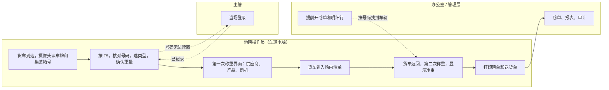
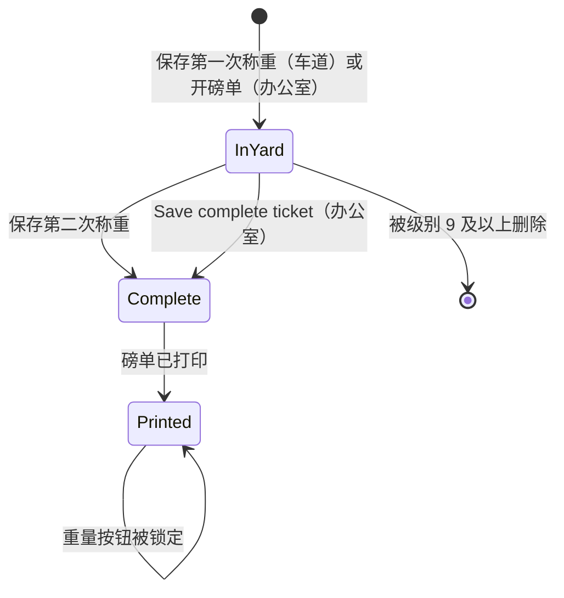
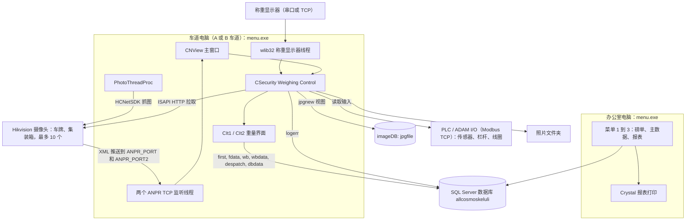
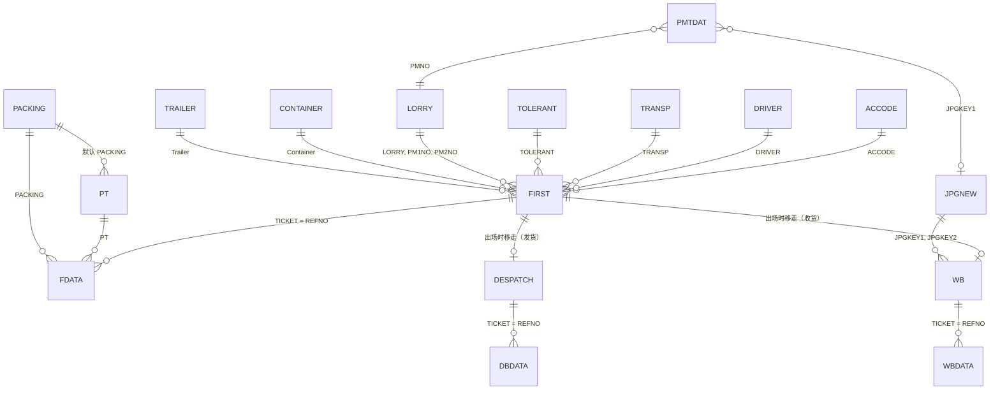
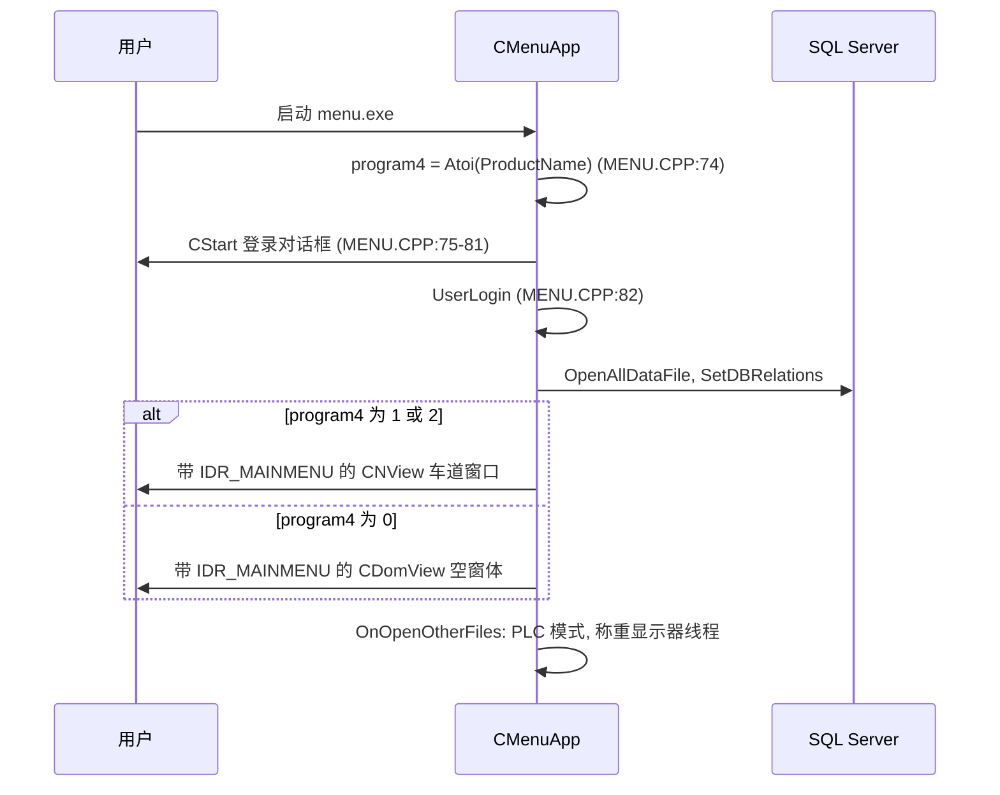
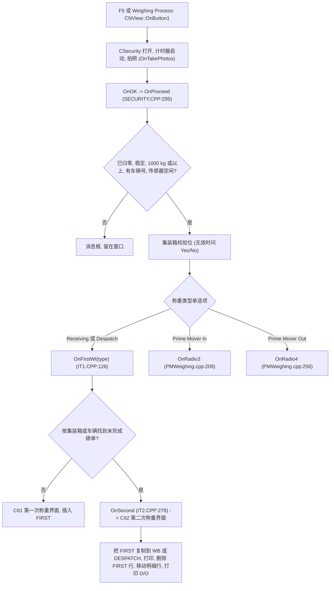
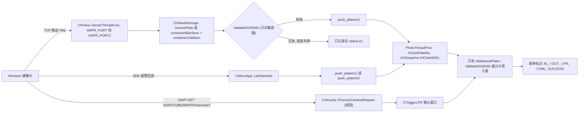
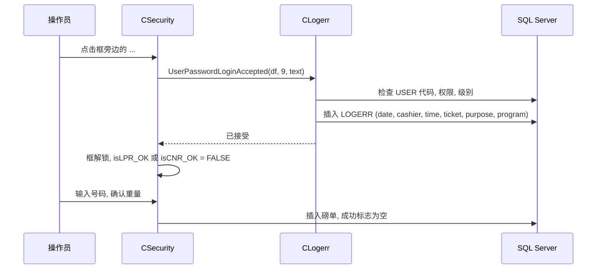
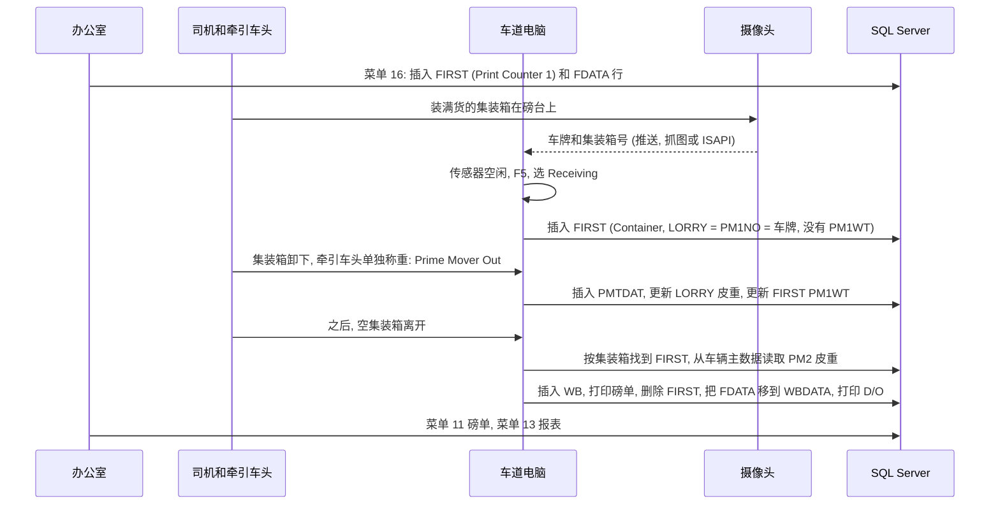
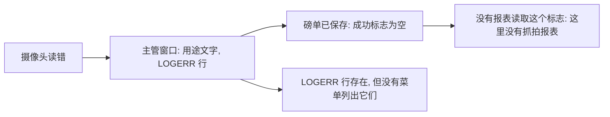

# Application_All_Cosmos - 模块参考

> 英文版为准。同步自英文版 commit 8a4cce1（2026-10-28）。
> 最后核对的 commit 为 `15df32c`（"Rectified some bugs again"，2026-07-20）。
> 翻译状态：英文版见 [MODULE_REFERENCE.md](MODULE_REFERENCE.md)；本中文版同步于 2026-10-28（commit 8a4cce1）。
> 规则：任何改变行为、表、字段、屏幕、报表或计算的修改，都必须在同一个 commit 里更新本参考文档。
> 本仓库是**一对程序中的第二个**：`Application_Vance_Bioenergy` 是与之相关的程序，它的参考文档被用作结构和风格的模板。两条代码线已经**分叉**，所以本文件是完整重写，不是复制（见[与 Application_Vance_Bioenergy 的差异](#与-application_vance_bioenergy-的差异)）。

**这个程序是什么。** 这是 **All Cosmos Industries Sdn Bhd** 的地磅程序（公司名称在代码里是加扰存放的，明文名称写在注释里，`MENU.CPP:56-57`；`PROVIDER.SYS` 里的数据库名叫 `allcosmoskeluli`）。它是建立在共用 wlib32 框架上的 VC6 / MFC 程序。同一个 exe 运行在三种电脑上：最多两台**地磅车道电脑**（车道 A 和车道 B），每台带一个 PLC（Advantech ADAM / Modbus）用于传感器和栏杆，并带最多**十个摄像头**；以及一台**办公室电脑**，保存主数据表、磅单界面和报表。每辆车称重两次（进和出）。磅单是**表头加明细**的单据：表头记录车辆、对方单位、重量和时间；明细行记录送货单、采购订单、产品、包装、数量和**理论重量**。摄像头读取车牌和集装箱号，由操作员确认；要手工输入号码，必须先由主管登录。程序还可以把**牵引车头**（拖头）单独称重，以便算出集装箱重量。仓库里没有 `User_Guide` 文件夹，也没有其他 `docs` 文件，所以没有截图；编写本文档时程序没有运行过。数据库类型来自表结构仓库 `SQL_All_Cosmos`（见 [2.3](#23-主数据目录)）。

## 目录

- [菜单图和覆盖范围](#菜单图和覆盖范围)
- [第一部分：业务视图](#第一部分业务视图)
  - [1.1 简单说明](#11-简单说明) / [1.2 谁用什么](#12-谁用什么) / [1.3 一天的工作](#13-一天的工作) / [1.4 实例演示](#14-实例演示)
  - [1.5 界面导览](#15-界面导览) / [1.6 这个数字从哪里来](#16-这个数字从哪里来) / [1.7 状态含义](#17-状态含义)
  - [1.8 如果发生以下情况](#18-如果发生以下情况) / [1.9 你可能看到的消息](#19-你可能看到的消息) / [1.10 该做和不该做](#110-该做和不该做)
  - [1.11 开始之前](#111-开始之前) / [1.12 词汇表](#112-词汇表) / [1.13 问 AI](#113-问-ai)
- [第二部分：技术视图](#第二部分技术视图)
  - [与 Application_Vance_Bioenergy 的差异](#与-application_vance_bioenergy-的差异)
  - [2.1 概览](#21-概览) / [2.2 架构和依赖](#22-架构和依赖) / [2.3 主数据目录](#23-主数据目录)
  - [2.4 子表层级](#24-子表层级) / [2.5 模块和处理流程](#25-模块和处理流程) / [2.6 端到端流程](#26-端到端流程)
  - [2.7 报表目录](#27-报表目录) / [2.8 集成](#28-集成) / [2.9 配置](#29-配置) / [2.10 维护](#210-维护)
- [休眠代码](#休眠代码) / [用户权限](#用户权限) / [尚未记录的内容](#尚未记录的内容) / [代码发现](#代码发现)

## 菜单图和覆盖范围

菜单资源 `IDR_MAINMENU`（`menu.rc:111-150`）有 3 个顶层项和 **25 个叶子项**（8 个表项中有一个是子弹出菜单 "29 More Master Setup"，含 3 个项）。菜单 ID `ID000nn` 就是节点 `nn`（例如 `ID00016` 是节点 16）；`CMenuApp::SubProgram`（`MAIN.CPP:67`）按节点分派。节点号由 `enum menu {M_NORMAL=1, M_CTRL, M_OTHER}`（`MAIN.CPP:10`）生成：菜单 1 是 `M_NORMAL*10+n`，菜单 2 是 `M_CTRL*10+n`，菜单 3 是 `M_OTHER*10+n`；子弹出菜单直接使用节点 291、292、293。**车道窗口和办公室窗口用的是同一个 `IDR_MAINMENU`**（`MENU.CPP:92`、`:100`），所以每台电脑上都有这个菜单，但受每个用户的权限限制（库会隐藏用户不能用的项）。下面的标题抄自 `menu.rc`，包括带句号的怪异写法 "3&8. Camera Profile"。

| 菜单路径 | 节点 | 处理函数 | 文档位置 |
|---|---|---|---|
| 1. Weighing > 11 Receiving Weighing | 11 | `STCR=1; AdminTicketDb(&wb,&wbdata)` (`MAIN.CPP:72-74`) | [2.5.7](#257-磅单界面菜单-1112-和-16) |
| 1 > 12 Despatch Weighing | 12 | `STCR=2; AdminTicketDb(&despatch,&dbdata)` (`MAIN.CPP:76-78`) | [2.5.7](#257-磅单界面菜单-1112-和-16) |
| 1 > 13 Receiving Weighing Report | 13 | `STCR=1; OldTableContainer("wbctn")` (`MAIN.CPP:80-82`) | [2.7](#27-报表目录) |
| 1 > 14 Despatch Weighing Report | 14 | `STCR=2; OldTableContainer("wbctn")` (`MAIN.CPP:84-86`) | [2.7](#27-报表目录) |
| 1 > 15 Audit Report | 15 | `STCR=0; TableContainer("fcctn")` (`MAIN.CPP:88-90`) | [2.7](#27-报表目录) |
| 1 > 16 First Weighing | 16 | `STCR=3; AdminTicketDb(&first,&fdata)` (`MAIN.CPP:92-94`) | [2.5.7](#257-磅单界面菜单-1112-和-16) |
| 2. Table > 21 Set A/C Code | 21 | `AdminDb(&accode)` (`MAIN.CPP:97-98`) | [2.3.2](#232-供应商和客户accode) |
| 2 > 22 Set Product Code | 22 | `AdminDb(&prodtype)` (`MAIN.CPP:100-101`) | [2.3.3](#233-产品pt) |
| 2 > 23 Set Driver Code | 23 | `AdminDb(&driver)` (`MAIN.CPP:103-104`) | [2.3.4](#234-司机driver) |
| 2 > 24 Set Transporter Code | 24 | `AdminDb(&transp)` (`MAIN.CPP:106-107`) | [2.3.8](#238-小型代码列表transpwarehouseunitcontainertrailertt) |
| 2 > 25 Set Packing Code | 25 | `AdminDb(&packing)` (`MAIN.CPP:109-110`) | [2.3.6](#236-包装和允差packingtolerant) |
| 2 > 26 Set Tolerant Code | 26 | `AdminDb(&tolerant)` (`MAIN.CPP:112-113`) | [2.3.6](#236-包装和允差packingtolerant) |
| 2 > 27 Set Vehicle Information | 27 | `vehicle.Run()` (`MAIN.CPP:115-116`) | [2.3.5](#235-车辆和牵引车头lorry) |
| 2 > 28 Set Warehouse Information | 28 | `AdminDb(&warehouse)` (`MAIN.CPP:118-119`) | [2.3.8](#238-小型代码列表transpwarehouseunitcontainertrailertt) |
| 2 > 29 More Master Setup > 291 Set Unit Code | 291 | `AdminDb(&unit)` (`MAIN.CPP:121-122`) | [2.3.8](#238-小型代码列表transpwarehouseunitcontainertrailertt) |
| 29 > 292 Set Container Information | 292 | `AdminDb(&container)` (`MAIN.CPP:124-125`) | [2.3.8](#238-小型代码列表transpwarehouseunitcontainertrailertt) |
| 29 > 293 Set Trailer Information | 293 | `AdminDb(&trailer)` (`MAIN.CPP:127-128`) | [2.3.8](#238-小型代码列表transpwarehouseunitcontainertrailertt) |
| 3. Utility > 31 Set Password | 31 | `SubProgram` 里没有对应的 case；框架把 `ID00031` 映射到 `OnPassword`（`MAINFRM.CPP:28`），即库的密码界面 | [2.5.11](#2511-工具菜单-3) |
| 3 > 32 Backup Data | 32 | `BackupProcess()` (`MAIN.CPP:130-131`) | [2.5.11](#2511-工具菜单-3) |
| 3 > 33 Operator Information | 33 | `SetUser()` (`MAIN.CPP:133-134`) | [2.5.11](#2511-工具菜单-3) |
| 3 > 34 System Update | 34 | `OnSystemUpgrade("WB.EXE","ALLCOS2")` (`MAIN.CPP:136-137`) | [2.5.11](#2511-工具菜单-3) |
| 3 > 35 Company Profile | 35 | `AdminProfileDb(&profile)` (`MAIN.CPP:139-140`) | [2.5.11](#2511-工具菜单-3) |
| 3 > 36 Reset Database | 36 | `CleanDatabase()` (`MAIN.CPP:142-143`) | [2.5.11](#2511-工具菜单-3) |
| 3 > 37 Weighbridge Profile | 37 | `weighbridge.Run()` (`MAIN.CPP:145-146`) | [2.5.10](#2510-地磅资料菜单-37) |
| 3 > 38 Camera Profile | 38 | `camera.Run()` (`MAIN.CPP:148-149`) | [2.5.11](#2511-工具菜单-3) |

**没有菜单项的界面。** 称重本身不在菜单上：它是车道电脑的主窗口（车道窗口，然后是按 **F5** 打开的 "Weighing Control" 窗口，再是第一次称重或第二次称重界面），见 [2.5.2](#252-车道电脑上的称重weighing-control第一次称重第二次称重) 到 [2.5.6](#256-牵引车头称重)。右键菜单 **Vehicle In Yard**、主管确认窗口、摄像头确认窗口 **Trigger licence plate recognition**、**Change Weighing Type** 窗口、搜索窗口和导出窗口都是由代码打开的，不在菜单上。

**覆盖说明。** 生成的 `_inventory/Application_All_Cosmos/inventory.md` 只作为线索，已对照代码和 `menu.dsp` 重新核对：它列出了同样的菜单项，但没有字段类型，也漏掉了表头/明细配对。**没有菜单项**对应牵引车头日志、抓拍报表、原因、料斗或罐车。磁盘上的 46 个 `.cpp` 文件中，36 个在 `menu.dsp` 里；另外 10 个列在[休眠代码](#休眠代码)下。

---

# 第一部分：业务视图

## 1.1 简单说明

- 程序给每一辆进出场地的车辆称重。每辆车称重**两次**：进场时一次（第一次称重），出场时一次（第二次称重）。两次之差就是货物的**净重**。
- 地磅旁有车道电脑，另有一台办公室电脑。车道电脑显示实时重量、摄像头画面和场内车辆清单。办公室电脑用来管理主数据列表、打开和更正磅单，以及出报表。
- 磅单是**表头加明细行**。表头记录哪辆车、集装箱、供应商或客户、司机和运输商。明细行记录车上装的是什么：送货单号、订单号、产品、包装、数量，以及包装和数量应当相加得出的**理论重量**。
- 一个摄像头读取**车牌**，另一个读取**集装箱号**。操作员确认号码。如果号码有误或缺失，必须先由**主管登录**，操作员才能输入。主管姓名和原因文字会写入日志，管理层就能看到这种情况发生的频率。
- 除了普通货车，场地还处理由**牵引车头**（拖头）拉的集装箱。牵引车头可以单独称重，这样程序知道它的空车重量，并可从集装箱重量中扣除。
- 磅台处有两个**传感器**，告诉操作员磅台上或磅台旁还有东西。如果传感器被挡住，程序会问是否继续。
- 谁在用：地磅操作员每天使用；主管批准手工输入的号码；办公室处理磅单和报表；管理层看审计报表；IT 负责摄像头、PLC、备份和数据库。
- 不做会出什么问题：只有第一次称重而没有第二次称重，车辆会永远留在"场内"清单里；磅单上会印出错误的集装箱号或车牌号；从未单独称重的牵引车头会导致集装箱净重算错。

## 1.2 谁用什么

| 部门 | 地点 | 主要任务 | 从哪里开始 |
|---|---|---|---|
| 地磅操作员 / 保安 | 车道电脑（A 或 B 车道） | 按 F5，核对车牌和集装箱号，选择 Receiving、Despatch、Prime Mover In 或 Out，确认重量，填写第一次称重和第二次称重界面 | 每天：整个称重流程。班次开始时：检查摄像头有画面，重量显示 "Stable" 和 "Zero Detected" |
| 主管（用户级别 9 或更高） | 车道电脑 | 在必须手工输入号码、必须接受磅单差异或更改车道模式时登录；更改场内车辆的称重类型 | 按需要 |
| 办公室 / 物流 | 办公室电脑 | 在车辆到达前开磅单（菜单 16），完成或更正磅单（菜单 11、12、16），打印送货单，运行称重报表（13、14） | 每天：磅单；月底：报表 |
| 主数据负责人 | 办公室电脑 | 维护供应商和客户（21）、产品（22）、司机（23）、运输商（24）、包装（25）、允差（26）、车辆（27）、仓库（28）、单位、集装箱和拖车（291 到 293）的列表 | 每周，或出现新的对方单位时 |
| 管理层 / 审计 | 办公室电脑 | 审计报表（15）：谁改了哪张磅单 | 每周或月底 |
| IT / 管理员 | 办公室电脑和车道电脑 | 操作员账户（33）、公司资料（35）、地磅资料（37）、摄像头资料（38）、备份（32）、系统更新（34）、重置数据库（36） | 安装时和硬件变更时 |

### 用户级别和审批

- 程序为每个操作员设一个数字**用户级别**（在 Operator Information，菜单 33 中设置）。代码里检查的级别是 **9**（主管）、**10** 和 **99**（管理员）。
- 级别 9 或更高的用户可以在主管确认窗口（"Please ask supervisor to confirm this transaction."）登录。级别更低的用户会得到"无权限"。
- 级别低于 9 的操作员不能更改场内车辆的称重类型，也不能从场内清单删除车辆。
- 级别低于 10 时，磅单界面上的重量、时间和牵引车头框是只读的。级别 10 及以上可以编辑。
- 级别低于 99 时，车辆记录的车牌号和皮重是只读的。

## 1.3 一天的工作

**早上，车道电脑。** 操作员在车道电脑上启动程序。程序连接数据库和 PLC。如果这台电脑没有在地磅资料里登记为地磅，程序会提示找不到车道。主窗口显示重量、"Zero Detected" 和 "Stable" 指示灯、实时摄像头画面和两个清单：**场内车辆**（已做第一次称重，没有集装箱）和**场内集装箱**。

**一辆带集装箱的货车到达（收货）。**
1. 货车停在磅台上。摄像头拍照，车牌摄像头和集装箱摄像头把读到的内容发给电脑。
2. 操作员按 **F5**（或 "Weighing Process" 按钮）。**Weighing Control** 窗口打开，显示重量并拍照。
3. 窗口从摄像头填入车辆号和集装箱号。程序只接受马来西亚格式的车牌和 ISO 校验位正确的集装箱号。如果号码有误或缺失，框保持为空并锁定。
4. 如果号码有误，操作员点击框旁边的 "..." 按钮。主管登录，然后操作员输入号码。这是一次**覆盖**，会连同主管姓名写入日志。
5. 操作员选择 **Receiving**（或 **Despatch**）并确认重量（再按一次 F5）。第一次称重界面打开：操作员选择供应商、产品、司机、运输商、仓库、允差代码，还可以输入供应商自己的重量。
6. 操作员保存。车辆出现在场内清单里。

**单独称牵引车头。** 集装箱卸下后，用 **Prime Mover Out** 把牵引车头单独称重。重量存入牵引车头日志，成为该车的空车重量，并写到该牵引车头未完成磅单上，作为它的第一次牵引车头重量。牵引车头回来取空集装箱时，用 **Prime Mover In** 记录。

**之后，同一辆车离开（第二次称重）。** 摄像头再次读取。操作员按 F5 并确认；因为车辆或集装箱已在场内清单里，程序打开**第二次称重界面**。它显示净重、与供应商重量的差异，以及明细行清单。保存后，程序把磅单移到已完成磅单，并立即**打印磅单和送货单**。

**办公室。** 办公室电脑打开磅单（菜单 11、12），可以在车辆到达前开磅单并添加明细行（菜单 16），并运行报表。主数据列表也在这里编辑。



*图：操作员的路径沿左边方框从上到下。虚线表示主管介入的地方，以及办公室可以在车辆到达前准备磅单的地方。*

## 1.4 实例演示

所有数值都是虚构的。车牌、集装箱号和名称不属于任何真实的人或公司。集装箱号 `ABCU1234560` 的 ISO 校验位有效，所以程序接受它。

**准备（选好的主数据）。** 供应商 `S001 Example Trading Sdn Bhd`；产品 `P01 Sample goods`；包装 `PK25`（净重 25 kg，包装 0.2 kg，所以一个单位重 25.2 kg）；司机 `D001 Ali`；运输商 `T01 Example Haulage`；仓库 `W01 Store 1`。牵引车头 `WXY1234` 在车辆主数据里。使用 A 车道。

**第 0 步（办公室，可选）。** 办公室用 **First Weighing**（菜单 16）为这次来访开一张磅单，对 "Add new ticket for receive (No for despatch) ?" 回答 Yes，得到类似 `K000000123` 的号码。它加一条明细行：送货单 `DN100`，产品 `P01`，数量 1,000，单位重 25.2 kg，托盘重 0 kg。程序算出理论重量 1,000 x 25.2 + 0 = **25,200 kg**。

**第 1 步：第一次称重（A 车道）。**
1. 车牌摄像头读到 `WXY1234`，集装箱摄像头读到 `ABCU1234560`。两个都被接受。操作员按 F5，选 **Receiving** 并确认。磅秤显示 41,000 kg，稳定，且已归零。
2. 第一次称重界面打开：操作员选择 `S001`、`P01`、`D001`、`T01`、`W01`，并输入供应商重量 25,000 kg。
3. 已保存。磅单号由收货流水号生成。车辆出现在集装箱清单里。第一次重量是 41,000 kg。磅单上的牵引车头号是 `WXY1234`，但它的重量还是空的。

**第 2 步：单独称牵引车头。** 集装箱卸下。牵引车头单独离开，用 **Prime Mover Out** 称重：磅秤显示 9,100 kg（在 5,000 和 10,000 之间，所以没有警告）。程序把 9,100 kg 存为 `WXY1234` 未完成磅单的**第一次牵引车头重量**，也存为车辆主数据里 `WXY1234` 的空车（皮）重量。

**第 3 步：第二次称重（A 车道）。**
1. 之后牵引车头回来取空集装箱。摄像头读取号码。操作员按 F5 并确认；程序在场内清单里找到集装箱，打开第二次称重界面。
2. 磅秤显示 15,600 kg。**第二次牵引车头重量**自动取自车辆主数据：9,100 kg。

**第 4 步：计算内容。**
- 重集装箱（不含牵引车头）：41,000 - 9,100 = 31,900 kg。
- 空集装箱（不含牵引车头）：15,600 - 9,100 = 6,500 kg。
- **净重** = |6,500 - 31,900| - 损耗 0 = **25,400 kg**。
- 与供应商重量 25,000 kg 的差异：25,400 - 25,000 = **+400 kg**。正差异不需要批准。如果供应商说的是 25,600 kg，差异就是 -200 kg，程序会要求主管确认（"Supplier weight is more than theoretical weight"）。

**第 5 步：保存、打印、状态。** 操作员保存。程序把磅单从场内清单移到已完成的收货磅单，明细行随之移动，并且不询问就先打印磅单，再打印送货单。在办公室，菜单 11 现在显示这张磅单，菜单 13（Receiving Weighing Report）包含它。

**第 6 步：如果集装箱摄像头失灵。** 在第 1 步，集装箱框会是空的。操作员点击它旁边的 "..." 按钮，主管登录，操作员输入 `ABCU1234560`。一行 "Manual input container number." 连同主管姓名和时间写入主管日志。磅单本身不记得号码是手工输入的（见[代码发现 3](#代码发现)）。

## 1.5 界面导览

仓库里没有截图，程序也没有运行过，所以不放截图。下面的字段标签是对话框里的标题。程序只是自动填入的框，标为 "automatic"（自动）。哪些框是**必填**由框架的保存检查决定，不由本程序决定；本程序额外加的规则见 [1.9](#19-你可能看到的消息)。

### 车道电脑主窗口（A 或 B 车道）

**用途。** 车道电脑上一直打开的窗口。它显示实时重量、指示灯、摄像头，以及场内的清单。

| 项目 | 含义 | 值从哪里来 |
|---|---|---|
| Weight（大号数字） | 磅台上当前重量（kg），或 "No signal" | 自动，来自称重显示器 |
| Zero Detected / Stable | 磅秤已归零且重量稳定时打勾 | 自动（稳定 = 最近 5 次读数相差不超过 20 kg） |
| Container In Yard | 有集装箱的未完成磅单数量 | 自动 |
| Tanker In Yard | **没有**集装箱的未完成磅单数量（标题写 "Tanker"，但每辆没有集装箱的车都会计入） | 自动 |
| 清单，列为 No.、Lorry.、AC Name、Product、Date/Time In、Weight (kg)、Ticket、W. Type、Remarks | 没有集装箱的未完成第一次称重：每条一行。W. Type 显示 Receiving、Despatch 或 Auto（类型未保存） | 自动 |
| 清单，列为 No、Ticket、Vehicle、Container、Trailer、Date/Time In、Weight (kg) | 有集装箱的未完成第一次称重 | 自动 |
| 摄像头画面 | 六个图片框（十个摄像头位置显示在称重界面里） | 自动 |

**按钮。** **F5 -> Weighing Process**（或回车键）打开 Weighing Control 窗口。**Refresh Pending List** 重新加载两个清单。**Restart Camera** 重新连接摄像头。**Backup Data** 在窗体上，但本仓库里没有代码支持它（菜单 32 才是有效的备份）。重量数字上方有四个标题都是 **Detail Report** 的按钮；按编号看，它们从车道电脑打开磅单界面（菜单 11 和 12）和称重报表（菜单 13 和 14）。在任一清单的一行上右键，会出现 **Vehicle In Yard** 菜单：*View 1st Weight* 和 *Edit 1st Weight*（所有人），*Change Weighing Type* 和 *Delete*（仅级别 9 及以上），*Back*。

### Weighing Control 窗口（"Weighing Control"）

**用途。** 读取车牌和集装箱号，检查磅秤，并开始一次称重。按 F5 打开。

| 字段标签 | 含义 | 值从哪里来 |
|---|---|---|
| 重量显示、"Zero Detected"、"Stable" | 实时重量及其检查 | 自动 |
| 两个传感器灯（重量左右两边） | 传感器**没有**被挡住时显示，被挡住时隐藏 | 自动，来自 PLC |
| "Licence Plate Number" 框和按钮 | 车辆号 | 由摄像头读取；只有主管登录后才能输入（Manual 设置下则一直可输入） |
| "Container Number" 框和按钮 | 集装箱号（11 个字符） | 由摄像头读取；只有主管登录后才能输入（Manual 设置下则一直可输入） |
| Weighing Type | Receiving、Despatch、Prime Mover In、Prime Mover Out | 由操作员选择 |
| Take Photos | 重新拍摄摄像头画面 | 按钮 |
| 进度条 | 显示正在读取摄像头 | 自动 |
| 栏杆灯（右侧） | 2 号栏杆的继电器灯 | 自动，来自 PLC |
| **F5 -> Confirm Weight** | 开始称重 | 按钮 |

**按钮。** "Licence Plate Number" 和 "Container Number" 按钮会询问摄像头，并打开 **Trigger licence plate recognition** 窗口来确认读数。框旁边的两个 "..." 按钮在主管登录后解锁输入。对话框里还有 **Bin Number** 按钮、第三个框和 **Manual** 按钮，但它们是隐藏并禁用的。

### Trigger licence plate recognition 窗口

显示两个摄像头的画面（车牌或集装箱，取决于按的按钮），以及两个按钮，上面是各摄像头读到的内容。操作员点击读数正确的按钮；该文字就成为车辆号或集装箱号。不点击就关闭窗口，则什么都不改变。

### 第一次称重界面（"Receiving Weighing" 或 "Despatch Weighing"）

**用途。** 记录第一次重量、谁在送货或提货，以及货物是什么。窗口标题显示 "Vehicle Number: ..." 或 "Container Number: ..."。

| 字段标签 | 含义 | 值从哪里来 |
|---|---|---|
| Vehicle No. | 车辆号 | 自动，来自 Weighing Control 窗口 |
| Yes/No, Flag | 磅单的状态字母和内部调拨标志 | 自动 |
| Supplier（发货时为 Customer） | 业务伙伴 | 从 A/C 代码列表选择 |
| Product | 产品 | 从产品列表选择 |
| Driver | 司机 | 从司机列表选择 |
| Tolerant | 允差代码 | 从允差列表选择 |
| Transporter | 运输公司 | 从运输商列表选择 |
| Warehouse | 货物去哪里 | 从仓库列表选择 |
| Seals No. From / To | 封条号 | 输入 |
| Supplier Lot No. | 批号 | 输入 |
| Remarks | 自由文字 | 输入 |
| Container, Trailer | 集装箱号和拖车 | 集装箱由程序填写，拖车从拖车列表选择 |
| PO No（发货时为 DO No） | 这辆车在 AllcosmosSystem 里的采购订单（收货）或送货单（发货） | 输入；可选。它成为磅单的第 1 条明细行，并在保存重量时发送到 AllcosmosSystem（[2.8](#28-集成)） |
| Prime Mover（号码、日期/时间、重量） | 牵引车头 | 车上有集装箱时，牵引车头号自动填入 |
| 1st Weight (kg) | 毛重 | 自动，每四分之一秒从磅秤读取 |
| Less wastage | 扣减框 | 输入（它**会**从净重中扣除） |
| Supplier Weight（发货时为 Buyer Weight） | 对方的净重 | 输入 |
| Date / Time | 进场时间 | 自动 |

**按钮。** **Save** 保存第一次重量。**Re-Capture** 重新拍照。关闭窗口时会询问 "Exit"，标题是 "Confirm it ?"。

### 第二次称重界面

框与第一次称重界面相同，另外有第二次重量、净重和差异，以及磅单的**明细行表格**（No、D/N No、P/O No 1、P/O No 2、P/O Qty、Item Code、Item Description、Qty、Unit、Packing、Unit Wt.、No pallets.、Pallet Wt、Theoretical Wt.）。双击一行可编辑。如果磅秤现在显示的重量比第一次重，程序就认为车辆是装满货出场（发货）；如果这与所选类型不符，它会问 "Should be Receiving weighing type" 或 "...Despatch weighing type"。

| 字段标签 | 含义 | 值从哪里来 |
|---|---|---|
| 1st Weight / 2nd Weight（带日期和时间） | 两次重量 | 第一次：来自第一次称重界面；第二次：自动来自磅秤；日期/时间选择器可以更改 |
| Prime Mover No. / Date/Time / Weight（两行） | 第一次和第二次称重的牵引车头重量 | 第一次：来自 Prime Mover Out；第二次：来自车辆主数据 |
| Less wastage | 扣减 | 输入 |
| Nett Wt. (kg) | 净重 | 计算得出，见 [1.6](#16-这个数字从哪里来) |
| Supplier Wt (kg) | 对方的重量 | 之前输入 |
| Variance (kg) | 净重减供应商重量 | 计算得出 |

**按钮。** **Save** 完成磅单。**Re-Capture** 重新拍照。

### 主管确认窗口（"Please ask supervisor to confirm this transaction."）

| 字段标签 | 含义 | 值从哪里来 |
|---|---|---|
| Date | 今天 | 自动（禁用） |
| Supervisor ID, Supervisor Password | 谁来确认 | 输入 |
| Purpose | 这个窗口的原因文字，例如 "Manual input vehicle number. Level : 9" | 自动 |

**按钮。** **OK** 检查用户、密码和级别，并写入日志行。**Cancel** 关闭窗口，该操作被拒绝。本程序**没有原因列表**。

### 牵引车头重量登记（"Weight Registration"）

由 **Prime Mover In** 或 **Prime Mover Out** 打开。显示牵引车头号、称重日期/时间和重量（自动来自磅秤）、司机 1、司机 2 和运输商（取自车辆主数据或未完成磅单）。**Save** 保存一条牵引车头记录。"Is Shunting Lorry" 和 "Is Roro" 两个勾选框，以及 "Front/Back" 栏杆选择，在对话框里存在但是隐藏的。

### 磅单界面（菜单 11、12 和 16，办公室）

同一个界面显示已收货磅单、发货磅单或未完成磅单（菜单 16）。**表头：** Ticket No、Vehicle No、Received Date、Yes/No 和 Flag 框、Supplier、Product、Driver、Tolerant、Transporter、Warehouse、Seal Number From / To、Supplier Lot No、Remarks、Container、Trailer；然后是重量块（第一次和第二次重量，当保存的重量与调整后的重量不同时带星号；牵引车头 1 和 2 的号码、日期/时间和重量；Less wastage、Supplier Wt、Nett (Kg)）；然后是**合计**（Total Received Qty、Total Theoretical Wt、Total Theoretical Variance Wt、Supplier Variance Wt）。**明细表格：** 明细行。**按钮：** **1st Weight** 和 **2nd Weight**（把一个重量取入磅单）、**1** 和 **2**（牵引车头重量）、**Prime Mover Weighing**（打开车辆主数据）、**Save complete ticket**（仅限未完成磅单，见 [1.8](#18-如果发生以下情况)），以及库提供的添加、编辑、删除、搜索、打印和导出按钮。在表格下方，如果公司资料里设置了 AllcosmosSystem：显示该磅单最后一次 AllcosmosSystem 调用的结果（例如 "AllcosmosSystem rawmaterialticketout: OK (...)"）和 **Resend to AllcosmosSystem**（仅限已完成磅单；询问 "Send ticket ... to AllcosmosSystem again ?" 并显示答复）。**Print** 按钮询问 "Do you want to print ticket : ... ?"，送货单按钮询问 "Do you want to print D/O : ... ?"。见[代码发现 6](#代码发现)：这个界面上的重量按钮可能给不出可靠的重量。

### 明细行界面（"wbdata Detail Information"）

| 字段标签 | 含义 | 值从哪里来 |
|---|---|---|
| DO No | 送货单号 | 输入 |
| PO NO 1, PO NO 2, PO QTY | 采购订单号和数量 | 输入 |
| Product | 这一行的产品 | 从产品列表选择；会填入包装 |
| Packing | 包装代码 | 选择；会填入单位重量 |
| Qty | 数量 | 输入 |
| Unit | 单位代码 | 从单位列表选择 |
| Unit Weight (Kg) | 一个单位的重量 | 由包装自动填入，可以输入 |
| No of pallet | 托盘数 | 输入（不参与重量计算） |
| Pallet Weight (kg) | 托盘总重 | 输入 |
| Total Net Theoretical Weight (Kg) | 这一行的理论重量 | 计算得出，见 [1.6](#16-这个数字从哪里来) |
| DO Qty (Kg) | 供应商送货单上印的重量 | 输入 |
| Bin Location | 这一行的货物放在哪里 | 输入 |

### 主数据界面（菜单 2）

| 菜单 | 界面标题 | 主要的框 |
|---|---|---|
| 21 | Customer Data Entry | 代码号、名称、地址（3 行）、电话、传真、执照号、到期日、联系人、备注；简称框是隐藏的 |
| 22 | Product Data Entry | 产品代码、描述、备注、默认包装 |
| 23 | Driver（标题为 "Dialog"） | 司机代码、姓名、IC 号、备注、手机号、地址（其他身份证件列和黑名单标志在表里，但不在这个界面上） |
| 24 | TRANSP | 运输商代码、名称、电话、传真、地址、备注 |
| 25 | packing | 包装代码、描述、净重、包装重量、毛重、备注 |
| 26 | tolerant | 允差代码、描述、百分比、重量（kg）、备注 |
| 27 | Vehicle Data Entry | Truck No 或 Prime Move No、司机 1、司机 2、运输商、备注、抓取时间、**Tare Weight (Kg)** 按钮（取磅秤重量） |
| 28 | packing（仓库界面的标题） | Ware house 代码、描述、备注 |
| 291 | unit | 单位代码、描述、备注 |
| 292, 293 | Product Data Entry（集装箱和拖车界面重用这个对话框） | 代码、描述 |

### 工具界面（菜单 3）

- **Camera Profile**（38）：摄像头列表（库界面）。
- **Weighbridge Profile**（37）：地磅号、名称、ADAM IP 地址、电脑名称、传感器 1 和传感器 2 的点号，以及两个 ANPR 端口。栏杆和线圈点、双向模式和手动设置的勾选框及其两个按钮在对话框里，但是隐藏的。
- **Company Profile**（35）：公司代码、地址行、重量服务器电脑名称、输出文本文件名、**Update Company No**；**AllcosmosSystem** 组：API URL、Username、Password 和 **Site**（Keluli 或 Suasa）。
- **Reset Database**（36）："Please key in reset password"；**Reset All Data Files**；**Clean Report Files Only** 按钮存在但是隐藏的。

### 报表列表

菜单 13、14 和 15 打开一个报表列表（选一个，然后给出期间）。

## 1.6 这个数字从哪里来

### 磅单上的重量

- **毛重（第一次重量）** = 保存第一次称重界面时的磅秤读数。界面每四分之一秒从磅秤刷新一次，经过库的"重量调整"；原始读数也会保存。
- **第二次重量** = 第二次称重时的磅秤读数，方式相同。
- **牵引车头重量。** 第一次牵引车头重量是在牵引车头用 **Prime Mover Out** 单独称重时写到未完成磅单上的（它是牵引车头的磅秤读数）。第二次牵引车头重量是保存第二次重量时车辆主数据里该车的空车（皮）重量（该皮重由该车最近一次牵引车头称重设定）。**车辆没有皮重时不会有任何警告。**

### 净重

```
loaded      = 1st weight  - prime mover weight 1
empty       = 2nd weight  - prime mover weight 2
net weight  = | empty - loaded | - wastage
```
演算数字：第一次 41,000，牵引车头 1 = 9,100 -> 重 31,900；第二次 15,600，牵引车头 2 = 9,100 -> 空 6,500；净重 = 31,900 - 6,500 = 25,400 kg。没有集装箱的车，两个牵引车头重量都是 0，所以净重 = |第二次 - 第一次| - 损耗。在第二次称重时间出现之前不会计算任何东西。这里 "Less wastage" **会**被扣除。

### 与供应商的差异

```
variance (kg) = net weight - supplier weight
if variance < 0 -> ask a supervisor: "Supplier weight is more than theoretical weight"
```
演算数字：25,400 - 25,000 = +400，不问；25,400 - 25,600 = -200，打开主管窗口。保存磅单且存在第二次重量时才做这个检查。

### 明细行的理论重量

```
unit weight (packing) = packing net weight + packing weight
theoretical weight    = quantity x unit weight + pallet weight
```
演算数字：包装净重 25 kg + 包装 0.2 kg = 25.2 kg；数量 1,000 x 25.2 + 0 = 25,200 kg。"No of pallet" 框不参与公式。磅单的合计把各行加起来（库的表格合计，未追踪）。

### 打印时的允差

打印带有允差代码的磅单时，程序把"总差异"与该代码的允差重量（kg）比较，如果差异更大就请主管确认。**它用的数字在本程序里从未计算，所以总是 0，这个问题永远不会出现**；见[代码发现 1](#代码发现)。允差代码的百分比没有被使用。

### 称重前的磅秤检查

- 先归零：自上次称重以来，磅秤必须回到过零。
- 稳定：最近 5 次读数相差不超过 20 kg。
- 至少 1,000 kg。
- 单独的牵引车头应当重于 5,000 kg 且不超过 10,000 kg（否则出现 Yes/No 警告）。

### 车牌和集装箱检查

- **马来西亚车牌（应用于摄像头读到的内容）：** 忽略空格；长度 2 到 10；1 到 3 个字母，然后 1 到 4 个数字，最后最多再有一个字母。`WXY1234` 和 `VBU8A` 通过；`1234`、`ABCD1234` 和 `W1234AB` 不通过。手工输入的车牌**不检查**。
- **集装箱号（ISO 6346）：** 4 个字母、6 个数字和 1 个校验位。每个字母有一个值（A=10、B=12、C=13 ……跳过 11 的倍数）；前 10 个字符的"值 x 2^位置"之和，对 11 取余，就是校验位（10 算作 0）。例 `ABCU1234560`：10 + 24 + 52 + 256 + 16 + 64 + 192 + 512 + 1,280 + 3,072 = 5,478；5,478 除以 11 余 0，所以最后一位必须是 0。摄像头读数不通过的会被丢弃；手工输入不通过的会得到一个 Yes/No 问题。

## 1.7 状态含义

| 单据 | 状态 | 含义 | 谁或什么会改变它 | 还能编辑什么 |
|---|---|---|---|---|
| 未完成的磅单（车辆在场内） | In yard，类型 Receiving / Despatch / Auto | 已做第一次称重，还没做第二次称重。"Auto" 表示没有存称重类型 | 保存第一次称重（或办公室，菜单 16）时创建；第二次称重、**Save complete ticket** 或删除（级别 9）使其结束 | 所有人都可以通过右键菜单查看和编辑；类型可由级别 9 及以上更改 |
| 已完成的磅单（收货或发货） | Complete | 两次重量都已保存，已复制到收货或发货磅单列表 | 保存第二次称重 | 级别 10 及以上可以更改重量和时间；磅单打印后重量按钮被锁定 |
| 磅单 "status" 字母 | P | 创建磅单时设置；本程序之后不再改它 | 第一次称重步骤 | - |
| 磅单上的摄像头结果（4 个标志：进场车牌、进场集装箱、出场车牌、出场集装箱） | Read / Not read | "Read" = 读数被接受；空白 = 未读到（见[代码发现 3](#代码发现)） | Weighing Control 窗口 | 界面上不可编辑 |
| 牵引车头记录 | In (I) / Out (O) | 通过的方向 | Prime Mover In / Out | 任何菜单都进不去 |



*图：磅单在场内清单中创建，在第二次称重时（或办公室将其完成时）变成已完成磅单，打印后重量按钮被锁定。*

## 1.8 如果发生以下情况

| 情况 | 会发生什么 | 正确的处理 |
|---|---|---|
| 摄像头读不出车牌或集装箱号 | 框保持为空并锁定 | 点击框旁边的 "..." 按钮，主管登录，然后输入号码。一行记录写入主管日志 |
| 摄像头读成了错误的车牌，但格式仍然有效 | 它被当作已读到而接受 | 操作员必须对照货车检查这个框。如果错了，用 "..." 按钮覆盖 |
| 手工输入的车牌有误 | 手工输入的车牌不做检查 | 确认之前再看一次车牌；错误的号码会印到磅单上 |
| 手工输入的集装箱号校验位不通过 | 带原因的警告和 Yes/No | 重新核对集装箱上的号码；只有确实正确时才回答 Yes |
| 磅台处传感器被挡住 | "Sensor blocked / Do you want to continue ?" | 清空磅台。回答 No 离开窗口；只有传感器有故障时才回答 Yes |
| 在第一次称重界面选错了供应商、产品或司机 | 错误的内容保存到磅单上 | 在场内清单里右键该车辆，选 *Edit 1st Weight*，或在办公室打开磅单 |
| 称重类型（Receiving 或 Despatch）错了 | 在第二次称重时，程序发现磅秤比第一次重或轻，问 "Should be Receiving weighing type" | 回答 Yes 切换，No 保留所选类型。主管（级别 9）也可以用 *Change Weighing Type*；磅单号保留第一个字母 |
| 重量不是从零开始、不稳定或低于 1,000 kg | 消息 "Weight without from zero."、"Weight unstable."、"Weight too light." | 等重量稳定下来；如果磅秤没有回到零，就把车移开 |
| 供应商重量大于净重 | "Supplier weight is more than theoretical weight" 并要求主管登录 | 由主管决定是否接受 |
| 净重比供应商的重量高出很多 | 不会问任何问题 | 自己核对送货单；允差代码没有作用（见 [1.6](#16-这个数字从哪里来)） |
| 车辆主数据里的牵引车头没有空车重量 | 没有消息：第二次牵引车头重量是 0，集装箱净重是错的 | 在第二次称重之前，用 **Prime Mover Out** 单独称牵引车头（或在车辆界面按 **Tare Weight (Kg)**） |
| 打印后编辑磅单 | 磅单界面上的重量按钮被锁定 | 级别 10 及以上仍可编辑重量框；否则请主管处理 |
| 重新打印磅单 | 按磅单界面上的 **Print** 按钮（或送货单按钮） | 每次打印都会要求确认 |
| 取消或作废磅单 | 没有取消功能。级别 9 及以上可以从场内清单**删除**第一次称重，但它的明细行仍留在数据库里 | 在第二次称重前删除第一次称重，并通知 IT 清除遗留的行（见[代码发现 5](#代码发现)） |
| 在办公室完成一张磅单 | 在办公室打开磅单（菜单 16 或场内清单），按 **Save complete ticket** 并回答 Yes | 只在车辆已经离开时使用；磅单会移到收货或发货列表 |
| 称重时断电或断网 | 按 Save 时第一次重量就已保存。第二次称重保存时断电，可能让磅单同时留在场内清单和已完成清单，或留下明细行 | 重启后检查场内清单和已完成磅单；请 IT 删除重复项（见[代码发现 4](#代码发现)） |
| 重复录入 | 已在场内清单里的车辆或集装箱会进入第二次称重，而不是新的第一次称重 | 如果车辆确实是再次到达，请级别 9 删除旧的第一次称重 |
| PLC 或摄像头离线 | 传感器灯和栏杆灯没有反应，摄像头框保持为空 | 联系 IT |
| 车道模式错误 | 地磅资料里的 Dual mode 和 Manual setting 只能通过隐藏的按钮更改 | 请 IT 处理 |

## 1.9 你可能看到的消息

文字取自程序。`%s` 表示运行时填入的值。

| 消息（显示标题时用引号标出） | 含义 | 怎么做 |
|---|---|---|
| "Weight without from zero." | 这次称重之前，磅秤没有回到零 | 清空磅台，等待 "Zero Detected" |
| "Weight unstable." | 重量还在变动 | 等待 "Stable" |
| "Weight too light." | 低于 1,000 kg | 检查磅秤和车辆 |
| "Vehicle Not found." | 车辆号框是空的 | 读取或输入车辆号 |
| "Sensor blocked / Do you want to continue ?"（"Error Message"） | 磅台传感器被挡住 | 清空磅台 |
| （校验位消息）"Do you want to continue"（"Error Message"） | 集装箱号校验位不对 | 重新核对集装箱；确实正确才选 Yes |
| "Weight too light / Do you want to continue?"（5,000 kg 或以下）和 "Weight too heavy / Do you want to continue?"（超过 10,000 kg）（"Error"） | 单独的牵引车头应当重 5,000 到 10,000 kg | 检查集装箱是否已卸下 |
| "Please key in prime mover no"（"Error"） | 没有号码就开始了牵引车头称重 | 输入或读取车牌 |
| "Cannot weighing!!! / Do you want to continue?"（标题 "Supplier weight is required for tanker"） | 没有集装箱的收货磅单没有供应商重量 | 输入供应商重量；只有允许时才继续 |
| "Should be Receiving / Despatch weighing type"（"Wrong Weighing Type"） | 磅秤显示的方向与所选类型相反 | 选 Yes 更改类型 |
| "Supplier weight is more than theoretical weight Level : 9"（主管窗口） | 净重低于供应商重量 | 由主管决定 |
| "Manual input vehicle number. Level : 9" / "Manual input container number. Level : 9"（主管窗口） | 即将手工输入一个号码 | 主管登录 |
| "Closing will remove detected container number from motion detect"（"Confirm it"） | 有集装箱号在等待时关闭 Weighing Control | 选 Yes 清除它 |
| "User ID not found"、"Password incorrect"、"not authorised" | 主管窗口的检查 | 更正输入，使用级别 9 或更高的用户 |
| "Change to %s mode." 和 "Change to %s setting."（主管窗口），然后 "Restart Domain system to take effect. Please yes to restart, no to cancel." | 更改车道模式或 Manual setting | 确认；程序会关闭，必须重新启动 |
| "Change weighing to %s?"（"Confirm it"） | Change Weighing Type 窗口 | 选 Yes 更改 |
| "Change Weighing Type for vehicle no.:%s" / "Delete vehicle no:%s in yard"（"Confirm it"） | 场内清单右键菜单 | 确认 |
| "Add new ticket for receive (No for despatch) ?"（"Confirm it"） | 菜单 16 中新建磅单 | Yes 为收货，No 为发货 |
| "Confirm to complete ticket %s to %s Entry ?"（"Confirm it"） | Save complete ticket | 选 Yes 移走它 |
| "Cannot convert ticket in this entry" | 对一张不是未完成的磅单按了 Save complete ticket | 从菜单 16 打开该磅单 |
| "Do you want to print ticket : %s ?" / "Do you want to print D/O : %s ?"（"Confirm it"） | 打印确认 | 选 Yes 打印 |
| "Incomplete data"（"Error Message"） | 第二次称重之前打印送货单表格 | 先完成称重 |
| "Exit"（"Confirm it ?"） | 关闭第一次称重或第二次称重界面 | 选 Yes 不保存离开 |
| "HMI %s not found" | 这台电脑不在地磅资料里 | IT 添加电脑名称 |
| "HMI %s line %s PLC ip %s" | 电脑名称在地磅资料里出现了不止一次 | IT 删除重复项 |
| "Database not open" | 某个主数据表打开失败 | 联系 IT |
| "Failed to create TCP server socket"、"Failed to listen on port"、"Failed to accept incoming client" | 摄像头监听程序无法启动 | 检查地磅资料里的 ANPR 端口 |
| "Please key in reset password:" 和 "Incorret password"（屏幕上就是这样拼写的） | Reset Database | 不要使用；见[休眠代码](#休眠代码) |

## 1.10 该做和不该做

**称重**
- 按 F5 之前，务必确认屏幕上的车牌和集装箱号与货车一致。
- 每个手工输入的号码都要用 "..." 按钮并由主管登录；绝不跳过。
- 不要在第一次称重界面按两次 Save；已在场内清单里的车辆会进入第二次称重。
- 车辆走了以后，不要把它留在场内清单里：清单和计数会一直不对。

**牵引车头**
- 牵引车头卸下集装箱后，务必用 **Prime Mover Out** 单独称重，这样第一次牵引车头重量和车辆的空车重量才正确。
- 不要用 **Prime Mover In** 来设置未完成磅单的重量：它只记录通过，并更新车辆主数据。

**主数据**
- 添加代码前，先检查主数据列表有没有重复。
- 在明细行里使用某个包装之前，先设置好包装重量（净重和包装重量），因为单位重量来自它们。
- 不要依赖司机黑名单或磅单上的 **Tolerant** 代码：本程序不会根据它们采取任何动作。

## 1.11 开始之前

- 车辆主数据（菜单 27）保存牵引车头；它的皮重通过单独称重填入。
- 供应商和客户（21）、产品（22）、司机（23）、运输商（24）、包装（25）、允差代码（26）、仓库（28）和单位（291）已存在；如果要选用集装箱（292）和拖车（293），它们的代码也要存在。
- 操作员账户（33）有正确的级别：主管为 9 或更高。
- 地磅资料（37）里每台车道电脑都有一行，含电脑名称、PLC IP 地址、传感器点号和摄像头监听端口。
- 摄像头资料（38）列出每条车道的摄像头：车牌摄像头和集装箱摄像头，以及它们的地址和登录信息。
- 称重显示器在车道电脑的 `win.ini` 里配置好，PLC 可以连通。
- 磅单号已为收货和发货设置了流水号。
- 磅单和送货单的报表文件在程序文件夹里。

## 1.12 词汇表

| 术语 | English meaning | Malay | Chinese |
|---|---|---|---|
| Weighbridge | Truck scale | Jambatan timbang | 地磅 |
| First weight / second weight | The weights when the vehicle enters and leaves | Timbang pertama / kedua | 第一次称重 / 第二次称重 |
| Net weight | Goods weight = difference of the two weights | Berat bersih | 净重 |
| Gross weight | Vehicle plus goods | Berat kasar | 毛重 |
| Tare | Empty weight of the vehicle | Berat kosong | 皮重 |
| Receiving | Goods coming in | Terimaan | 收货 |
| Despatch | Goods going out | Penghantaran | 发货 |
| Header and detail | The ticket (header) and its lines (detail) | Pengepala dan butiran | 单头与明细 |
| Theoretical weight | Quantity times unit weight plus pallet weight | Berat teori | 理论重量 |
| Packing | Type of pack with its net and packing weight | Pembungkusan | 包装 |
| Tolerance | Allowed difference code | Toleransi | 允差 |
| LPR | Licence plate recognition (camera reads the plate) | Pengecaman plat nombor | 车牌识别 |
| CNR | Container number recognition | Pengecaman nombor kontena | 集装箱号识别 |
| Override | A number typed by hand after a supervisor signs in | Pindaan manual | 手动覆盖 |
| Supervisor | User of level 9 or above | Penyelia | 主管 |
| Prime mover | Tractor head that pulls a container | Kepala treler | 牵引车头 |
| Container | ISO shipping container with an 11-character number | Kontena | 集装箱 |
| Trailer | Trailer pulled by the prime mover | Treler | 拖车 |
| Sensor | Detector that shows something is on or beside the platform | Pengesan | 传感器 |
| Barrier | Gate arm at the platform | Palang | 栏杆 |
| PLC | Controller that reads the sensors and switches the barriers | PLC | 可编程控制器 |
| Dual mode | Lane mode where the barrier at the other end opens by itself | Mod dual | 双向模式 |
| Ticket | Weighing document | Tiket | 磅单 |
| Delivery order (D/O) | Form handed to the driver | Pesanan penghantaran | 送货单 |
| Yard list | Vehicles with a first weight and no second weight | Senarai dalam kawasan | 场内车辆清单 |

## 1.13 问 AI

**称重**
1. 怎样给带集装箱的货车称重，从第一次称重到打印磅单？
2. Weighing Control 窗口里车牌框是空的，是什么意思？
3. 怎样手工输入集装箱号？
4. 为什么程序说传感器被挡住了？
5. "Prime Mover Out" 会改变磅单上的什么？

**磅单**
6. 怎样在货车到达之前在办公室开磅单并添加送货明细行？
7. 送货明细行的理论重量是怎么算出来的？
8. 集装箱磅单的净重是怎么算出来的？
9. 程序什么时候会请主管接受重量差异？
10. 怎样重新打印磅单或送货单？

**牵引车头和集装箱**
11. 怎样单独称牵引车头，它会改变什么？
12. 如果牵引车头在车辆主数据里没有空车重量，会怎样？
13. 怎样往列表里添加新的集装箱或拖车？

**主数据和设置**
14. 怎样添加包装类型，净重和包装重量是什么？
15. 谁可以更改场内车辆的称重类型？
16. 怎样添加新摄像头或更改 PLC 地址？
17. 怎样把已经离开的车辆从场内清单移除？
18. 怎样在办公室完成一张磅单？
19. "Reset Database" 会删除什么？
20. 收货和发货可以打印哪些报表？

---

# 第二部分：技术视图

## 与 Application_Vance_Bioenergy 的差异

**概要。** `Application_Vance_Bioenergy` 和本仓库共用车道设计（Weighing Control 窗口、第一次和第二次称重界面、摄像头推送和 ISAPI 拉取、照片线程、牵引车头单选项、主管窗口），但两条代码线已经**分叉**。Vance 有抓拍成功率报表、磅单上的覆盖链接、料斗和罐车、黑名单检查、允差审计、供应商毛重检查和 `ReportEngine`；本仓库**一项都没有**（2026-01-05 的 commit "Remove Bin, Blacklist and Barrier changes for this project" 把料斗、黑名单和栏杆代码拿掉了；这里没有任何抓拍报表代码）。作为交换，本仓库有**表头/明细磅单**、最多**十个摄像头**、**传感器模块**、包装、允差、单位、集装箱和拖车主数据、"First Weighing" 菜单和 "Save complete ticket" 功能。本参考文档是根据本仓库自己的代码写的；没有重新打开代码就从 Vance 文本复制的内容为零。

**对比（2026-10-27 重新运行，对象是工作树，已统一换行符，文件名不区分大小写匹配）。**

| | 本仓库 | Application_Vance_Bioenergy |
|---|---|---|
| Git 历史 | 27 个 commit，最新 `15df32c`（2026-07-20） | 36 个 commit，最新 `548c388`（2026-10-27，文档） |
| 被跟踪的文件 | 394 | 536 |
| 两边都有的名称 | 380 | 380 |
| 只在这里 / 只在那里 | 14 / 156 | |
| 内容不同的名称 | 380 个中的 61 个 | |
| 磁盘上的 `.cpp` / 在 `menu.dsp` 里的 | 44 / 34 | 51 / 36 |
| `menu.rc` 里的对话框 | 34 | 35 |
| 菜单叶子项 | 25 | 23 |
| 公司、数据库、文件夹、`ProductName` | All Cosmos Industries，数据库 `allcosmoskeluli`，`internetFolder` "ALLCOS"（`MENU.CPP:52`），`ProductName` 为 `WB01`（`menu.rc:1672`），`CompanyName` 为空 | Vance Bioenergy，`VanceBioenergy`，"vance"，`WB02` |
| 表结构仓库 | `SQL_All_Cosmos`（100 个表脚本、65 个视图脚本、8 个函数） | `SQL_Vance_Bioenergy` |
| 每条车道的摄像头 | 10 个位置（`TotalCameras = 10`，`NVIEW.CPP:44`） | 3 |
| exe 的角色 | 看 `ProductName` 末尾的数字：1 为 A 车道，2 为 B 车道，0 为办公室（`MENU.CPP:74`）；每个角色都有菜单 | 规则相同，但车道电脑没有菜单 |

**只在这里的文件：** `PACKING.CPP`、`SENSOR.CPP` / `SENSOR.H`、`UNIT.CPP`（未编译）、`WBDATA.CPP`、`RPT2`、`menu.pdb`（调试数据库）、`detail4.rpt`、`despatch_mix.rpt`、`packing.rpt` 和三个图标。**只在 Vance 的文件**（这里没有）：`ANPRListener.*`、`CaptureReports.cpp`、`IdValidation.*`、`ReportRunner.*`、`DRIVER.*`、`TRANSP.*`、`WARE.*`、`PT.H`、`ACCODE.H`、`bin.*`、`l.cpp`、`w.CPP`、`weighbrige.cpp`、`ReportEngine` 文件夹和 `report\` 文件夹的大部分。**逐字节相同的 `.cpp` / `.h`：** `BARRIER`、`CLIENT`、`tcpServer`、`LORRY.CPP`、`PMTDAT`、`PROFILE`、`FastSearch`、`ChangeWeighingType`、`CATEGORY`、`EXPDATA`、`GST`、`GwEdit`、`PRODTYPE`、`PTYPE`、`Slip2`、`SV`、`Tscr`、`STDAFX.CPP`，以及头文件 `adamtcp.h`、`Receive.h`、`weighbridge.h`、`resetpassword.h`、`pmtdat.h`、`PMWeighing.h`、`PROFILE.H`、`Export4ASCII.h`、`FastSearch.h`、`GwEdit.h`、`ChangeWeighingType.h`、`tcpServer.h`、`BARRIER.H`、`EXPDATA.H`、`TSCR.H`。其余同名文件都不相同。

| 主题 | Application_Vance_Bioenergy | 本仓库 |
|---|---|---|
| 菜单 | 3 组 23 项；包括牵引车头日志（15）、LPR/CNR 成功率（17、18）、原因（27）、料斗/罐车（28）、图像数据库（36） | 3 组 25 项；**First Weighing（16）**、包装（25）、允差（26）、仓库（28）、单位/集装箱/拖车（291-293）、**Set Password（31）**、**System Update（34）**；没有 15、17、18，没有原因、料斗、图像数据库项 |
| 磅单表 | `first`、`wb`、`despatch`，扁平结构；只能通过车道窗口打开磅单 | **表头加明细**：`first`+`fdata`、`wb`+`wbdata`、`despatch`+`dbdata`（`MENU.CPP:23-46`、`:178-180`）；办公室开的磅单号前缀为 K/D（`WB.CPP:566-586`） |
| 磅单额外的列 | `BIN`、覆盖链接、`SUP_GROSS_WT` | `Container`、`Trailer`（枚举 `WB_Container`、`WB_Trailer`，`MENU.H:155`）；没有覆盖或供应商毛重列 |
| 办公室对磅单的操作 | 第一次/第二次重量按钮、A5 打印 | 第一次/第二次重量按钮、**Save complete ticket**、打印和送货单打印（没有 A5 选择）、搜索窗口、导出按钮 |
| Weighing Control | 栏杆检查、车牌格式警告、黑名单、供应商毛重、允差、料斗 | 只有归零、稳定、1,000 kg 和**传感器被挡住**（`SECURITY.CPP:318-326`）；没有栏杆检查、没有车牌格式警告、没有黑名单 |
| 主管窗口 | 要求选原因代码，并把日志行链接到磅单 | 只有用户、密码、级别；记录用途文字；没有原因列表，没有到磅单的链接（`LOGERR.CPP:55-95`） |
| 净重 | `wastage` 固定为 0；差异和差异 % | **会扣除损耗**；差异 = 净重 - 供应商重量；没有差异 %（`INIT_WB.CPP:124-148`） |
| 允差 | 第二次称重时按 `TOLERANCE_RANGE` 百分比检查 | 打印时检查每张磅单的允差代码，但用的数字从未计算（发现 1）；`TOLERANCE_RANGE` 没有被使用 |
| 牵引车头 | 自动更新勾选、第一次称重时取主数据皮重、"Tare weight non exist" 消息、24 小时调车规则 | 没有勾选；第一次牵引车头重量由 **Prime Mover Out** 写入，第二次重量取自主数据皮重，没有警告，没有调车规则 |
| 料斗和罐车 | 完整的料斗/罐车周期 | 已删除；"Tanker In Yard" 现在统计没有集装箱的磅单 |
| 摄像头 | 3 个位置：车牌 / 集装箱 / 全景，`IdValidation.cpp` | 10 个位置，每条车道两个车牌摄像头和两个集装箱摄像头用于拉取按钮，验证函数在 `MENU.CPP:473-535` 里，有第二个监听端口 |
| PLC | 称重后开栏杆、对侧栏杆逻辑、`LogManualOpenBarrier`；端口 502 读、503 写 | **传感器** `Sensor1/2`；称重后不开栏杆（`OnOpenBarrier` 为空，`SECURITY.CPP:696`）；只有双向模式开栏杆；所有 Modbus 都用 502；`CheckManualOpenBarrier` 从未被调用 |
| 报表 | 通过 `ReportEngine` 的 Crystal + RDL 抓拍报表 | 只有 Crystal：6 个明细/汇总报表（菜单 13、14）、2 个文件变更报表（菜单 15）、磅单表格；没有 RDL，没有引擎 |
| 司机界面 | IC 扫描（MyKad）、黑名单 | 普通的列表界面，有六个框；黑名单列在表里存在，但既不显示也不读取 |
| Reset Database | 删除磅单表和主数据表，并清空两个日志表 | 还会删除明细表、`packing`、`prdata` 和 `pr`；不清空；密码规则相同，都是固定前缀加日期（`ResetPassword.cpp:56`） |
| 次服务器规则、PLC 连接对话框 | 有 | 没有（`IsHasSingleTask` 返回 FALSE，`MENU.CPP:455-458`） |
| 表结构仓库 | 落后于代码 | 更接近代码，但 `wbdata` / `weighbridge` 脚本与枚举仍有出入（发现 8） |

**怎样重新核对本节。** 在两个仓库里运行 `git ls-files`，不区分大小写地比较名称；去掉换行符后比较内容（例如 `cmp <(tr -d '\r' < a) <(tr -d '\r' < b)`）；打开 `menu.dsp` 看编译的 `.cpp` 列表；比较两个 `IDR_MAINMENU` 资源和两个 `SubProgram` 函数；在本仓库里 grep `BLACKLIST`、`LOGERR_PKKEY`、`SUP_GROSS`、`ReportEngine`、`bindat`、`IdValidation` 和 `isOverToleranceWeight`（除了 `MENU.H:70` 里未使用的 `bindat` 枚举，其余都不存在）。任何一个仓库有变动时，更新上面的数字。

## 2.1 概览

- **它是什么。** 一个 MFC 程序 `menu.exe`（项目 `menu.dsp`，工作区 `Menu.dsw`），用 Visual C++ 6 在共用的 wlib32 框架上编译。Release 链接 `wlib32.lib` 和 `wininet.lib`；Debug 链接 `dlib32.lib`（`menu.dsp:56`、`:83`）。头文件来自库目录 `wlib32`、`winlib` 和 `wtlib32`（代码包含 `<Tan.h>`、`db_ado.h`、`comm.h`、`mycctv.h`）。类 `CMenuApp` 派生自 `CMyCctvApp`（`MENU.H:195`），所以摄像头 SDK 调用来自库类，但 `MYCCTV.CPP` 也作为本地副本**在本文件夹里编译**，它与库文件相差约 300 行 diff（登录、抓图和车牌请求代码）。
- **客户。** All Cosmos Industries Sdn Bhd：`company` 是一个加扰的字符串，明文名称写在它上面的注释里（`MENU.CPP:56-57`）；`menu.rc:1664` 里的 `CompanyName` 是空的；`MENU.CPP:47` 有一条遗留注释 "LD Green (M) Sdn. Bhd"。`internetFolder = "ALLCOS"`（`MENU.CPP:52`）。系统更新菜单用名称 `ALLCOS2` 查找 `WB.EXE`（`MAIN.CPP:137`），而项目实际生成的是 `menu.exe`。
- **一个 exe，三种角色。** 角色来自 exe 的版本资源：`program4 = Atoi(strVersionInfo)`（`MENU.CPP:74`），其中 `strVersionInfo` 是 `ProductName` 字符串（`menu.rc:1672` 是 `WB01`，按末尾数字规则得 1）。`program4` = 1 是 A 车道，2 是 B 车道（它还决定使用 `camera2` 表，`MENU.CPP:127-131`），0 是办公室版本。车道打开 `CNView`（带摄像头预览、场内清单和 F5 按钮的窗体），办公室打开 `CDomView`，配空窗体 `IDD_MENU_FORM0`（`MENU.CPP:90-104`）。两者都使用资源 `IDR_MAINMENU`。提交的 `ProductName` 是 `WB01`，所以按提交状态的 exe 是 A 车道版本；其他角色要靠修改资源来生成。
- **窗口标题。** "`<company> Weighing System Ver 1.00`"（`MAINFRM.CPP:38`）。版本资源是 1.0.0.1（`menu.rc:1666`）。
- **构建事实。** `ReadMe.txt` 列在项目里（`menu.dsp:322`），但不在仓库里。`.gitignore` 排除了 `*.bak`、`*.dat`、`*.log`、`*.txt`、`*.trc`、`*.csv` 等，所以日志和备份不会被提交。
- **规模。** 磁盘上 44 个 `.cpp` 文件（34 个参与编译）、29 个 `.h` 文件、约 9,400 行 C++、2,416 行和 34 个对话框的 `menu.rc`、130 个被跟踪的 `.rpt` 文件（根目录 72 个，`report\` 里 2 个，`rpt\` 里 56 个；73 个不同名称）、9 个 `.FMT` / `.REP` 文件，以及 68 个厂商 DLL 和库（Hikvision、Jovision、Advantech、OpenSSL、curl、libxml2）。

### 文件状态（全部 44 个 `.cpp` 文件）

| 文件 | 是否编译（`menu.dsp`） | 内容 |
|---|---|---|
| `MENU.CPP` | 是 | `CMenuApp`：启动、打开表、关系、摄像头回调、车牌和集装箱验证函数、ANPR XML 辅助函数 |
| `MAIN.CPP` | 是 | 菜单分派 `SubProgram`、磅单启动器 |
| `MAINFRM.CPP` | 是 | 框架：PLC 模拟器开关、称重显示器线程启动、Set Password 命令 |
| `NVIEW.CPP` | 是 | 车道主窗口 `CNView`：场内清单、两个 ANPR TCP 监听、双向模式栏杆、右键菜单 |
| `SECURITY.CPP` | 是 | `CSecurity` "Weighing Control"：验证、照片线程、ISAPI 拉取、主管输入、F5 |
| `IT1.CPP` | 是 | 第一次称重界面 `CIt1`、`CSecurity::OnFirstWt`、`OnRadio1` / `OnRadio2` |
| `IT2.CPP` | 是 | 第二次称重界面 `CIt2`、`CSecurity::OnSecond` |
| `PMWeighing.cpp` | 是 | 牵引车头称重 `CPMWeighing`、`OnRadio3` / `OnRadio4`、车辆主数据更新 |
| `TriggerLPR.cpp` | 是 | 摄像头确认窗口 `CTriggerLPR` |
| `LOGERR.CPP`、`PASS.CPP` | 是 | 主管确认窗口及其包装函数 `UserPasswordLoginAccepted` |
| `WB.CPP`、`INIT_WB.CPP` | 是 | 磅单界面 `CWb`（表头/明细）、磅单表规则、净重 |
| `WBDATA.CPP`、`PACKING.CPP` | 是 | 明细行规则（理论重量）、包装重量规则 |
| `SENSOR.CPP` | 是 | 传感器灯 `CSensor` |
| `LORRY.CPP`、`ACCODE.CPP`、`PROFILE.CPP`、`weighbridge.CPP` | 是 | 车辆、供应商（只有表格布局）、公司资料和地磅资料界面 |
| `ADAM.CPP`、`BARRIER.CPP` | 是 | PLC 输入/输出（Modbus TCP 或 ADAM 驱动）、传感器状态、栏杆计时器 |
| `CLIENT.CPP`、`tcpServer.cpp` | 是 | Winsock 模拟器客户端（端口 5001）和 ANPR TCP 服务器包装 |
| `MYCCTV.CPP` | 是 | 库摄像头应用类的本地副本 |
| `ResetPassword.cpp` | 是 | Reset Database（菜单 36） |
| `PMTDAT.CPP` | 是 | 牵引车头日志界面 `Cpmtdat`；**没有菜单项能打开它** |
| `ChangeWeighingType.cpp`、`FastSearch.cpp`、`Export4ASCII.cpp` | 是 | 可以到达：场内清单的右键菜单、磅单界面的搜索按钮、磅单界面的导出按钮 |
| `LOGO.CPP` | 是 | `CMenuApp::SetStdCompanyLogo`：把标题、公司代码和地址复制到 `logo`（在 `MENU.CPP:166` 调用） |
| `CATEGORY.CPP`、`MENUVIEW.CPP` | 是 | 参与编译但已失效：见[休眠代码](#休眠代码) |
| `STDAFX.CPP` | 是 | 预编译头 |
| `EXPDATA.CPP`、`GST.CPP`、`GwEdit.cpp`、`PT.CPP`、`PRODTYPE.CPP`、`PTYPE.CPP`、`SV.CPP`、`Slip2.cpp`、`Tscr.cpp`、`UNIT.CPP` | **否** | 10 个不在 `menu.dsp` 里的文件：见[休眠代码](#休眠代码) |

## 2.2 架构和依赖



*图：两种电脑都连接同一个 SQL Server 数据库。只有车道电脑连接称重显示器、PLC 和摄像头。没有报表引擎：报表是 Crystal 文件，通过库打印。*

**库。** wlib32 提供：屏幕类（`CStaff` 用于单记录主数据界面，`CParent` 用于表头/明细磅单界面 `CWb`，`CFEdit` 用于 `CIt1` 和 `CIt2`，`CReqitem` 用于明细行和牵引车头弹出窗口，`CFM20Dlg` 用于 `CSecurity`，`CCctvView` 用于 `CNView`）、`DB` 游标类和 ADO 访问（`ado`、`tado`、`ReplaceRecord`、`qd`、`Search`）、称重显示器线程（`SetCommThread`，全局 `cweight`）、带 Hikvision 和 Jovision SDK 调用的摄像头应用类 `CMyCctvApp`、Crystal Reports 打印路径、用户、备份和文件变更界面，以及主管用户列表。这些内部细节请用 `wlib32-kb` 技能；只有本程序依赖它们的地方才做概述。

**数据库。** SQL Server，数据库 `allcosmoskeluli`，通过 `PROVIDER.SYS` 里的 OLE DB 提供程序字符串连接（第 1 行：提供程序、SQL 登录、密码字段、初始目录、数据源；登录名在该文件里，密码字段是空的，这里不重复任何值）。`ExitInstance` 关闭另外三个连接 3、4 和 5（`MENU.CPP:447-453`）；`weighbridge` 表在连接 5 上打开（`MENU.CPP:132`）。图片表 `jpgnew` 是**另一个数据库的视图**，`imageDB.dbo.jpgfile`（脚本 `JPGNEW.sql`）。

**报表。** Crystal `.rpt` 文件从程序文件夹读取（`m_ReportFolder` 留空，库的默认值是空字符串），通过库打印；针式打印机的 `.FMT` / `.REP` 表格存在但没有被调用（见 [2.7](#27-报表目录)）。

**外部服务和硬件**（详情见 [2.8](#28-集成) 和 [2.5.8](#258-栏杆plc-和称重显示器)）：称重显示器（串口或 TCP，`win.ini` 的 `[Indicator]` 段）；PLC（Advantech ADAM 系列，通过 `ADAMTCP.dll` 或 Modbus TCP，`ADAM.CPP`）；Hikvision 摄像头，通过 `HCNetSDK` 和 ISAPI HTTP 接口，以及备选的 Jovision 驱动 `JCSDK`；照片存放在图像数据库和备份文件夹里。AllcosmosSystem 地磅 API（HTTPS，[2.8](#28-集成)）是唯一的外部网络服务；这份代码里没有电子发票、电子邮件、MyKad 读卡器或报表引擎。

**与其他系统的关系。** `Application_Vance_Bioenergy` 是相关的程序（见[差异](#与-application_vance_bioenergy-的差异)）。表结构仓库 `SQL_All_Cosmos` 还包含 `WEB_*` 表和 `WEIGHT_BRIDGE_DATA*` 表，供一个网络门户使用，该门户不属于本仓库。共用的库是 `wlib32`、`winlib`、`wtlib32`。

## 2.3 主数据目录

下面所有类型都使用表结构仓库 `SQL_All_Cosmos`（`SQL_All_Cosmos/dbo/Tables/*.sql`、`dbo/Views/*.sql`、`dbo/Functions/*.sql`）。它**比 Vance 的表结构更接近代码**（磅单表已经有 `Container` 和 `Trailer`），但并不完全一致：`WBDATA` / `FDATA` / `DBDATA` 和 `weighbridge` 脚本与代码里的字段号枚举有出入（详情见各表和发现 8）。枚举号与脚本位置不符的地方，表里会注明；以线上数据库为准。

### 2.3.1 程序打开的所有表（`CMenuApp::OpenAllDataFile`，`MENU.CPP:119-181`）

| `DB` 对象 | SQL 表或视图 | 打开方式 | 界面 / 用途 |
|---|---|---|---|
| `container`、`trailer` | `container`、`trailer` | `ado`（`:121-122`） | 集装箱（菜单 292）和拖车（菜单 293）列表 |
| `first` | `first` | `ado(...,init_wb)`（`:123`） | 未完成磅单（"场内车辆"）、菜单 16、车道清单 |
| `pmtdat`、`pm1`、`pm2` | `pmtdat`；视图 `PM1`（`DIRECTION='O' AND TICKET IS NULL`）、`PM2`（`DIRECTION='I' AND TICKET IS NULL`） | `tado(...,init_pmtdat)`、`ado`（`:124-126`） | 牵引车头日志（由车道写入，**没有菜单项读取它**）；`PM1` 和 `PM2` 已打开，但这里没有任何代码使用 |
| `camera` | `camera`（当 `program4 == 2` 时为 `camera2`） | `ado`（`:127-131`） | 摄像头资料（菜单 38）；B 车道有自己的摄像头表 |
| `weighbridge` | `weighbridge` | `ado(...,init_weighbridge,NULL,cnn__5)`（`:132`） | 车道设置和地磅资料（菜单 37），在连接 5 上 |
| `despatch_ticket_info`、`receive_ticket_info` | 同名视图 | `tado`（`:133-134`） | 发货和收货磅单的流水号来源（见 [2.4.1](#241-磅单表firstwbdespatch)） |
| `unit`、`tt` | `unit`、`tt` | `ado`（`:143-144`） | 单位（菜单 291）；磅单标志列表（没有菜单项） |
| `wbdata`、`dbdata`、`fdata` | `wbdata`、`dbdata`、`fdata` | `tado(...,init_wbdata)`（`:145-147`） | 三种磅单表头的明细行 |
| `tolerant` | `tolerant` | `ado`（`:148`） | 允差代码（菜单 26）；打印磅单时读取 |
| `profile` | `profile` | `ado` + `readrec(1)`（`:149-152`） | 公司资料（菜单 35） |
| `wb`、`despatch` | `wb`、`despatch` | `tado(...,init_wb)`（`:153-154`） | 已完成的收货和发货磅单（菜单 11、12） |
| `accode` | `accode` | `ado(...,init_accode)`（`:155`） | 供应商和客户（菜单 21） |
| `prodtype` | `pt` | `ado(...,init_stdlist)`（`:156`） | 产品（菜单 22） |
| `driver` | `driver` | `ado(...,init_stdlist)`（`:157`） | 司机（菜单 23） |
| `lorry`、`vehicle`、`pm1no`、`pm2no` | `lorry`；视图 `PM1NO`、`PM2NO`（都是 `SELECT * FROM LORRY`） | `ado(...,init_lorry)`（`:158-161`） | 车辆和牵引车头（菜单 27）；`lorry` 是称重代码使用的游标，`vehicle` 是菜单打开的游标，`pm1no` / `pm2no` 让磅单界面可以独立查找牵引车头 1 和 2 |
| `stype`、`Status` | `stype`、`status` | `ado`（`:162-163`） | 小型代码列表，这里没有界面使用 |
| `logo` | `logo` | `ado`（`:165-168`） | 打印用的公司名称；由 `SetStdCompanyLogo` 填入；备份照片文件夹 |
| `one`、`two`、`wbsetup` | dBase `one.scr`、`two.scr`、`wbsetup.scr` | `ropen`、`dopen`（`:170-172`） | 库的提示窗口使用的日期范围工作文件 |

| `packing` | `packing` | `ado(...,init_packing)`（`:174`） | 包装代码（菜单 25） |
| `warehouse`、`transp` | `warehouse`、`transp` | `ado`（`:175-176`） | 仓库（菜单 28）、运输商（菜单 24） |

`wb.e->chain = &wbdata`、`despatch.e->chain = &dbdata`、`first.e->chain = &fdata`（`:178-180`）声明了表头/明细配对。`reason`、`bin` 和 `bindat` 只是**声明**（`MENU.H:38`、`:70-71`），没有任何地方打开它们。

其他表由库打开：`user` 和 `login`（操作员）、`logerr`（主管日志，在 `CLogerr::OnOK` 中按需打开，`LOGERR.CPP:57-58`）、`jpgnew`（照片）、`ticketno`（流水号）、`rptlog`（报表日志）、文件变更表 `fc_wb`、`fc_wbdata`、`fc_despatch`、`fc_dbdata`、`fc_lorry`，以及 SQL 日志表。

### 2.3.2 供应商和客户（`accode`）

- **用途、负责人、界面。** 业务伙伴（收货磅单上的供应商，发货磅单上的客户）。由主数据负责人维护。菜单 21：`AdminDb(&accode)` 打开库的单记录界面 `CStaff`，对话框是 `IDD_ACCODE`（标题 "Customer Data  Entry"）；`init_accode` 只设置浏览表格，表格显示代码、名称、电话和传真（`ACCODE.CPP:20-54`）。简称框在对话框里是隐藏的（`menu.rc:540`）。
- 脚本：`SQL_All_Cosmos/dbo/Tables/ACCODE.sql`。

| # | 字段（枚举 `accode`，`MENU.H:175-176`） | SQL 列 | 类型 | 可空 | 键 | 含义 |
|---|---|---|---|---|---|---|
| 1 | `CU_CODENO` | `CODENO` | NVARCHAR(10) | N | PK | A/C 代码 |
| 2 | `CU_CUSTOMER` | `CUSTOMER` | NVARCHAR(40) | Y | | 名称 |
| 3 | `CU_SNAME` | `SNAME` | NVARCHAR(20) | Y | | 简称（界面上隐藏） |
| 4-6 | `CU_ADD1..3` | `ADD1..ADD3` | NVARCHAR(40) | Y | | 地址 |
| 7 | `CU_TEL` | `TEL` | NVARCHAR(14) | Y | | 电话 |
| 8 | `CU_FAX` | `FAX` | NVARCHAR(14) | Y | | 传真 |
| 9 | `CU_POLAR` | `PORLA` | NVARCHAR(50) | Y | | 执照号（标签 "LICENCE NO"） |
| 10 | `CU_EXPIRY` | `EXPIRE` | SMALLDATETIME | Y | | 执照到期日 |
| 11 | `CU_CONTACT` | `CONTACT` | NVARCHAR(20) | Y | | 联系人 |
| 12 | `CU_REMARKS` | `REMARKS` | NVARCHAR(40) | Y | | 备注 |

链接：`first.ACCODE`、`wb.ACCODE`、`despatch.ACCODE`（代码里把该字段命名为 `CUST`，`#define ACCODE CUST`，`MENU.H:168`）指向这里；存在外键 `FK_FIRST_ACCODE` 和 `FK_DPDATA_ACCODE`（脚本 `FIRST.sql`、`DESPATCH.sql`；`WB.sql` 没有）。

### 2.3.3 产品（`pt`）

菜单 22，对话框 `IDD_PT`（标题 "Product Data Entry"），库的 `CStaff`，用 `init_stdlist`。脚本 `PT.sql`。

| # | 字段（枚举 `prodtype`，`MENU.H:174`） | SQL 列 | 类型 | 可空 | 键 | 含义 |
|---|---|---|---|---|---|---|
| 1 | `PT_CODE` | `CODE` | NVARCHAR(30) | N | PK | 产品代码 |
| 2 | `PT_DECRIPT` | `DECRIPT` | NVARCHAR(50) | Y | | 描述（拼写与表里一致） |
| 3 | `PT_REMARKS` | `REMARKS` | NVARCHAR(40) | Y | | 备注 |
| 4 | `PT_PACKING` | `PACKING` | NVARCHAR(25) | Y | FK `FK_PT_PACKING` | 默认包装 |
| 5 | （不在枚举里） | `time@in` | DATETIME | Y | | 本代码未使用 |

被以下使用：`first.PT`、`wb.PT`、`despatch.PT`（NVARCHAR(30)）以及明细行 `fdata.PT`、`wbdata.PT`、`dbdata.PT`（外键 `FK_FDATA_PT`、`FK_WBDATA_PT`、`FK_DPDATA_PT`）。在明细行上选产品时，会复制它的默认包装和该包装的单位重量（[2.4.2](#242-明细行fdatawbdatadbdata)）。

### 2.3.4 司机（`driver`）

菜单 23，对话框 `IDD_DRIVER`，有**六个框**（代码、姓名、IC 号、备注、手机号、地址；`menu.rc:1040-1062`），库的 `CStaff`，用 `init_stdlist`。这里没有 `DRIVER.CPP`，也没有 IC 扫描。脚本 `DRIVER.sql`。

| # | SQL 列 | 类型 | 可空 | 含义 |
|---|---|---|---|---|
| 1 | `CODE` | NVARCHAR(14) | N, PK | 司机代码 |
| 2 | `NAME` | NVARCHAR(35) | Y | 姓名 |
| 3 | `NRIC` | NVARCHAR(14) | Y | IC 号 |
| 4 | `REMARKS` | NVARCHAR(35) | Y | 备注 |
| 5 | `HPNO` | NVARCHAR(14) | Y | 手机号 |
| 6 | `ADDRESS` | NVARCHAR(200) | Y | 地址 |
| 7-24 | `GENDER` CHAR(1)、`DOB` SMALLDATETIME、`POB`、`ETHNICITY`、`CITIZENSHIP`、`RELIGION`、`ADD1..ADD3`、`TOWN`、`POSTCODE`、`STATE` NVARCHAR(50)、`JOIN` SMALLDATETIME、`OLDIC` NVARCHAR(50)、`EXPIRY` SMALLDATETIME、`NATIONALITY` NVARCHAR(3)、`PASSPORT_NO` NVARCHAR(50)、`BLACKLISTED` BIT | | Y | 身份证件列和一个黑名单标志。**不在这个界面上，这里也没有任何代码读取它们** |

被以下使用：`first/wb/despatch.DRIVER`（NVARCHAR(14)；外键 `FK_FIRST_DRIVER`、`FK_DPDATA_DRIVER`）、`pmtdat.DRIVER1/2`、`lorry.DRIVER1/2`。

### 2.3.5 车辆和牵引车头（`lorry`）

菜单 27：`vehicle.Run()` 运行该表的 `AdminDb` 钩子 `Lorry_AdminDb`（`LORRY.CPP:100-104`），后者在 `CStaff` 上打开 `CLorry`（`IDD_LORRY`，标题 "Vehicle Data Entry"）。同一张表保存普通货车和牵引车头。界面用一个按钮把磅秤的实时重量取入 **Tare Weight (Kg)**（`CLorry::OnButton1`，`LORRY.CPP:132-141`），每 500 毫秒刷新一次重量显示（`:75-87`），并显示最后一次称重的车道字母（`ShowInformation`，`:50-57`）。`lorry_save` 在 `LPRNO` 为空时把车辆号复制进去（`:117-123`）。`Lorry_initial` 让 `Lo_INDICATOR` 对所有人只读，让 `Lo_LPRNO` 和 `Lo_TARE` 在级别低于 99 时只读（`:106-115`）。脚本 `LORRY.sql`。

| 枚举（`MENU.H:183-184`） | 代码中的序号 | SQL 脚本列和位置 | 类型 | 可空 | 含义 |
|---|---|---|---|---|---|
| `Lo_LORRY` | 1 | `LORRY`（1） | NVARCHAR(20) | N, PK | 车辆或牵引车头号 |
| `Lo_DRIVER1` | 2 | `DRIVER1`（2） | NVARCHAR(14) | Y | 司机 1 |
| `Lo_DRIVER2` | 3 | `DRIVER2`（3） | NVARCHAR(14) | Y | 司机 2 |
| `Lo_TRANSP` | 4 | `TRANSP`（4） | NVARCHAR(10) | Y | 运输商 |
| `Lo_TIME` | 5 | `TIME`（5） | DATETIME | Y | 抓取皮重的时间 |
| `Lo_TARE` | 6 | `TARE`（6） | DECIMAL(6) | Y | 空车重量，kg |
| `Lo_REMARKS` | 7 | `REMARKS`（7） | NVARCHAR(40) | Y | 备注 |
| `Lo_USER` | 8 | `USER`（8） | NVARCHAR(5) | Y | |
| `Lo_LPRNO` | 9 | `LPRNO`（9） | NVARCHAR(20) | Y | 车牌摄像头读到的号码，当它与车辆号不同时使用（`TriggerLPR.cpp`，按 `Lo_LPRNO` 搜索） |
| `Lo_INDICATOR` | 10 | 脚本里的位置 10 是 `IS_SHUNTING_LORRY` BIT；`Indicator` INT 在位置 12 | | Y | 最后一次称重它的车道（1 或 2）。**不一致**：见发现 8 |
| （按名称） | - | `IS_SHUNTING_LORRY`（10） | BIT | Y | 从牵引车头记录复制（`OnUpdateLorry`，`PMWeighing.cpp:314`）；没有界面显示它 |
| （按名称） | - | `LAST_WEIGHT_BY`（11） | NVARCHAR(12) | Y | 最后一次称重它的用户（`PMWeighing.cpp:315`）；作为第二次牵引车头重量的用户读取（`IT2.CPP:295`） |

每次牵引车头通过都会自动更新它（[2.5.6](#256-牵引车头称重)）。外键：无。被 `first/wb/despatch.LORRY`（车辆号，或有集装箱时是**拉集装箱的车辆**，见 [2.4.1](#241-磅单表firstwbdespatch)）以及 `PM1NO`、`PM2NO` 使用。

### 2.3.6 包装和允差（`packing`、`tolerant`）

**`packing`** - 菜单 25，对话框 `IDD_PACKING`（标题 "packing"）。`tell_packing` 在每次更改时重新计算毛重：`Pk_WEIGHT = NETWT + PW`（`PACKING.CPP:18-28`）。脚本 `PACKING.sql`。

| # | 字段（枚举 `packing`，`MENU.H:185`） | SQL 列 | 类型 | 可空 | 含义 |
|---|---|---|---|---|---|
| 1 | `Pk_PACKING` | `PACKING` | NVARCHAR(25) | N, PK | 包装代码 |
| 2 | `Pk_DES` | `DESCRIPTION` | NVARCHAR(50) | Y | 描述 |
| 3 | `Pk_NETWT` | `NETWT` | FLOAT(53) | Y | 内容物净重，kg |
| 4 | `Pk_PW` | `PW` | FLOAT(53) | Y | 包装重量，kg |
| 5 | `Pk_WEIGHT` | `WEIGHT` | FLOAT(53) | Y | 一个单位的毛重 = 净重 + 包装（计算得出）；这就是明细行上使用的**单位重量** |
| 6 | `Pk_REMARKS` | `REMARKS` | NVARCHAR(230) | Y | 备注 |

被以下使用：`pt.PACKING`（默认包装）和 `fdata/wbdata/dbdata.PACKING`（外键）。

**`tolerant`** - 菜单 26，对话框 `IDD_TOLERANT`（标题 "tolerant"），库的 `CStaff`，没有自己的代码。脚本 `TOLERANT.sql`：`CODE` NVARCHAR(10) PK、`NAME` NVARCHAR(50)、`PERCENT` DECIMAL(6,2)、`WEIGHT` DECIMAL(6)、`REMARKS` NVARCHAR(50)。被磅单字段 `TOLERANT` 引用（外键 `FK_FIRST_TOLERANT`、`FK_DESPATCH_TOLERANT`；`WB.sql` 没有）。唯一读取它的代码是 `CWb::OnPrint`，它取字段 4（`WEIGHT`）作为最大差异（`WB.CPP:462-465`）；`PERCENT` 没有被读取。这个检查从不触发（发现 1）。脚本 `WBTol.sql`（`UW` INT、`Tol` FLOAT）没有被代码使用。

### 2.3.7 公司、地磅和摄像头资料（`profile`、`weighbridge`、`camera`）

**`profile`**（脚本 `PROFILE.sql`；枚举 `profile`，`MENU.H:179-181`）：一行记录，界面 `CProfile`（`IDD_PROFILE`，标题 "Company Profile"，`AdminProfileDb`，`MAIN.CPP:55-64`，带 `OneRecordOnly`）。`CODE` NVARCHAR(10) PK（公司代码）、`ADD1..ADD3` NVARCHAR(80)、库的 `User Field 1..4` NVARCHAR(50)（枚举名 `Pro_WtServer`、`Pro_OutputTxtName`、`Pro_STTIME`、`Pro_MinWt`）、`stable`、`zero`、`SW`、`DRIVER` BIT NOT NULL（库的标志）、`BACKUP_PHOTO_FOLDER`、`EXPORT_PDF_FOLDER` NVARCHAR(110)、`TOLERANCE_RANGE` DECIMAL(18)、`IS_SECONDARY_SERVER`、`ENABLE_SECONDARY_SERVER` BIT。对话框只显示代码、三行地址、重量服务器电脑名称和输出文本文件名；最后四列**不在界面上，本代码也不读取**。**Update Company No** 询问一个注册号并运行 `Update profile set [CODE] = ...`（`PROFILE.CPP:92-107`）；**Set GWST** 的处理函数是空的（`:109`）。

**`weighbridge`**（脚本 `weighbridge.sql`；枚举 `WEIGHBRIDGE`，`MENU.H:156-163`）：每条车道一行。界面 `IDD_WEIGHBRIDGE`，`CWeighbridge`（`weighbridge.CPP`），由菜单 37 打开。车道电脑按 `COMPUTER_NAME` 找到自己的那一行（`MENU.CPP:201-223`）。

| # | SQL 列 | 类型 | 含义（按代码的用法） |
|---|---|---|---|
| 1 | `WEIGHBRIDGE` | NVARCHAR(2) PK | 车道号 |
| 2 | `NAME` | NVARCHAR(50) | 车道名称 |
| 3 | `IP` | NVARCHAR(20) | PLC IP 地址（`SetADAM_IPAdd`，`ADAM.CPP:62-72`） |
| 4 | `COMPUTER_NAME` | NVARCHAR(50) | 车道电脑 |
| 5 | `BR1` | INT | 数字输入点：1 号栏杆状态 |
| 6 | `LOOP1` | INT | 数字输入点：1 号线圈传感器 |
| 7, 8 | `BR1_UP`、`BR1_DOWN` | INT | 打开和关闭 1 号栏杆的数字输出点 |
| 9 | `BR1DISABLED` | BIT | 1 号栏杆禁用标志（但见发现 9） |
| 10-14 | `BR2`、`LOOP2`、`BR2_UP`、`BR2_DOWN`、`BR2DISABLED` | INT、INT、INT、INT、BIT | 2 号栏杆同上 |
| 15 | `ALT` | INT | 数字输出 "weight DO point"：重量超过 30 kg 时打开（`NVIEW.CPP:373-381`） |
| 16, 17 | 枚举 `weighbridge_MOB1`、`MOB2` | 脚本列 `DO`、`DI` INT | 手动开栏杆的物理按钮（`NVIEW.CPP:47-48`，`ADAM.CPP:364`）。代码和脚本里的**名称不同**（发现 8） |
| 18 | `WEIGHT` | DECIMAL(6) | 最近的重量（库） |
| 19 | `RUNNING` | INT | 库 |
| 20 | `MANUAL_MODE` | BIT | **双向模式**已开启（`isWBDualMode`，`SECURITY.CPP:167-170`）；按名称读取 |
| 21 | `ANPR_PORT` | INT | 第一个摄像头监听程序的 TCP 端口（`NVIEW.CPP:339`） |
| 22 | `Set_Manual_Flag` | BIT | **手动设置**已开启（`isManualSetting`，`SECURITY.CPP:172-175`，按 `SET_MANUAL_FLAG` 读取） |
| 23, 24 | `Sensor1`、`Sensor2` | INT | 传感器 1 和 2 的数字输入点（`SensorStatus`，`ADAM.CPP:39-56`） |
| 25 | `ANPR_PORT2` | INT | 第二个摄像头监听程序的 TCP 端口（`NVIEW.CPP:341`） |
| 枚举中的 26-32 | `REC_STATUS`、`NEWUSER`、`NEWTIME`、`MODIFYUSER`、`MODIFYTIME`、`Print Counter`、`PKKEY` | | **脚本里没有**的审计块（脚本以位置 26 的 `PKKEY` INT 结束）：发现 8 |

点号是 PLC 位图像的从 1 开始的索引；输入读取 `DiData[point-1]`（`BarrierStatus`、`ILoopStatus`，`ADAM.CPP:326-348`）。`initial_weighbridge` 让 `MANUAL_MODE` 和 `SET_MANUAL_FLAG` 只读（`weighbridge.CPP:191-198`）；它们只能通过对话框里两个**隐藏**的按钮更改（[2.5.10](#2510-地磅资料菜单-37)）。

**`camera` / `camera2`**（库界面 `IDD_CAMERA2`，菜单 38；脚本 `CAMERA.sql`）：`CAMERA` NVARCHAR(2) PK（代码 `'01'` 到 `'10'`）、`NAME`、`REMARKS` NVARCHAR(50)、`NO` INT（通道）、`FAILTIME`、`OKTIME` DATETIME、`STATUS` CHAR(1)、`IPADD` NVARCHAR(20)、`PORT` INT、`USER`、`PASSWORD` NVARCHAR(10)、`BRAND` NCHAR(50)、`LPR` BIT、`direction` VARCHAR(20)、`srno` INT、`inactive` BIT、`video_clip` BIT。`PORT` 或 `NO` 等于 0 的摄像头被视为未启用（`MYCCTV.CPP:225-246`）。摄像头密码以明文存放在这个表里（发现 10）。

### 2.3.8 小型代码列表（`transp`、`warehouse`、`unit`、`container`、`trailer`、`tt`）

| 表（菜单） | 界面 | 列（类型，来自脚本） |
|---|---|---|
| `transp`（24） | `IDD_TRANSP`（标题 "TRANSP"），库的 `CStaff` | `CODE` NVARCHAR(10) PK、`NAME` NVARCHAR(40)、`TEL`、`FAX` NVARCHAR(16)、`ADD1..ADD3` NVARCHAR(30)、`REMARKS` NVARCHAR(230) |
| `warehouse`（28） | `IDD_WAREHOUSE`（标题 "packing"） | `WAREHOUSE` NVARCHAR(10) PK、`DESCRIPTION` NVARCHAR(50)、`REMARKS` NVARCHAR(230)（Vance 的脚本还有一个地址列；这里没有） |
| `unit`（291） | `IDD_UNIT`（标题 "unit"） | `CODE` NVARCHAR(5) PK、`NAME` NVARCHAR(50)、`REMARKS` NVARCHAR(50)。被 `fdata/wbdata/dbdata.UNIT` 使用（NVARCHAR(5)，没有外键） |
| `container`（292） | `IDD_STATUS`（标题 "Product Data Entry"，重用） | `Container` NVARCHAR(20) PK、`Description` NVARCHAR(50)。被选入磅单字段 `Container`（NVARCHAR(20)） |
| `trailer`（293） | `IDD_STATUS`（同样重用） | `Trailer` NVARCHAR(20) PK、`Description` NVARCHAR(50)。被选入磅单字段 `Trailer` |
| `tt`（无菜单） | `IDD_TT` | `TT` NVARCHAR(1) PK、`TTNAME` NVARCHAR(40)、`REM` NVARCHAR(40)：磅单 `TT` 的标志列表 |
| `stype`、`status`（无菜单） | `IDD_STATUS` | 代码列表，这里没有界面使用 |
| `logerr` | 无（由 `CLogerr` 写入） | 见 [2.5.4](#254-主管确认和手工输入的号码logerr) |
| `LogManualOpenBarrier` | 无 | `DATETIME` DATETIME PK、`WB` CHAR(1)、`BarrierNo` TINYINT。**从未写入**：它的写入函数 `CheckManualOpenBarrier`（`ADAM.CPP:364`）没有调用者 |
| `logo` | 库 | 打印用的公司名称和地址（`CODE` NVARCHAR(7) PK、`NAME`、`ADD1..ADD4` NVARCHAR(80) 以及报表选择工作字段；枚举 `logo`，`MENU.H:186-189`） |
| `user`、`login` | 库的 `SetUser`（菜单 33） | `USER`：`CODE`、`DECRIPTION`、`ACCESS`（密码，发现 10）、`LEVEL`、权限列 |
| `ticketno` | 库 | 流水号：`recordset` NVARCHAR(20) PK、`Next No` INT、`Prefix` NVARCHAR(50)、`Len` SMALLINT、`Suffix` 以及约 80 个库选项列（脚本 `TicketNo.sql`） |
| `jpgnew` | 视图 | `select * from imageDB.dbo.jpgfile`（脚本 `JPGNEW.sql`）：图片存储，从 `jpg11` 起的列由 `SaveImages` 写入 |

## 2.4 子表层级

本程序有**三个真正的表头/明细配对**，在 `OpenAllDataFile` 中用 `chain` 声明（`MENU.CPP:178-180`）：`first` + `fdata`、`wb` + `wbdata`、`despatch` + `dbdata`。办公室的启动器给界面传入它的明细表：`AdminTicketDb(DB *df, DB *sub)` 设置 `p1.sub = sub`（`MAIN.CPP:12-23`），场内清单的 *Edit 1st Weight* 用 `p1.sub = &fdata` 做同样的事（`NVIEW.CPP:699`）。明细行显示在磅单界面的 `MGRID` 里（`WB.CPP:147-173`），在车道上则显示在第二次称重界面的只读表格里（`IT2.CPP:169-231`）。`MGRID` 的其他用途是 `NVIEW.CPP:432-458` 的两个场内清单，以及 `INIT_WB.CPP:13-32` 和 `ACCODE.CPP:20-48` 的浏览表格。每棵树都以"嵌套子表：无"结束。

```
FIRST  (未完成磅单；主键 TICKET)  1---* FDATA   (REFNO = TICKET，行号 SQNO)    嵌套子表：无
   |  在第二次称重时（CSecurity::OnSecond）或由 "Save complete ticket"（CWb::OnSetCompleteTicket）移走
   +--> WB       (Print Counter 原为 1：收货)  1---* WBDATA  (REFNO = TICKET)   嵌套子表：无
   +--> DESPATCH (Print Counter 原为 2：发货)  1---* DBDATA  (REFNO = TICKET)   嵌套子表：无
FIRST / WB / DESPATCH 每一个都有：
   LORRY             -> LORRY.LORRY       （车辆）                              嵌套子表：无
   PM1NO / PM2NO     -> LORRY.LORRY       （牵引车头 1 和 2）                   嵌套子表：无
   ACCODE, DRIVER, TRANSP, WAREHOUSE, PT, TOLERANT -> 主数据表                  嵌套子表：无
   Container, Trailer -> CONTAINER.Container, TRAILER.Trailer                  嵌套子表：无
   JPGKEY1 / JPGKEY2 -> JPGNEW (imageDB.jpgfile 的视图，列 jpg11 ...)         嵌套子表：无
每条明细行有：
   PT -> PT.CODE (FK), PACKING -> PACKING.PACKING (FK), UNIT -> UNIT.CODE (无 FK)
PMTDAT (牵引车头通过；主键 REFNO) -> 经 JPGKEY1 到 JPGNEW；它的 TICKET 在这里从不填写
```



*图：磅单在第二次称重时从 FIRST 移到 WB 或 DESPATCH，明细行随之移动（FDATA 到 WBDATA 或 DBDATA）。大写的是 SQL 表。主数据链接只画了 FIRST；WB 和 DESPATCH 的链接相同。*

### 2.4.1 磅单表（`first`、`wb`、`despatch`）

- **用途。** `first` 保存已做第一次称重、还没做第二次称重的车辆（"场内清单"）；办公室也可以提前创建一行 `first`（菜单 16）。`wb` 和 `despatch` 保存已完成的收货和发货磅单。这三张表有**几乎相同的列**（脚本 `FIRST.sql`、`WB.sql`、`DESPATCH.sql`），代码用同一个枚举 `wb`（`MENU.H:149-155`）来访问它们，所以同一套界面代码能服务三张表。
- **界面。** `first`：车道窗口的场内清单、第一次称重界面 `CIt1`（`IDD_IT1`），以及办公室的 `CWb`（菜单 16，`IDD_WB`）。`wb` 和 `despatch`：车道上的第二次称重界面 `CIt2`（`IDD_IT2`），以及办公室的 `CWb`（收货用 `IDD_WB`，发货用 `IDD_DESPATCH`，菜单 11 和 12）。
- **主键。** `TICKET` NVARCHAR(10) 聚集主键（`PK_FIRST`、`PK_WB`、`PK_DPDATA`）。在车道上，号码由库的 `FindAddInfoTicketNo` 根据以信息视图命名的流水号记录生成（类型 1 用 `receive_ticket_info`，类型 2 用 `despatch_ticket_info`，`IT1.CPP:166-179`；初始赋值在 `MENU.CPP:135-142`）。在办公室，对 `first` 磅单按 **New** 时由自己生成号码：前缀 `K`（收货）或 `D`（发货），加上 `TicketNo` 行的 `Next No`，格式为 `%09d`（`WB.CPP:566-586`、`:616-624`）。`receive_ticket_info` 是 `WB` 按磅单号倒序的前 100 张磅单，**加上** `Print Counter = 1` 的 `FIRST` 行（`FIRST_RCV`）；`despatch_ticket_info` 对 `DESPATCH` 和 `FIRST_DES`（`Print Counter = 2`）是同样的做法（脚本 `receive_ticket_info.sql`、`despatch_ticket_info.sql`、`FIRST_RCV.sql`、`FIRST_DES.sql`）。真实的 `Prefix` 值保存在 `ticketno` 表里（不在仓库中）；`CWb::OnSetCompleteTicket` 用 `select top 1 [prefix] from [ticketno] ...` 读取它们，默认值为 `D` 和 `K`（`WB.CPP:497-509`）。
- **磅单的类型。** `FIRST` 没有收货/发货列：磅单未完成时，代码把类型存在 `Print Counter` 里（1 收货，2 发货）（`IT1.CPP:166-179`、`WB.CPP:619-623`），在车道上完成磅单时把它清为 0（`IT2.CPP:322`）。已完成磅单的类型就是它所在的表。`TT`（枚举 `TT`）是 "Internal Transfer" 标志，创建时为 `N`，`STATUS` = `P`（`INIT_WB.CPP:86-92`）。
- **`LORRY` 里存什么。** 普通车辆时，`LORRY` 是车辆号。**集装箱**时，第一次称重存 `Container` = 集装箱号，`LORRY` = 车辆，`PM1NO` = 车辆（`IT1.CPP:148-153`）；第二次称重设置 `Container`、`PM2NO` 和牵引车头 2 的其他字段（`IT2.CPP:281-296`）。
- **链接键。** 没有指向上级的链接；`FIRST` 和 `DESPATCH` 有外键（`ACCODE`、`DRIVER`、`TOLERANT`、`TRANSP`）；`WB` 没有。
- **行怎样保存。** 第一次称重界面被接受后，由 `df->AddNew()` 插入第一次称重（`IT1.CPP:195`）。在第二次称重时，程序把该行复制到 `wb` 或 `despatch`（`fetch(pf, df)`，`IT2.CPP:323`），追加它（`pf->AddNew()`，`:327`），打印磅单（`:330-332`），用单独的 SQL 语句删除 `FIRST` 行（`:335-336`），然后移动明细行（`:337-360`）并打印送货单（`:363-368`）——是多条语句，不是一个事务（发现 4）。`CWb::OnSetCompleteTicket` 从办公室做同样的事，顺序不同：追加表头，删除 `first` 行，然后逐行移动明细行并删除 `fdata` 行（`WB.CPP:525-549`）。在办公室界面上编辑磅单，要经过库的 `ReplaceRecord`。
- **基数。** 每个集装箱或车辆同一时间只有一张未完成磅单：`OnFirstWt` 先按集装箱（11 个字符的号码）搜索 `FIRST`，没有就按车辆搜索，找到就进入第二次称重（`IT1.CPP:135-146`）。没有集装箱号时，拉集装箱磅单的车辆也会匹配车辆搜索。
- **嵌套子表：无**（[2.4.2](#242-明细行fdatawbdatadbdata)的明细行是唯一的子表）。

| # | 字段（枚举 `wb`） | SQL 列 | 类型 | 可空 | 含义 |
|---|---|---|---|---|---|
| 1 | `TICKET` | `TICKET` | NVARCHAR(10) | N, PK | 磅单号 |
| 2 | `LORRY` | `LORRY` | NVARCHAR(20) | Y | 车辆号 |
| 3 | `Date`（`TDATE`） | `DATE` | SMALLDATETIME | Y | 日期；设为保存第一次称重的时间（`IT1.CPP:194`） |
| 4 | `STATUS` | `STATUS` | NVARCHAR(1) | Y | 创建时为 `P` |
| 5 | `TT` | `TT` | NVARCHAR(1) | Y | 内部调拨标志，Y 或 N |
| 6 | `CUST`（`ACCODE`） | `ACCODE` | NVARCHAR(10) | Y | 供应商或客户 |
| 7 | `PT` | `PT` | NVARCHAR(30) | Y | 产品 |
| 8 | `DRIVER` | `DRIVER` | NVARCHAR(14) | Y | 司机 |
| 9 | `TOLERANT` | `TOLERANT` | NVARCHAR(10) | Y | 允差代码 |
| 10 | `TRANSP` | `TRANSP` | NVARCHAR(10) | Y | 运输商 |
| 11 | `WAREHOUSE` | `WAREHOUSE` | NVARCHAR(10) | Y | 仓库（在第二次称重界面上标签为 "Destination"） |
| 12 | `PGROSS`（`FIRST`） | `FIRST` | NUMERIC(6) | Y | 第一次（毛）重量，kg |
| 13 | `PTARE`（`SECOND`） | `SECOND` | NUMERIC(6) | Y | 第二次重量，kg |
| 14 | `WASTAGE` | `WASTAGE` | NUMERIC(6) | Y | 损耗；从净重中**扣除** |
| 15 | `SWT` | `SWT` | NUMERIC(6) | Y | 供应商（或买方）重量 |
| 16, 17 | `SEALFR`、`SEALTO` | 同名 | VARCHAR(50) | Y | 封条号 |
| 18 | `LOTNO` | `LOTNO` | `FIRST` 中为 VARCHAR(20)，`WB` 和 `DESPATCH` 中为 VARCHAR(10) | Y | 供应商批号；已完成表里**较短的列可能截断**（发现 8） |
| 19, 20 | `TIMEIN`、`TIMEOUT` | 同名 | DATETIME | Y | 第一次和第二次称重的时间 |
| 21 | `REM` | `REM` | NVARCHAR(50) | Y | 备注 |
| 22-24 | `PM1NO`、`PM1TIME`、`PM1WT` | 同名 | NVARCHAR(20)、DATETIME、DECIMAL(6)（`WB` 中为 NUMERIC(6)） | Y | 牵引车头 1 的号码、时间、重量 |
| 25-27 | `PM2NO`、`PM2TIME`、`PM2WT` | 同名 | NVARCHAR(20)、DATETIME、DECIMAL(6)（`WB` 中为 NUMERIC(6)） | Y | 牵引车头 2 |
| 28-31 | `I1`、`I2`、`I3`、`I4` | 同名 | `FIRST` 中为 CHAR(1)，`WB` 和 `DESPATCH` 中为 CHAR(10) | Y | 第一次称重、第二次称重、牵引车头 1 和 2 的车道字母（A 或 B）（`strIndicator`，`ADAM.CPP:351-358`）；`I3` 和 `I4` 从未填写（发现 7） |
| 32, 33 | `W1`、`W2` | 同名 | FLOAT(53) | Y | 第一次和第二次称重时的磅秤原始读数 |
| 34, 35 | `Z1`、`Z2` | 同名 | INT | Y | 为审计保留的调整后重量 |
| 36 | `FWNO` | `FWNO` | NVARCHAR(3) | Y | 库的字段 |
| 37-42 | `USER1..USER6` | 同名 | NVARCHAR(12) | Y | 第一次称重（1）、第二次称重（2）、牵引车头 1（3）、牵引车头 2（4）时的操作员 |
| 43 | `REFNO` | `REFNO` | NVARCHAR(6) | Y | 库的字段 |
| 44, 45 | `JPGKEY1`、`JPGKEY2` | 同名 | INT | Y | 第一次和第二次称重的照片组（指向 `JPGNEW` 的键） |
| 46-49 | `IN_LPR`、`IN_CNR`、`OUT_LPR`、`OUT_CNR` | `IN_LPR_SUCCESS`、`IN_CNR_SUCCESS`、`OUT_LPR_SUCCESS`、`OUT_CNR_SUCCESS` | BIT | Y | 1 = 摄像头读数被接受；空白 = 未读到（发现 3） |
| 50 | `BIN` | `BIN` | NVARCHAR(20) | Y | 料斗代码的遗留；没有任何东西写它，但 `PMWeighing.cpp:176` 仍读它 |
| 51 | `WB_Container` | `Container` | NVARCHAR(20) | Y | 集装箱号（场内清单按此列拆分） |
| 52 | `WB_Trailer` | `Trailer` | NVARCHAR(20) | Y | 拖车；在磅单界面选择 |
| （不在枚举里） | | `CONFIRMED_DATE` DATETIME、`CONFIRMED_BY` VARCHAR(50)、`APPROVED_DATE` DATETIME、`APPROVED_BY` VARCHAR(50)、`REMARK` NVARCHAR(500) | | Y | 脚本的位置 53-57；**这里没有代码使用它们**（可能是网络门户在用） |
| （审计） | | `REC_STATUS` CHAR(1)、`NEWUSER` CHAR(12)、`NEWTIME` SMALLDATETIME、`MODIFYUSER` CHAR(12)、`MODIFYTIME` SMALLDATETIME、`Print Counter` INT | | Y | 审计块；`Print Counter` 在磅单未完成时还携带磅单类型（见上） |

视图（脚本在 `dbo/Views`）：`ALL_TICKET`（`WB` 加 `FIRST` 行）、`REP_WB`、`REP_DESPATCH`、`REP_WBPT`、`REP_DBPT`、`REP_ALL_TICKET_DESPATCH`、`DETAIL`、`detail_ac`、`detail_pt`（报表数据源）、`Container_In_Yard`（对 `Container` 不为空的 `FIRST` 行做 `select SUM(totalCount) AS Final_Count`；车道窗口读取它，`UpdatePrimeMoverWeighingData` 拼了一条用到它的查询但从不运行）、`CNR_SUCCESS`、`LPR_SUCCESS` 和 `*_RATE` 视图（Vance 代码线较早的抓拍率视图；本程序里没有任何东西读取它们），以及另一个系统的 30 个 `K_*` 视图。函数 `fn_IsValidContainerNo` 在 SQL 里实现 ISO 6346 检查（只被已失效的 `UpdatePrimeMover2ndWeight` 使用，`PMWeighing.cpp:142`）。

### 2.4.2 明细行（`fdata`、`wbdata`、`dbdata`）

- **用途。** 磅单的送货行：车上装的是什么，带包装和理论重量。`fdata` 属于未完成磅单，`wbdata` 属于已收货磅单，`dbdata` 属于发货磅单。三个脚本的列相同（`DBDATA.REMARK` 是 NVARCHAR(500)，`WBDATA` 和 `FDATA` 是 VARCHAR(500)）。
- **界面和表格。** 办公室磅单界面的表格（`CWb::ShowInitFrame`、`ReplaceSubGrid`，`WB.CPP:147-173`），带库的明细添加/编辑/删除按钮；弹出对话框是 `IDD_WBDATA`（标题 "wbdata Detail Information"）或 `IDD_DBDATA`，由库的 `CReqitem` 运行。在车道上，第二次称重界面在只读表格里显示同样的列，双击会在该行上打开 `IDD_DBDATA`（`CIt2::OnDblClickMsflexgrid1`，`IT2.CPP:48-74`）。
- **链接键。** `REFNO` = 表头的 `TICKET`。添加一行时库设置 `sub->dat[1] = df->dat[1]`（`CParent::OnAddSub`），并用 `select * from [sub] where [REFNO]=<ticket> order by [SQNO]`（`CParent::GetAutoDetailSqlString`）读取明细行；车道代码使用同样的条件（`IT2.CPP:192`、`:346`）。`SQNO` 是行号；车道上双击时按 `REFNO` 和 `sqno = 表格行号` 找到该行（`IT2.CPP:58`）。
- **行怎样保存。** 单独操作时：`CParent::OnAddSub` 先保存表头（`db_save(df,0)`），然后运行行对话框并插入该行。车道上的双击执行 `adoTmp.Update()`（`IT2.CPP:69-72`）。在第二次称重和 "Save complete ticket" 时，程序用 `fetch` 和 `AddNew` 把每一行复制到目标明细表，然后删除 `fdata` 行（`IT2.CPP:346-360`、`WB.CPP:532-547`）。从场内清单删除车辆时，**不会删除它的 `fdata` 行**（发现 5）。
- **行规则**（`tell_wbdata`，`WBDATA.CPP:18-42`）：选择产品时，把该产品的默认包装和包装的 `WEIGHT` 复制到 `UW`；选择包装时复制它的 `WEIGHT`；每次更改都会重新计算合计 `TW = QTY x UW + PalletWt`（`NoPallet` 未使用）。`DO_QTY` 和 `BIN_LOCATION` 是输入的，不参与任何计算，也不会发送到 AllcosmosSystem。办公室和车道界面的表格列来自同一个列表 `SetDetailGridTitles` / `SetDetailGridRow`（`WBDATA.CPP`），以 DO Qty (Kg) 和 Bin Location 结尾。三张明细表保持相同的列，因为第二次称重时明细行是用 `fetch` 从 `fdata` 复制的（脚本 `sql/001_detail_add_do_qty_bin.sql`）。
- **基数。** 每张磅单有多行。**嵌套子表：无。**

| # | 字段（枚举 `wbdata`，`MENU.H`） | SQL 列 | 类型 | 可空 | 含义 |
|---|---|---|---|---|---|
| 1 | （REFNO，不在枚举里） | `REFNO` | NVARCHAR(10) | N | 表头的磅单号 |
| 2 | `Wd_SQNO` | `SQNO` | FLOAT(53) | N | 行号 |
| 3 | `Wd_DO` | `DO` | NVARCHAR(10) | Y | 送货单号（标签 "DO No"） |
| 4, 5 | `Wd_PO1`、`Wd_PO2` | `PO1`、`PO2` | NVARCHAR(15) | Y | 采购订单号 |
| 6 | `Wd_PQTY` | `PQTY` | DECIMAL(12) | Y | 采购订单数量 |
| 7 | `Wd_PT` | `PT` | NVARCHAR(30) | Y | 产品（指向 `PT` 的 FK） |
| 8 | `Wd_QTY` | `QTY` | DECIMAL(6) | Y | 数量 |
| 9 | `Wd_UNIT` | `UNIT` | NVARCHAR(5) | Y | 单位代码 |
| 10 | `Wd_PACKING` | `PACKING` | NVARCHAR(25) | Y | 包装（指向 `PACKING` 的 FK） |
| 11 | `Wd_UW` | `UW` | DECIMAL(9,3) | Y | 单位重量，kg |
| 12 | `Wd_NoPallet` | `NoPallet` | DECIMAL(5) | Y | 托盘数 |
| 13 | `Wd_PalletWt` | `PalletWt` | DECIMAL(7,2) | Y | 托盘重量，kg |
| 14 | `Wd_TW` | `TW` | DECIMAL(9,2) | Y | 这一行的理论重量，kg（计算得出） |
| 15-23 | `Wd_GROSS_WEIGHT` ... `Wd_REMARK` | `GROSS_WEIGHT` DECIMAL(10,3)、`TOTAL_LOADING_TONNAGE` DECIMAL(10,3)、`PALLET_QTY` INT、`BAG_QTY` INT、`EMPTY_IMAGE_KEY` NVARCHAR(100)、`LOADED_IMAGE_KEY` NVARCHAR(100)、`ADDED_DATE` DATETIME、`ADDED_BY` VARCHAR(50)、`REMARK` | | Y | 在枚举里列出名称，是为了让下面的字段号正确；这里没有代码使用它们 |
| 24 | `Wd_DO_QTY` | `DO_QTY` | DECIMAL(10,2) | Y | Delivery Order Quantity：供应商送货单上的重量，kg（`IDC_EDIT24`） |
| 25 | `Wd_BIN_LOCATION` | `BIN_LOCATION` | NVARCHAR(40) | Y | 货物的料位（`IDC_EDIT25`） |
| 26 | （按名称查找） | `PKKEY` | INT IDENTITY | N, PK | 聚集主键（`PK_WBDATA_1`、`PK_DPDATA_1`、`PK_FDATA_1`）；`REFNO` 上有索引 |

### 2.4.3 牵引车头日志（`pmtdat`，视图 `PM1`、`PM2`）

- **用途。** 牵引车头每次单独称重（Prime Mover In 或 Out）记一行。界面类 `Cpmtdat`（`PMTDAT.CPP`，对话框 `IDD_PMTDAT`）存在，但**没有菜单项能打开它**；这些行只被写入（由 `OnRadio3` / `OnRadio4`），并由本程序之外的报表读取。
- **链接键。** `PMNO` = 车辆；`TICKET` 本意是链接到集装箱磅单，但本仓库里没有任何东西填写它（视图 `PM1` 和 `PM2` 选的是它为空的行）。
- **行怎样保存。** 由 `OnRadio3` 和 `OnRadio4` 调用 `pmtdat.AddNew()`（`PMWeighing.cpp:246`、`:293`），单独保存，流水号 `REFNO` 来自 `FindAddInfoTicketNo`（`:245`、`:292`）。
- **嵌套子表：无。**

| # | 字段（枚举 `pmtdat`，`MENU.H:165`） | SQL 列 | 类型 | 可空 | 含义 |
|---|---|---|---|---|---|
| 1 | `Pm_REFNO` | `REFNO` | NVARCHAR(10) | N, PK | 序号 |
| 2 | `Pm_PMNO` | `PMNO` | NVARCHAR(18) | Y | 牵引车头号 |
| 3 | `Pm_DATE` | `DATE` | SMALLDATETIME | Y | 日期（默认 `getdate()`） |
| 4 | `Pm_TICKET` | `TICKET` | NVARCHAR(10) | Y | 磅单（这里不填） |
| 5 | `Pm_TIMEIN` | `TIMEIN` | DATETIME | Y | 称重时间 |
| 6 | `Pm_WEIGHT` | `WEIGHT` | DECIMAL(6) | Y | 重量 |
| 7 | `Pm_DIRECTION` | `DIRECTION` | CHAR(1) | Y | `I` 进或 `O` 出 |
| 8 | `Pm_REMARKS` | `REMARKS` | NVARCHAR(250) | Y | 备注 |
| 9, 10 | `Pm_W1`、`Pm_Z1` | `W1`、`Z1` | DECIMAL(6) | Y | 原始重量和调整后重量 |
| 11 | `Pm_JPGKEY1` | `JPGKEY1` | INT | Y | 照片组 |
| 12, 13 | `Pm_DRIVER1`、`Pm_DRIVER2` | `DRIVER1`、`DRIVER2` | NVARCHAR(14) | Y | 司机 |
| 14 | `Pm_TRANSP` | `TRANSP` | NVARCHAR(10) | Y | 运输商 |
| 15, 16 | `Pm_IS_SHUNTING`、`Pm_IS_RORO` | `IS_SHUNTING_LORRY`、`IS_RORO` | BIT | Y | 标志（它们的勾选框在称重弹出窗口里是隐藏的） |

脚本里正好是这 16 列；Vance 代码线的抓拍列在这里不存在。

### 2.4.4 主管日志（`logerr`）和照片（`jpgnew`）

`LOGERR`（脚本 `LOGERR.sql`）：`DATE` SMALLDATETIME、`CASHIER` NCHAR(12)（主管）、`ACCESS` NCHAR(8)、`TICKET` NCHAR(9)、`TIME` NCHAR(8)、`PASS_TYPE` NCHAR(40)（用途文字）、`PROGRAM` NCHAR(5)、`Remarks` NVARCHAR(100)（这里从不写入）、`PKKEY` INT IDENTITY 主键。枚举 `logerr`（`MENU.H:182`，7 个字段）。由 `CLogerr::OnOK` 写入（[2.5.4](#254-主管确认和手工输入的号码logerr)）。`TICKET` 取调用者传入的记录的键（`df->dat[1]`），在车道上那是 `first` 游标，所以不一定是正在称重的那张磅单。嵌套子表：无。

`jpgnew` 是**图像数据库**（`imageDB.dbo.jpgfile`）的视图。`CSecurity::SaveImages` 创建一个新图片行（`app->CreateNewJpgFile`），把 1 到 10 号位置的每个摄像头画面存入列 `jpg11` 到 `jpg20`（`SECURITY.CPP:568-589`），把键写入磅单的 `JPGKEY1`（第一次称重，`IT1.CPP:190`）或 `JPGKEY2`（第二次称重，`IT2.CPP:324`），或写入牵引车头行的 `JPGKEY1`；然后 `CNView::CopyPhotoToServer` 把十个文件复制到 `<BACKUP_PHOTO_FOLDER>\<8 位键>\` 并删除本地副本（`NVIEW.CPP:536-572`；文件夹或任一文件失败时立即返回 FALSE）。它从 `logo` 表读取文件夹（`NVIEW.CPP:539-545`），而 `logo` 脚本里**没有** `BACKUP_PHOTO_FOLDER` 列（该列在 `profile` 上），所以在按脚本建立的数据库上，复制会立即返回 FALSE（发现 14）。

## 2.5 模块和处理流程

### 2.5.1 启动、角色和菜单分派



*图：每台电脑都走同样的启动路径；只有窗口类按角色不同。*

1. `CMenuApp::CMenuApp` 设置 `internetFolder`、加扰的公司字符串、`IsSqlFile = TRUE`，读取 `PROVIDER.SYS`（`GetSystemProviderString`），并设置 `ReportSortUserLevel = 9`（`MENU.CPP:50-62`）。
2. `Domain()` 用 `INIT_ADO_USER | INIT_ADO_PROGRAM_PASSWORD | INIT_DISABLE_AUTO_SPACE_LPNO` 运行登录对话框 `CStart`（`MENU.CPP:75-79`），取消则退出（`:81`）。**没有次服务器检查，也没有 "Connecting to PLC" 对话框**（`IsHasSingleTask` 返回 FALSE，`:455-458`）。
3. 文档模板：车道用 `CNView`，办公室用 `CDomView`（带 `IDD_DOMVIEW = IDD_MENU_FORM0`，一个空窗体），两者都用 `IDR_MAINMENU`（`MENU.CPP:90-104`）。`HideStaffMenu = 9999`（`:115`）。
4. 接着是 `OpenAllDataFile`（[2.3.1](#231-程序打开的所有表cmenuappopenalldatafilemenucpp119-181)）和 `SetDBRelations`（`MENU.CPP:183-224`）。`SetDBRelations` 为 `wb`、`despatch` 和 `pmtdat` 设置库的打印标志（`m_pdf`、`m_PrintOneFormOnly`、`m_WithoutPrintWithoutFC`；Crystal 预览只在 Debug 下，`:185-198`）。在车道上（`program4 != 0`），它按电脑名称在 `weighbridge` 里查找这台电脑：没有行就提示 "HMI %s not found" 并停止；多于一行则显示 "HMI %s line %s PLC ip %s"；然后 `SetADAM_IPAdd()`（`:200-223`）。
5. `CMainFrame::OnOpenOtherFiles` 在 Debug 下把 `ADAMSimulator` 设为 1，在 Release 下设为 **2（Modbus TCP）**；它在五台指定的开发电脑上强制设为 1；设置 `ADAM_flag = 0` 和 `current_indicator = program4`，并启动称重显示器线程 `SetCommThread`（`MAINFRM.CPP:43-63`）。框架还设置 `m_auto_purge_logfiles_after_days = 30`（`:39`）。`CNView::OnInitialUpdate` 设置图片文件夹 `c:\data`（`NVIEW.CPP:329-330`）、250 毫秒的视频计时器、清单和两个摄像头监听线程（`:326-343`）。
6. **菜单分派。** 点击菜单会产生 `ID000nn`；框架调用 `CMenuApp::SubProgram(key)`（`MAIN.CPP:67`），它设置 `STCR`（1 为收货，2 为发货，3 为 First Weighing，其他为 0）并调用对应的界面。`STCR` 决定标题颜色（收货为粉色，发货为绿色，`SetTitleColor`，`MENU.CPP:260-287`），并且当 `STCR > 1` 时，`RptResetFiles` / `ConfirmCrystalTableFile` 会在报表表名里把 `wb` 换成 `despatch`、`rep_wb` 换成 `rep_despatch`、`wbdata` 换成 `dbdata`（`MENU.CPP:226-258`）。

### 2.5.2 车道电脑上的称重：Weighing Control、第一次称重、第二次称重

**功能。** F5 或 `CNView` 上的按钮用 `df = &first` 打开 `CSecurity`（`CNView::OnButton1`，`NVIEW.CPP:588-605`；F5 和回车在 `PreTranslateMessage` 里被截获，`:404-407`）。在 `CSecurity` 里：拍照、验证、选类型、确认（`OnOK` -> `OnProceed`，`SECURITY.CPP:295-363`；再按 F5 见 `:764-766`）。



*图：一个窗口，四个单选项。有未完成磅单的车辆或集装箱总是进入第二次称重。*

**`OnProceed` 里的验证**（`SECURITY.CPP:295-354`）：`IsZeroWt` 必须为真（"Weight without from zero."），重量必须稳定（"Weight unstable."），`cweight` 至少 1,000（"Weight too light."），车辆号不能为空（"Vehicle Not found."）；如果 `SensorStatus(1)` 或 `SensorStatus(2)` 为开，就弹出 Yes/No 的 "Sensor blocked" 问题，选 No 就结束窗口（`:317-326`）；11 个字符的集装箱号没通过库的 `CheckContainerDigit` 时给出 Yes/No 警告（`:333-340`）。**没有栏杆检查，也没有车牌格式检查**（只有当摄像头提供车牌时才会过滤）。稳定性是 `IsHistoryWtStable(20, 5)`（`:237-239`）；Zero 和 Stable 框以及重量文字每个计时器周期从 `OnGW` 刷新（`:222-244`）。窗口标题和 F5 标题在工作期间会被更改（`OnOK`，`:356-363`）。

**第一次称重**（`CSecurity::OnFirstWt`，`IT1.CPP:126-198`）：
1. `lsetblank(df)` 和 `(*df->e->start)(df)`（`start_receive`：日期、`STATUS` = `P`、`TT` = `N`，`INIT_WB.CPP:86-92`）（`IT1.CPP:128-131`）。
2. 搜索未完成磅单：号码有 11 个字符时按集装箱（`WB_Container`），否则按车辆（`LORRY`）；找到就转到 `OnSecond` 并返回（`:135-146`）。
3. 否则是新磅单：有集装箱时 `Container` = 集装箱号，`LORRY` = 车辆，`PM1NO` = 车辆（对车辆主数据做的 `qd` 结果被丢弃，所以 **`PM1WT` 保持为空**）；没有集装箱时 `LORRY` = 车辆（`:148-156`）。然后 `PGROSS`、`W1`、`Z1` = `cweight`，`USER1`、`TIMEIN`、`I1` = 车道字母（`:158-164`）。
4. 磅单号来源设为收货或发货信息视图，`FindAddInfoTicketNo` 分配号码，`Print Counter` = 类型（`:166-179`）。
5. `CIt1` 运行；它的 250 毫秒计时器重写 `PGROSS` = `adjust_wt(cweight)`、`W1` = 原始值、`Z1` = 调整值（`:105-124`）。它的 `OnOK`（`:53-66`）运行 `ReplaceRecord`、`IsSaveConditionOk`（它调用该表的保存规则 `receive_save`，[2.5.7](#257-磅单界面菜单-1112-和-16)），清除推送来的集装箱号并结束对话框（B 车道为 `IDOK`，A 车道为 `IDC_BUTTON1`；两者都表示"已接受"）。**没有黑名单检查，也没有料斗步骤。**
6. 接受后：`SaveImages(df,"JPGKEY1")`、两个 `IN_*_SUCCESS` 标志（`isLPR_OK` / `isCNR_OK` 的值）、`TIMEIN` 和 `Date` 设为当前时间、`df->AddNew()`（插入 `FIRST`）（`:190-196`）。然后 `OnRadio1` / `OnRadio2` 把两个标志重置为 TRUE 并关闭 Weighing Control（`:201-221`）。栏杆**不会**打开（发现 9）。

**第二次称重**（`CSecurity::OnSecond`，`IT2.CPP:263-358`）：
1. 有集装箱时，设置 `Container`，在车辆主数据里查找车辆，`PM2WT` = 它的 `TARE`，`PM2NO` = 车辆，`PM2TIME` = `Lo_TIME`，`USER4` = `LAST_WEIGHT_BY`；车道字母写入名为 `IT4` 的字段，而这个字段不存在（发现 7）。否则 `LORRY` = 车辆（`:281-299`）。
2. 类型从 `Print Counter` 读取；`PTARE`、`W2`、`Z2` = `cweight`，`I2`、`USER2`，`TIMEOUT` = 现在，`df->SqlUpdate()` 在界面打开**之前**写入未完成行（`:300-308`；发现 12）。
3. `CIt2` 打开。`OnInitDialog` 把 `cweight` 与 `PGROSS` 比较，如果与保存的类型不符，就问 "Should be Receiving/Despatch weighing type"（`:126-141`）；它显示明细表格（`:163`、`:188-214`）；计时器通过 `compute_weight` 重写 `PTARE`、`W2`、`Z2` 并刷新净重和差异（`:254-276`）。`OnOK`（`:86-120`）：对没有集装箱且没有供应商重量的收货磅单，弹出 "supplier weight is required for tanker" 问题（`:88-94`），然后 `compute_weight`、`ReplaceRecord`、`IsSaveConditionOk`（它运行供应商差异检查），并结束对话框。
4. 接受后：目标表是 `wb`（类型 1）或 `despatch`（类型 2）；未完成行的 `Print Counter` 设为 0，`fetch(pf, df)` 复制该行，`SaveImages(pf,"JPGKEY2")`、`OUT_LPR_SUCCESS` / `OUT_CNR_SUCCESS`、`pf->AddNew()`（`:318-327`）；磅单表格 `<TABLE>.rpt` 用 `PrintOneFormOnly` 打印，**没有 Yes/No 问题**（`:329-332`）；删除未完成行（`:335-336`）；明细行移到 `wbdata` 或 `dbdata`，`fdata` 行被删除（`:337-360`）；打印送货单 `wbdo.rpt` / `dbdo.rpt`（`:363-368`）。磅单日期保持为第一次称重的日期。

**读写的表。** `first`（插入、更新、删除）、`wb` / `despatch`（插入）、`fdata`（读取、更新、删除）、`wbdata` / `dbdata`（插入）、`lorry`（读皮重）、`logerr`（插入，经主管窗口）、`jpgnew`（插入）。键类型：磅单 `NVARCHAR(10)`，车辆 `NVARCHAR(20)`，重量 `NUMERIC(6)` / `DECIMAL(6)`。

**流水号。** 磅单号来自 `FindAddInfoTicketNo`（库），依据信息视图（[2.4.1](#241-磅单表firstwbdespatch)）；牵引车头的 `REFNO` 使用同样的调用（`PMWeighing.cpp:245`、`:292`）。

**打印的报表。** 磅单表格 `WB.rpt` / `DESPATCH.rpt` 和送货单 `wbdo.rpt` / `DBDO.RPT`（[2.7](#27-报表目录)）。

**依赖。** 摄像头（[2.5.3](#253-摄像头抓拍lpr-和-cnr)）、主管窗口（[2.5.4](#254-主管确认和手工输入的号码logerr)）、传感器（[2.5.5](#255-传感器)）。

### 2.5.3 摄像头抓拍（LPR 和 CNR）

每条车道十个摄像头位置（`TotalCameras = 10`，`NVIEW.CPP:44`；还有 `IT1.CPP:225`、`IT2.CPP:218`、`SECURITY.CPP:189`、`:683`）。代码对位置的用法：**1 和 3 是车牌摄像头，2 和 4 是集装箱摄像头**（`SECURITY.CPP:434-435`、`:629-640`），5 到 8 保存拉取返回的裁剪图和全图（`:538-549`），9 和 10 只用于抓图（`:126-130`）。摄像头记录来自 `camera` 表（B 车道用 `camera2`）。照片放在 `c:\data\lprNN.jpg`（`NVIEW.CPP:195-200`、`:329`）。



*图：号码通过三条路径之一到达框里（摄像头推送或 SDK 回调、SDK 抓图、ISAPI 拉取）。自动路径先做格式检查；通过 XML 推送的车牌只会被记录。*

- **推送路径。** `CNView::OnCreateTCPServer` 为 `weighbridge` 行的每个端口字段 `ANPR_PORT` 和 `ANPR_PORT2` 启动一个监听线程（`NVIEW.CPP:215-281`，从 `:339-341` 调用）；端口为 0 或更小表示没有监听。`ServerThreadFunc` 一次接受一个连接，把收到的所有内容写入 `<端口名>_lpr.xml`（每个连接覆盖一次），并把每一块数据发给窗口（`:118-188`）。`OnNewMessage` 缓存文字（到 100,000 个字符时清空），并调用 `ProcessAnprXml`，它提取 `<licensePlate>`，以及两者都存在时的 `<containerMainNum>` + `<containerSubNum>`（`MENU.CPP:537-576`）。**车牌只会写入 `status<yymmdd>.trc`**（本该推送它的分支是空的，`NVIEW.CPP:95-98`）；通过 `ValidateISO6346` 的**集装箱号**会变成 `push_plateno2`（`:102-112`）。`CMenuApp::LprDetected`（SDK 报警回调）在读数含有数字、不是 "unknown"、至少 4 个字符、通过库的 `IsPlateNo` 且不为空时保留该读数；摄像头序号 1 变成 `push_plateno1`，序号 2 变成 `push_plateno2`（`MENU.CPP:377-445`；Debug 版本把 "unknown" 换成测试号码，`:392-397`）。
- **抓图路径。** `CSecurity::OnTakePhotos`（由 `OnInitDialog` 调用，`SECURITY.CPP:188`，也由 **Take Photos** 按钮调用）启动 `PhotoThreadProc`（`:593-614`）：对每个摄像头，它删除 `plate0N.jpg`，调用库的 `OnGetPlateNo(i,...)`（阻塞），当存在推送来的号码时对摄像头 1 或 2 用 `OnSnapshot` 拍照，对摄像头 3 以及摄像头 9 和 10 则总是拍照，并把结果发给窗口（`:87-141`）。`OnPhotoProcessed` **只有在**值通过检查时才填入 `IDC_L1`（摄像头 1 和 3，经 `IsMalaysiaPlate`）或 `IDC_L2`（摄像头 2 和 4，经 `ValidateISO6346`）（`:616-643`）。在线程里只有摄像头 1 和 2 给出号码；摄像头 3 和 4 不给，摄像头 4 到 8 在这里不抓图。
- **拉取路径。** "Licence Plate Number" 和 "Container Number" 按钮调用 `ProcessCameraRequest(1|2)`（`:425-553`）：对两个摄像头中的每一个（LPR：位置 1 和 3，CNR：位置 2 和 4），用 `camera` 行（`'01'` 到 `'04'`）里该摄像头的登录信息，在端口 80 上向 `/ISAPI/Traffic/MNPR/channels/1` 发 HTTP GET（`:447-472`）；回复最多读取 2 MB，前 20,000 个字符作为 XML 解析，图片 `detectionPicture.jpg`（全图）和 `licensePlatePicture.jpg`（裁剪图）从 multipart 正文里切出来（`:369-423`、`:488-516`）。`CTriggerLPR` 显示两个摄像头的图片和读数；点击某个读数就返回它（`:528-551`；`TriggerLPR.cpp`，`OnL1`、`OnL2`）。货车的 `LPRNO` 别名把摄像头车牌映射到主数据里的车辆号（按 `Lo_LPRNO` 搜索，`TriggerLPR.cpp`）。
- **验证函数**（`MENU.CPP`）：`IsMalaysiaPlate`（`:473-505`：去掉空格，长度 2 到 10，1 到 3 个字母，1 到 4 个数字，末尾最多一个字母）和 `ValidateISO6346`（`:507-535`：正好 11 个字符，校验位对 11 取余）。它们在 `MENU.CPP` 里，不在单独的文件里。
- **存储。** `SaveImages` 把十张图片存入 `jpgnew`，`CopyPhotoToServer` 复制它们（[2.4.4](#244-主管日志logerr和照片jpgnew)）。当库标志 `m_lpr_trace_type` 打开时，`LprLog` 可以把车牌图片复制到 `<图片文件夹>\<号码>\` 并记录在 `LogTraceLPRPhoto` 里（`MENU.CPP:312-338`）。

### 2.5.4 主管确认和手工输入的号码（`logerr`）

**覆盖是什么。** 称重窗口把车牌框和集装箱框锁住（只读），除非车道处于 **Manual setting**（`SECURITY.CPP:199-216`）。要输入号码，操作员点击框旁边的 "..."；程序调用 `UserPasswordLoginAccepted(df, 9, "Manual input vehicle number." 或 "Manual input container number.")`（`SECURITY.CPP:700-724`）。`UserPasswordLoginAccepted` 在文字后加上 " Level : 9" 并运行 `CLogerr`（`IDD_LOGERR`，标题 "Please ask supervisor to confirm this transaction."，`PASS.CPP:7-21`），它检查用户（也通过库搜索）、密码（明文比较）以及用户级别是否至少等于参数，然后写入**一行 `logerr`**：日期、用户、时间、作为磅单号的 `df->dat[1]`、用途文字和程序号（`LOGERR.CPP:55-95`）。然后调用者解锁该框，并把 `isLPR_OK` 或 `isCNR_OK` 设为 FALSE。保存磅单时，这个标志存入 `*_SUCCESS` 列（空白）。**没有原因列表，没有原因代码，磅单上也没有把它链接到日志行的键**（发现 3）。



*图：主管的记录在号码输入之前就写好了；磅单上只带一个空白的成功标志。*

**`UserPasswordLoginAccepted` 的用处：** 车牌或集装箱覆盖（`SECURITY.CPP:705`、`:718`）；供应商重量大于净重（`INIT_WB.CPP:107`）；打印时重量超出允差（`WB.CPP:469`，永远不会执行到）；更改 Manual setting 或 Dual mode（`weighbridge.CPP:63`、`:96`）。`IT2.CPP:105` 里被注释掉的副本是失效的。

**Manual setting。** 当 `weighbridge.SET_MANUAL_FLAG` 打开时，两个框从一开始就可写（`SECURITY.CPP:208-215`），`isLPR_OK` / `isCNR_OK` 保持 TRUE，所以此时输入号码**不会**弹出主管窗口，并且算作一次成功的抓拍。切换 Manual setting 的按钮是隐藏的（[2.5.10](#2510-地磅资料菜单-37)）。

**状态。** 本程序从不更新或删除 `logerr` 行。Audit Report（菜单 15）是磅单的文件变更日志，不是这些行的列表（[2.7](#27-报表目录)）。

### 2.5.5 传感器

- **有什么。** 两个磅台传感器，`weighbridge` 行里的 `Sensor1` 和 `Sensor2`，是 PLC 输入点（从 1 开始）。当 PLC 连接标志 `ADAM_flag` 非零或点号为 0 时，`SensorStatus(no)` 返回 0，否则返回 `adamData[point-1]`；3 号和 4 号会使用点号 + 32（`ADAM.CPP:39-56`）。只用 1 和 2。
- **刷新。** `adamData` 由 Weighing Control 的计时器 3 每 200 毫秒通过 `readADAMData(adamData, 0)` 填充（`SECURITY.CPP:269-274`），所以只有在 **Weighing Control 打开时**才会读取传感器。
- **指示灯。** `CSensor`（`SENSOR.CPP`，一个 `CDynamicLED`）绘制指示灯 `IDC_S1` 和 `IDC_S2`；`Show()` 在传感器**没有**被挡住时显示灯，被挡住时隐藏，并在重量超过 500 kg 时记住传感器第一次被触发的时间（`SENSOR.CPP:40-58`；保存的 `hitTime` 在别处没有使用）。`SetupIcons` 把两个灯都创建成红色方形，闪烁间隔 500 毫秒（`SECURITY.CPP:279-288`）。
- **用处。** `OnProceed` 询问 "Sensor blocked / Do you want to continue ?"；选 No 会结束 Weighing Control 窗口（`SECURITY.CPP:317-326`）。数据库里不保存任何传感器相关的内容。
- **资料。** 这两个点在地磅资料里设置（列 `Sensor1`、`Sensor2`，[2.3.7](#237-公司地磅和摄像头资料profileweighbridgecamera)）。

### 2.5.6 牵引车头称重

- **功能。** Weighing Control 窗口里的单选项 **Prime Mover In**（`OnRadio3`，`PMWeighing.cpp:209-254`）和 **Prime Mover Out**（`OnRadio4`，`:256-301`）。牵引车头日志**没有菜单项**。
- **流程。** 两者都检查重量（5,000 kg 或以下问 "Weight too light"，超过 10,000 kg 问 "Weight too heavy"，都是 Yes/No），要求有车辆号，并打开 `CPMWeighing`（`IDD_PMWeighing`，建立在 `CReqitem` 上的类），它从 `lorry` 预填司机、运输商和调车标志，或者从该车辆作为 `PM1NO` 的最新一行 `first` 预填司机和运输商（`PMWeighing.cpp:51-94`）。接受后写入一行 `pmtdat`：`PMNO`、`DIRECTION`（'I' 或 'O'）、日期、时间、`WEIGHT`、`W1`、`Z1`、照片、流水号 `REFNO`，然后 `AddNew`（`:235-246` 和 `:282-293`）。摄像头标志 `isLPR_OK` / `isCNR_OK` **不会**存入牵引车头行。
- **效果。** `OnUpdateLorry` 写车辆主数据：`TIME`、`TARE` = 磅秤重量、`INDICATOR` = `program4`、司机、运输商、`IS_SHUNTING_LORRY`、`LAST_WEIGHT_BY`（`:303-324`）。`UpdatePrimeMoverWeighingData`：对 **In** 立即返回；对 **Out**，它找到最新的未完成磅单（车辆带有 `BIN` 的最新一张，否则是车辆作为 `PM1NO` 的最新一张），`UpdatePrimeMover1stWeight` 填入 `PM1NO`、`PM1WT` = 磅秤重量、`PM1TIME`、`USER3` 并调用 `first.Update()`（`:125-136`、`:166-197`）；车道字母写入名为 `IT3` 的字段，而这个字段不存在（发现 7）。最后调用 `OnOpenBarrier`，它是一个空函数（`SECURITY.CPP:696`）。
- **界面规则。** 弹出窗口的 `OnTimer` 每 250 毫秒重写时间和重量（`:102-111`）；它的 `OnOK` 清除推送来的集装箱号（`:113-123`）。对话框里的 Front/Back 栏杆单选项是隐藏的；`OnInitDialog` 仍按方向和车道选中其中一个（`:70-75`）。
- **状态。** `Pm_DIRECTION` 为 I 或 O；没有其他状态。
- **未使用的函数。** `UpdatePrimeMover2ndWeight`（`:138-164`）有声明和定义，但哪里都没有调用。

### 2.5.7 磅单界面（菜单 11、12 和 16）

`AdminTicketDb` 用 `p1.sub = sub` 和 `LptNo = 1` 构建 `CWb(df->ID, df, df->f[1].idx & 0x01)`（`MAIN.CPP:12-23`）；表的配对是 `wb`+`wbdata`（菜单 11，`STCR = 1`）、`despatch`+`dbdata`（菜单 12，`STCR = 2`）或 `first`+`fdata`（菜单 16，`STCR = 3`）。`CWb`（`WB.CPP`）派生自库的 `CParent`（表头 + 明细表格）。构造函数设置打印标题 "Ticket" 和 "D/O"、`m_Print2`、`m_SaveAfterPrint`、`m_WhileEditNoPrint` 以及库的导出按钮标题 "export"（`WB.CPP:24-40`）。较旧的启动器 `AdminTicketFirstDb`（`MAIN.CPP:25-53`，自己问收货/发货问题）没有被调用；它的调用在 `MAIN.CPP:95` 被注释掉了。

- **表头显示。** `ShowInformation` 调用 `compute_weight`，在 Nett 框里显示净重（`m[11]`），在 "Total Theoretical Variance Wt" 里显示 `m[14]`（总是 0，发现 1），在 "Supplier Variance Wt" 里显示 `m[15]`；当第一次或第二次重量与调整后的重量不同时，在它旁边加星号（`FIRST` 对 `Z1`，`SECOND` 对 `Z2`），并启用或禁用重量按钮（`WB.CPP:76-145`）：当 `Print Counter` 大于 0 时，`IDC_BUTTON2` 到 `IDC_BUTTON6` 全部被禁用（即已打印的磅单，**但也包括任何未完成磅单，因为它的 `Print Counter` 存的是类型 1 或 2**），对应的重量一旦存在，第一次称重、牵引车头 1 和 2 的按钮就被禁用，而 **Save complete ticket**（`IDC_BUTTON7`）只在 `FIRST` 表上启用。
- **重量按钮。** **1st Weight** / **2nd Weight**（`OnFirstWt` `:349-366`、`OnSecondWt` `:368-390`）用 `current_weight` 设置时间、`PGROSS` / `PTARE`、`W1` / `W2`、`Z1` / `Z2`、操作员和 `I1` / `I2`；**1** 和 **2**（`OnPM1WT` `:405-425`、`OnPM2WT` `:427-447`）对牵引车头重量做同样的事。`current_weight` 只在 `CWb::OnTimer` 里赋值，而它的计时器启动（`SetTimer`）在 `OnInitDialog` 里被注释掉了（`:198-266`），所以**这些按钮保存的是一个未设置的值**（发现 6）。`OnConfirmWeight`（按钮 `IDC_BUTTON2`，隐藏）无法到达。
- **明细表格。** 见 [2.4.2](#242-明细行fdatawbdatadbdata)；表格的列是 No、D/N No、P/O No 1、P/O No 2、P/O Qty、Item Code、Item Description、Qty、Unit、Packing、Unit Wt.、No pallets.、Pallet Wt、Theoretical Wt.（`WB.CPP:147-164`）。
- **新建。** 在 `first` 上，`CWb::OnNew` 询问 "Add new ticket for receive (No for despatch) ?"，生成号码 `K` 或 `D` + 对应 `TicketNo.Next No` 的 `%09d`，并把 1 或 2 存入 `Print Counter`（`WB.CPP:563-666`）。号码是从 `ticketno` 读取的，本代码并不预留；库在保存该行时分配它（发现 12）。
- **打印。** `OnPrint`（`:449-475`）：没有第二次重量就什么都不做；询问 "Do you want to print ticket : %s ?"，然后是**允差检查**（`qd(df->dat[TOLERANT], &tolerant)`，最大差异 = `tolerant.val(4)`，`var = abs(m[14]) - maxvar`，当 `var > 0` 时要求主管登录），然后 `CStaff::OnPrint`。`m[14]` 从未计算，所以这个检查不会触发（发现 1）。`OnPressPrint2`（`:42-61`）在 "Incomplete data" / "Do you want to print D/O : %s ?" 之后，对 `STCR == 1` 打印 `wbdo.rpt`，对 `STCR == 2` 打印 `dbdo.rpt`。
- **Save complete ticket**（`OnSetCompleteTicket`，`WB.CPP:486-558`）：只在 `FIRST` 上；按磅单第一个字符对照 `ticketno` 前缀来选择目标（`WB.CPP:494-521`；对于多字符前缀，两个测试都不匹配，目标指针不会被设置，发现 12）；在 "Confirm to complete ticket %s to %s Entry ?" 之后，它把该行追加到 `wb` 或 `despatch`（**`Print Counter` 原样复制，为 1 或 2**），删除 `first` 行并移动 `fdata` 行。任何其他表会得到 "Cannot convert ticket in this entry"。
- **搜索。** `OnSearch` 打开 `CFastSearch`（`IDD_FASTSEARCH`，标题 "Vehicle In Yard"）：一个日期选择器、一个该表自该日期以来的磅单列表，以及勾选项 "Uncompleted Transaction"，它把范围限制为 `[second]` = 0 或为空的行（`FastSearch.cpp:64-96`、`WB.CPP:336-347`）；Advance 按钮把操作交给库的搜索。
- **导出。** `OnFtpUpload` 打开 `CExport4ASCII`（`IDD_Export4ASCII`，"Export To Text File"）：两个日期、一个文件名，并通过模板文件 `export.xls` / `wb.xls` 导出 `select * from [table] where [date] >= ... and [date] <= ... and tt = 'Y'`（内部调拨磅单）（`Export4ASCII.cpp:201-228`）；三个格式单选项在对话框里是隐藏的。
- **表规则**（`INIT_WB.CPP`）：`WB_initial` 让 `I1` 到 `I4` 对所有人只读，在级别低于 10 时还让 `PM1TIME`、`PM1WT`、`PM2TIME`、`PM2WT`、`PGROSS`、`PTARE`、`TIMEIN`、`TIMEOUT` 只读（`:34-52`）；`tell_receive` 在每次字段更改时重新计算重量，选了牵引车头号时，从 `pm1no` / `pm2no` 填入它的时间、重量（车辆的皮重）和用户（`:54-84`）；`start_receive` 设置日期、`STATUS` 为 `P`、`TT` 为 `N`（`:86-92`）；`receive_save` 在重量为 0 时清空 `PM1TIME` / `PM2TIME`，重新计算，并在 `m[15] < 0` 时请主管确认 "Supplier weight is more than theoretical weight"（`:94-111`）。浏览表格显示日期、供应商名称、车辆、产品描述和净重（`:13-32`）。
- **净重** `compute_weight`（`INIT_WB.CPP:124-148`）：`TIMEOUT` 为空时不计算任何东西；`m[7] = PM1WT`、`m[8] = PM2WT`、`m[2] = PGROSS - m[7]`、`m[5] = PTARE - m[8]`、`m[3] = WASTAGE`、`net = m[11] = |m[5] - m[2]| - wastage`、`m[0] = SWT`、`m[15] = m[11] - m[0]`。`m[12]` 到 `m[14]` 保持为 0。

### 2.5.8 栏杆、PLC 和称重显示器

- **称重显示器。** `SetCommThread`（库，在 `MAINFRM.CPP:62` 启动）从串口读取称重显示器，当 `win.ini [Indicator]` 里有 `ipadd` 和 `port` 时则从 TCP 读取；值是全局的 `cweight`，`adjust_wt` 应用预设扣减，`IsHistoryWtStable` 检测稳定性。`device=` 掩码按每台电脑配置（技能 `wlib32-indicator-mask`）。
- **PLC（Advantech ADAM 系列 / Modbus TCP）。** `ADAM.CPP`：`ADAMSimulator` 1 = 位于 `localhost` 端口 5001 的 TCP 模拟器（`CLIENT.CPP:21`、`ADAM.CPP:62-72`，命令 `ADAMR:` 和 `ADAMW:`），**2 = Modbus TCP：在端口 502 上用功能码 1 从地址 0 读取 24 位线圈（`:259-295`），用功能码 5 在端口 502 上写线圈，最多尝试 5 次（`:176-212`）**，3 = 端口 1 上的 Modbus RTU（`:214-243`、`:297-312`）；其他任何值使用 `ADAMTCP.dll`（端口 502，超时 2,000 毫秒，`:27-31`，写重试 10 次，之后在 Debug 下断言，`:123-133`）。Release 版本用 2（`MAINFRM.CPP:45-49`）。
- **读取。** `readADAMData(adamData, 0)` **只由 Weighing Control 的计时器调用**（`SECURITY.CPP:271`），在 Modbus TCP 模式下它填充 `adamData`（`ADAM.CPP:285-293`），由 `SensorStatus` 读取。`DiData` 已声明（`ADAM.CPP:33`），并被 `BarrierStatus`、`ILoopStatus`、`InitiateDualMode` 和 `CheckManualOpenBarrier` 读取，但**本仓库里没有任何代码写入它**（发现 9）。
- **点。** `BarrierStatus(n)` = `!DiData[BRn - 1]`（取反），`ILoopStatus(n)` = `DiData[LOOPn - 1]`（`ADAM.CPP:326-348`）；输出用 `WriteCoil(point, on)` 写入（`:164-246`）。
- **栏杆对象** `CBarrier`（`BARRIER.CPP`）：`OpenBarrier` 清除关闭线圈，并用 500 毫秒的计时器脉冲打开线圈，直到状态显示已打开或重试 12 次（`RetryCounter`，`:18`、`:80-142`、`:200-232`）；`CloseBarrier` 是镜像（`:244-274`）。`FindIOAddress` 按 `BR1DISABLE` / `BR2DISABLE` 查找禁用标志，但列名是 `BR1DISABLED` / `BR2DISABLED`，所以被禁用的栏杆永远不会被跳过（`:149-170`，发现 9）。
- **什么会打开栏杆。** 称重流程里没有任何东西：`CSecurity::OnOpenBarrier` 是空的（`SECURITY.CPP:696`），**Open** / **Close** 按钮是隐藏的，`OpenBarrier` 唯一的调用者是 `CNView::InitiateDualMode`（`NVIEW.CPP:312-324`，由 `:382` 的 `OnGw` 调用）：当重量为 0 且两个栏杆和线圈都处于"关闭且空闲"状态时，它在 A 车道打开 1 号栏杆（该分支不检查双向模式），或在 B 车道打开 2 号栏杆（仅当 `MANUAL_MODE` 打开时）。因为 `DiData` 一直是 0，条件 `DiData[...]` 永远不会为真。
- **手动开栏杆的物理按钮。** `CheckManualOpenBarrier`（`ADAM.CPP:364`）会往 `LogManualOpenBarrier` 插入一行，但它**没有调用者**；`CNView` 只读取这两个点号（`NVIEW.CPP:47-48`）。
- **重量灯。** 输出 `ALT` 在 `cweight > 30` 时打开，低于时关闭，只在状态改变时才写入（`NVIEW.CPP:373-381`）。这一个能用，因为它只写不读。

### 2.5.9 场内清单和 Change Weighing Type

`CNView::ShowInformation` 用 `select * from FIRST where container is null ORDER BY TIMEIN ASC` 和 `... where container is not null ...` 重新加载两个清单，并根据 `Container_In_Yard` 和 `select count(*) from first where container is null` 设置计数器（`NVIEW.CPP:490-526`）；第一个计数器写入一个控件（`IDC_TOTAL_VEHICLE_IN_YARD`），而车道窗体里并没有这个控件。右键（`RightClickGrid`，`:651-743`）加载菜单 `IDR_MFIRST_MULTI_WEIGHING`（`menu.rc:152-161`：Edit 1st Weight、View 1st Weight、Change Weighing Type、Delete、Back），并在级别低于 9 时移除 Change Weighing Type 和 Delete（`:664-668`）。
- **Edit** 在 `first` 上用 `p1.sub = &fdata` 打开 `CWb`（`:687-703`），在此之前先做 `UpdateTableLastTransaction` / `UpdateBrowseLastTransaction`。
- **View** 设置 `first.m_ViewOnly` 并调用库的 `Enq`（`:732-736`）。
- **Change Weighing Type**（`:704-717`）询问 "Change Weighing Type for vehicle no.:%s"，然后打开 `CChangeWeighingType`（`IDD_ChangeWeighingType`；`ChangeWeighingType.cpp:45-83`），它的 `OnOK` 在 "Change weighing to %s?" 之后运行 `update [first] set [Print Counter] = <1|2> where [TICKET] = ...`。磅单号保留第一个字母。
- **Delete**（`:718-731`）询问 "Delete vehicle no:%s in yard" 并运行 `Delete from [first] where [TICKET] = ...`。`fdata` 行被遗留下来（发现 5）。
- 每次选择后都会刷新清单（`:742`）。

### 2.5.10 地磅资料（菜单 37）

`weighbridge.Run()` 在 `weighbridge` 表上打开 `CWeighbridge`（[2.3.7](#237-公司地磅和摄像头资料profileweighbridgecamera)）。处理函数 **Change to Dual/Normal mode**（`OnChangeWeighbridgeMode`，`weighbridge.CPP:90-122`）和 **Change to Manual/Auto setting**（`OnSetManualWeighing`，`:57-89`）都要求主管登录（级别 9，用途 "Change to ... mode/setting."），然后 "Restart Domain system to take effect..."，翻转该位，`Update()`，设置 `m_SystemExitNow` 并关闭程序，所以更改在重启后生效。**这两个按钮和两个勾选框在 `IDD_WEIGHBRIDGE` 里是隐藏并禁用的（`menu.rc:1170-1212`），本该显示它们的代码也被注释掉了（`weighbridge.CPP:124-136`）**，所以在提交的构建里，这些功能无法从界面到达。`ShowInformation` 仍然设置按钮标题（`:139-151`）。

### 2.5.11 工具菜单 3

- **31 Set Password。** 框架把 `ID00031` 映射到 `OnPassword`（`MAINFRM.CPP:28`），即库的 `ChangeProgramPassword`；`SubProgram` 里没有对应的 case。
- **32 Backup Data。** `BackupProcess()`，库的备份界面。车道窗口也有一个 **Backup Data** 按钮（节点 61），在 `SubProgram` 里没有对应的 case，还有一个隐藏的 **Exit and Backup Data (C:\Backup)** 按钮。
- **33 Operator Information。** `SetUser()`，库的用户界面（用户、级别和权限；这里用到的级别 9、10 和 99 就是在那里设置的）。
- **34 System Update。** `OnSystemUpgrade("WB.EXE","ALLCOS2")`（`MAIN.CPP:137`），库的从共享文件夹自更新功能；exe 名称 `WB.EXE` 与编译出的 `menu.exe` 不同。
- **35 Company Profile。** `AdminProfileDb(&profile)` 用 `OneRecordOnly` 打开 `CProfile`（`MAIN.CPP:55-64`）；**Update Company No** 更改这唯一一行的主键。
- **36 Reset Database。** `CleanDatabase()` -> `CResetPassword`（`ResetPassword.cpp:50-121`）。在密码提示之后，它对 `fc_wbdata`、`wbdata`、`fc_dbdata`、`dbdata`、`prdata`、`fc_wb`、`wb`、`fc_despatch`、`despatch`、`pr`、`accode`、`pt`、`driver`、`transp`、`packing`、`login`、`warehouse` 运行 `delete from`，并对**每一行**流水号运行 `update [ticketno] set [next no] = 1`；**它不碰 `first`、`fdata`、`lorry`、`pmtdat`、`container`、`trailer`、`tolerant`、`unit`、`profile`、`weighbridge`、`camera` 或 `logerr`**。密码是固定前缀加当天日期（`:56`，发现 11）。一个隐藏的 **Clean Report Files Only** 按钮删除 `rptlog`（`:130-145`；`menu.rc:492-494`）。没有事务，也没有第二次确认。
- **38 Camera Profile。** `camera.Run()`：用于表 `camera` / `camera2` 的库摄像头界面。

## 2.6 端到端流程



*图：一次集装箱收货，从办公室的提前磅单到办公室报表。发货时把 WB / WBDATA 换成 DESPATCH / DBDATA。办公室这一步是可选的。*

**收一个装满货的集装箱，一步一步。** Weighing Control（[2.5.2](#252-车道电脑上的称重weighing-control第一次称重第二次称重)）-> 第一次称重存入 `first` -> 集装箱卸下 -> **Prime Mover Out** 写入 `PM1WT`（[2.5.6](#256-牵引车头称重)）-> 第二次称重，该行移到 `wb`，明细行移到 `wbdata` -> 打印磅单和送货单 -> 办公室查看（菜单 11）并运行报表（菜单 13）。

**办公室预先准备的磅单。** 菜单 16 创建未完成磅单及其明细行；在车道上 `OnFirstWt` 按集装箱或车辆号找到它，直接进入第二次称重，所以第一次重量必须已经在磅单上（用办公室的重量按钮输入，但这些按钮不可靠，发现 6；或者由车道自己的第一次称重写入）。办公室也可以用 **Save complete ticket** 完成这样的磅单。

**没有集装箱的车辆。** 流程相同，只是没有牵引车头的步骤：第一次称重，车辆进入左边的场内清单，第二次称重，磅单移走。净重 = |第二次 - 第一次| - 损耗。

**主管覆盖到日志。**



*图：在本程序里，一次覆盖只留下一行日志和一个空白标志；没有抓拍报表，两者之间也没有链接。*

## 2.7 报表目录

报表文件从程序文件夹读取（`m_ReportFolder` 为空）；报表**容器**集合（`*.SET` dBase 文件，按 DBF 布局 `REFNO`、`NAME`、`REPORT`、`MODE`、`PREF`、`GROUP`、`FILETYPE` 读取）也从程序文件夹读取。容器显示一个列表；选一个后会询问期间并打印。Crystal 版面是二进制的，没有打开过，所以下面的数据来源表是根据报表名称、换表规则和表结构仓库推断出来的，不是从文件里读到的。

| 报表 | 菜单 | 容器 / 文件 | 参数 | 数据来源（推断） | 部门 |
|---|---|---|---|---|---|
| Summary Report For Product | 13（收货）、14（发货） | `wbctn.SET` -> `summary_pt.rpt` | 期间 | `wb` 或 `despatch`（`STCR > 1` 时 `RptResetFiles` 把 `wb` 换成 `despatch`、`rep_wb` 换成 `rep_despatch`、`wbdata` 换成 `dbdata`，`MENU.CPP:226-258`） | 办公室 |
| Detail Listing Report | 13、14 | `detail2.rpt` | 期间 | 同上 | 办公室 |
| Product Delivery Record | 13、14 | `PRODUCTSDELIVERY.rpt` | 期间 | 同上 | 办公室 |
| Detail Report | 13、14 | `detail_old.rpt` | 期间 | 同上 | 办公室 |
| Summary Product Report | 13、14 | `detail3.rpt` | 期间 | 同上 | 办公室 |
| Weighing Detail Listing Report | 13、14 | `detail4.rpt`（只在本仓库里） | 期间 | 同上 | 办公室 |
| Receiving File Change | 15 | `fcctn.SET` -> `FC_WB.RPT` | 期间 | `fc_wb`（库的文件变更日志） | 管理层 |
| Despatch File Change | 15 | `FC_DESPATCH.RPT` | 期间 | `fc_despatch` | 管理层 |

`wbctn.GRP` 为用户级别 1 定义了一个组 "Report"，`fcctn.GRP` 为级别 9 定义了一个组 "Audit Trial Report"。菜单 13 和 14 打开的是**同一个**容器 `wbctn`；只有 `STCR` 不同。`PRCTN.SET`、`PRCTN.GRP`、`TABCTN.SET`、`TABCTN.GRP` 和 `LPSET.SCR` 没有任何菜单项能到达。这里**没有抓拍成功率报表，没有 LPR/CNR 报表，也没有手动栏杆报表**。

**磅单打印表格**（`IT2.CPP:329-332`、`:363-368`，`WB.CPP:42-61`）：第二次称重后用 `PrintOneFormOnly` 打印的 `<TABLE>.rpt`（`wb.rpt`、`despatch.rpt`），不能选纸张，以及送货单 `wbdo.rpt` 和 `DBDO.RPT`。这四个都在程序文件夹里。`wb_A5.rpt` 和 `despatch_A5.rpt` 在这里不存在。

**针式打印机表格。** `SLIP.FMT/.REP`、`BTSUM`、`DSUM`、`FCHANGE`、`FILTER.rep`（4 个 `.FMT`，5 个 `.REP`）：编译的代码没有调用它们（`CATEGORY.CPP` 引用 `pcat.rep`，未编译的 `PT.CPP` 引用 `ppt.rep`）。

**没有被引用的报表文件。** 根目录、`report\` 和 `rpt\` 里共有 73 个不同的 `.rpt` 文件名（不区分大小写）；12 个被引用（上面的六个、两个文件变更报表，以及 `wb`、`despatch`、`wbdo`、`DBDO`）；**61 个没有被引用**（例如 `accode.rpt`、`customer.rpt`、`detail.rpt`、`driver.rpt`、`lorry.rpt`、`psum.rpt`、`slip.rpt`、`transp.rpt`、`wb2.rpt`、`wb_mix.rpt`、`despatch_mix.rpt`、`packing.rpt`、`Copy of wb.rpt`）。`rpt\` 是一个旧的副本文件夹（56 个文件）；`report\` 里有 `fc_wb.rpt`、`fc_despatch.rpt` 和旧的 `LOGO.DBF`。

**RDL 文件。** 没有。没有 ReportEngine，也没有 `.rdl`。

## 2.8 集成

| 触发 | 端点或系统 | 内容 | 审计表 | 失败处理 |
|---|---|---|---|---|
| 摄像头事件（车道电脑上一直在监听） | `weighbridge.ANPR_PORT` 和 `ANPR_PORT2` 上的 TCP 服务器（`NVIEW.CPP:215-281`） | 带 `licensePlate` 或 `containerMainNum` + `containerSubNum` 的 Hikvision XML | 无；文本日志 `status<yymmdd>.trc`，文件 `<port name>_lpr.xml` | 无效的集装箱号被丢弃；车牌只记录日志；消息框 "Failed to create TCP server socket" 等（`tcpServer.cpp:8-25`）；端口打不开时监听停止 |
| Weighing Control 打开 | Hikvision SDK `HCNetSDK`（`NET_DVR_Login_V40`、`NET_DVR_ManualSnap`），经 `CMyCctvApp`（本地 `MYCCTV.CPP`） | JPEG 抓图、车牌文字 | `jpgnew` | 无法登录的摄像头，它的框保持为空；库会记录日志 |
| 操作员点击 Licence Plate / Container 按钮 | 通过 HTTP 的 Hikvision ISAPI：`GET /ISAPI/Traffic/MNPR/channels/1`，使用 `camera` 行里的摄像头登录信息（`SECURITY.CPP:447-472`） | Multipart：XML 加 `detectionPicture.jpg` 和 `licensePlatePicture.jpg` | 无 | 异常被吞掉（`:519-521`）；确认窗口显示空的读数 |
| Weighing Control 打开期间（200 毫秒） | PLC（Modbus TCP 502，或 ADAM 驱动或模拟器） | 24 个输入位 | 无 | 库的消息；`ADAM.CPP:123-133` 写失败重试 10 次，然后断言（Debug） |
| 称重显示器 | 串口或 TCP 称重显示器（`win.ini [Indicator]`） | 按库的掩码解析的重量文字 | 无 | 界面上显示 "No signal" |
| 每次称重之后 | 照片复制到 `<BACKUP_PHOTO_FOLDER>\<key>\`，文件夹从 `logo` 表读取（`NVIEW.CPP:539`） | 10 个 JPEG 文件 | 无 | 缺少该列时立即返回 FALSE：脚本里的 `logo` 没有这一列，它在 `profile` 上（发现 14）；本地副本留着 |
| 磅单变更 | 库的文件变更日志表（`fc_*`） | 变更前后的记录 | `fc_wb`、`fc_wbdata`、`fc_despatch`、`fc_dbdata`、`fc_lorry` | 库 |
| 保存带 PO No 的第一次称重（收货） | AllcosmosSystem `POST <API_URL>/api/rawmaterialticketin`，HTTP Basic（`AllcosmosWbApi.cpp`，由 `CSecurity::OnFirstWt` 调用，`IT1.CPP`） | `po_number`（第 1 行 `PO1`）、`item_code`（`PT`）、`date_in`（`TIMEIN`，yyyy-MM-dd HH:mm:ss）、`site_code`（`profile.SITE_CODE`）、`lorry_no`、`ticket_no` | `AllcosmosApiRequestLog`、`AllcosmosApiResponseLog` | 只有 HTTP 200 且 `isSuccess: true` 才算成功；否则消息被记录并显示在磅单界面上；称重从不被阻止 |
| 保存带 DO No 的第一次称重（发货） | `.../api/dotimein` | `do_no`（第 1 行 `DO`）、`date_in` | 同上 | 同上 |
| 保存第二次称重（`CSecurity::OnSecond`，`IT2.CPP`，在磅单和 D/O 打印之后） | `.../api/rawmaterialticketout` 或 `.../api/dotimeout`；如果对应的 In 调用从未成功，会先发送它 | 收货：`ticket_no`、`actual_weight`、`date_out`；发货：`do_no`、`date_out`、`actual_weight`（`compute_weight` 的净重，整数 kg） | 同上 | 如果 In 失败，就不发送 Out；磅单界面上的 **Resend to AllcosmosSystem** 会重复同样的调用 |

第一条明细行没有 PO No / DO No 的磅单不会被发送；`profile.API_URL` 为空时什么都不发送。该 API 由 Postman 集合 *AllcosmosSystem - Weighbridge API (Normal Cases)* 规定；只属于地磅的字段 DO Qty 和 Bin Location 不在其中。`menu.exe /testallcosmosapi <tickets>` 不经登录发送列出的已完成磅单，并写入 `apitest.log`（只用于测试数据库）。

**没有其他集成。** 本仓库的代码里没有其他 REST 或厂商 API，没有电子发票、Telegram 调用、电子邮件、FTP、MyKad 读卡器或报表引擎。`libcurl`、`libxml2`、OpenSSL 和 `Microsoft.Data.SqlClient.SNI.dll` 是以二进制提交的；这里的 C++ 不直接调用 curl 或 libxml2。

## 2.9 配置

- **exe 的角色**：版本资源里的 `ProductName`（`menu.rc:1672`），读作 `program4`（`MENU.CPP:74`）。1 = A 车道，2 = B 车道（选用 `camera2`），0 = 办公室。
- **数据库**：`PROVIDER.SYS`（OLE DB 字符串；键：provider、persist security info、user id、password、initial catalog、data source；**值不在这里重复**），由 `GetSystemProviderString` 读取。提交的文件第一行里有登录名（发现 10）。
- **`win.ini [Indicator]`**（库）：`device=`（端口、波特率、引导字符、掩码）、TCP 显示器可选的 `ipadd` 和 `port`、`MinWt`、`Var`、`ByteSize`、`DataBits`、`GSE460`、`XK3118`。本仓库的代码不读其他段。
- **固定的文件夹和文件**：图片 `c:\data`（`NVIEW.CPP:329`），备份 `C:\Backup`（按钮标题），文本日志 `status<yymmdd>.trc`（`NVIEW.CPP:55-62`、`:575-586`）、`<port name>_lpr.xml`（`:142`）、`ctrl.log`（`ADAM.CPP:20`）、`pref.log`（库）、库的 `trc` 日志。
- **写死的阈值**：重量至少 1,000 kg（`SECURITY.CPP:307`）；稳定 = 5 次读数相差不超过 20 kg（`:237-239`）；单独的牵引车头 5,000 到 10,000 kg（`PMWeighing.cpp:211-219`、`:258-266`）；主管级别 9，磅单重量编辑级别 10，管理员级别 99；重量灯在 30 kg 以上（`NVIEW.CPP:376`）；传感器触发时间在 500 kg 以上（`SENSOR.CPP:47`）；栏杆重试 12 次（`BARRIER.CPP:18`）；推送缓冲 100,000 个字符（`NVIEW.CPP:77`）；ISAPI 回复 2 MB 且只解析 20,000 个字符（`SECURITY.CPP:477`、`:490`）；PLC 超时 2,000 毫秒，模拟器端口 5001（`ADAM.CPP:27-31`、`CLIENT.CPP:21`）；`Print Counter` 1 为收货，2 为发货。
- **Debug 与 Release**：Debug 使用 PLC 模拟器（`ADAMSimulator = 1`，`MAINFRM.CPP:45-49`），预览 Crystal 报表（`MENU.CPP:189-198`），并用测试车牌替换 "unknown"（`MENU.CPP:392-397`、`TriggerLPR.cpp`）。在五台指定的开发电脑上，模拟器也被强制打开（`MAINFRM.CPP:50-58`）。
- **AllcosmosSystem**：`profile.API_URL`（基础地址；会加上 `/api/<name>`）、`API_USERNAME`、`API_PASSWORD`（明文，和摄像头登录一样）、`SITE_CODE`（`KELULI` 或 `SUASA`），在 Company Profile 里设置；连接超时 10 秒，发送/接收 15 秒（`AllcosmosWbApi.cpp`）。
- **起设置作用的表**：`profile`（公司、重量服务器名称、输出文件、AllcosmosSystem 连接）、`weighbridge`（PLC 点、ANPR 端口、传感器、模式）、`camera` / `camera2`、`ticketno`（流水号）、`packing`、`tolerant`、`unit`、`container`、`trailer`。
- **资料标志 `PF_*`**：这份代码里一个都没有使用。**存在但未使用的列：** `profile.TOLERANCE_RANGE`、`IS_SECONDARY_SERVER`、`ENABLE_SECONDARY_SERVER`，`profile.BACKUP_PHOTO_FOLDER` 和 `EXPORT_PDF_FOLDER` 没有被读取（照片复制读取的是 `logo.BACKUP_PHOTO_FOLDER`）。

## 2.10 维护

- **怎样更新本文档。** 与代码在同一个 commit 里修改。重新运行 `check_doc.py` 和 `check_mermaid.mjs`（见技能 `domain-module-reference`）。当 `SQL_All_Cosmos` 更新时，让表结构说明与它保持同步。任何一个仓库有变动时，重新运行[差异](#与-application_vance_bioenergy-的差异)里的对比。
- **最后核对的 commit 为 `15df32c`。** 翻译状态：zh-CN 已完成，同步于 2026-10-28。

| 日期 | Commit | 谁 | 改了什么 |
|---|---|---|---|
| 2026-10-27 | （文档，尚未提交） | Claude | 本仓库的第一份模块参考文档 |
| 2026-07-20 | `15df32c` | KelvinThung | Rectified some bugs again |
| 2026-04-30 | `cd032db` | KelvinThung | Rectified bugs from missing features |
| 2026-02-27 | `93f73b2` | BrianTay9323 | Enhancement |
| 2026-02-09 | `00165a2` | BrianTay9323 | Enhancement (refer desc) |
| 2026-02-04 | `f22e36a` | BrianTay9323 | Trailer column added |
| 2026-01-26 至 2026-01-28 | `947a277`、`2a2def1`、`6670c20`、`4ba9075` | BrianTay9323 | 子表格可编辑、代码引用描述、最新的送货单和磅单报表 |
| 2026-01-19 / 2026-01-20 | `2523648`、`96eba0c`、`72d61f3`、`b91fa17`、`672c229`、`2c419ca` | BrianTay9323、KelvinThung | 俯视图和称重显示器视图、传感器检查、摄像头视图大小、ADAM 端口更改 |
| 2026-01-14 | `3e4749d` | KelvinThung | 摄像头主数据界面；去掉重量服务器检查 |
| 2026-01-08 / 2026-01-09 | `04292e1`、`1443647`、`415ae3d`、`3430fce` | KelvinThung | 集装箱和拖车主数据、额外的 CNR 摄像头、移动侦测和手动抓拍使用同一条调用路径、多张触发图片、仪表板上的集装箱数量 |
| 2026-01-05 | `e83d6ea`、`bff13b8` | KelvinThung | 来自 Vance Bioenergy 的 LPR 和 CNR 改进；为本项目去掉料斗、黑名单和栏杆更改 |
| 2026-01-02 | `85caf81`、`e41ec0d`、`d0eb165` | KelvinThung | 初次导入 |

---

## 休眠代码

- **不在 `menu.dsp` 里（10 个文件）。** `EXPDATA.CPP`（导出到 `wbdata.xls` / `.dbf`）、`GST.CPP`、`GwEdit.cpp`（G.W.S.T 扣减键编辑框）、`PT.CPP` 和 `PRODTYPE.CPP` / `PTYPE.CPP`（引用 `ppt.rep` 等的打印钩子）、`UNIT.CPP`（`punit.rep` 的打印钩子；没有它，单位界面也能工作）、`Slip2.cpp`、`SV.CPP`（旧的销售额报表）、`Tscr.cpp`（旧的期间界面）。除了 `PT.CPP` 和 `UNIT.CPP`，它们都与 `Application_Vance_Bioenergy` 里的同名文件逐字节相同。
- **参与编译但无法到达。** `CATEGORY.CPP`（`init_category` 从未附加到任何表）；`MENUVIEW.CPP`（`CMenuView`，按钮网格视图；使用它的文档模板在 `MENU.CPP:84-89` 被注释掉了）；`PMTDAT.CPP`（`Cpmtdat`：没有菜单项打开牵引车头日志界面，车道写记录时只用到它的表规则 `init_pmtdat`）。
- **失效的函数。** `AdminTicketFirstDb`（`MAIN.CPP:25-53`，调用在 `:95` 被注释掉）、`CSecurity::UpdatePrimeMover2ndWeight`（`PMWeighing.cpp:138`）、`OnBin_WeightIn_Info`（`IT1.CPP:267-270`，返回 TRUE）、`CSecurity::OnOpenBarrier`（`SECURITY.CPP:696`）、`OnButton5`、`OnButton7`（`:145-147`、`:565-567`）、`ManualModeActive`（`:691`）、`CNView::OnRadio1/2/3`、`OnGo`、`OnSecond`、`OnW2`、`SetCompanyName`（空，`NVIEW.CPP:412-434`、`:528-534`）、`CMenuApp::AddLog` 和 `SetAlarmChannel`（空桩，`MENU.CPP:340-348`）、`CTriggerLPR::Save2loglpr`（函数体被注释掉）、`CheckManualOpenBarrier`（`ADAM.CPP:364`，没有调用者）、`CWb::OnInitDialog` 和 `OnTimer`（重量服务器逻辑被注释掉，`WB.CPP:198-320`）、`CProfile::OnGWST`（被注释掉）。枚举 `bindat` 和 `bin`，以及 `MENU.H` 里的许多 `extern` 声明（例如 `DetailReport4AC`、`SalesContractUpdateReport`、`PorlaReport`），在本仓库里没有定义或没有使用者。
- **没有入口的界面。** `IDD_TT`、`IDD_STATUS`（被集装箱和拖车重用）、`IDD_PMTDAT`、`IDD_GWST`、`IDD_FC`、`IDD_FASTSEARCH` 和 `IDD_Export4ASCII`（只从磅单界面打开）、`IDD_ChangeWeighingType`（只从场内清单菜单打开）。
- **隐藏的功能。** (1) **Reset Database** 只靠一个由固定文字和当天日期构成的密码保护（`ResetPassword.cpp:56`；值不在这里重复），而一个隐藏的 **Clean Report Files Only** 按钮会删除 `rptlog`（`menu.rc:492-494`）。(2) 地磅资料里的 **Change to Dual/Normal mode** 和 **Change to Manual/Auto setting** 按钮和勾选框是隐藏的（`menu.rc:1170-1212`）。(3) 在 Weighing Control 上，**Manual** 按钮（`IDC_BUTTON5`）、带框和 "..." 的 **Bin Number** 按钮（`IDC_BUTTON7`、`IDC_L3`、`IDC_BUTTON8`）以及栏杆 **Open** / **Close** 按钮是隐藏并禁用的。(4) 车道窗体上的 **Exit and Backup Data (C:\Backup)** 和一个列表框是隐藏的。(5) 导出对话框的三个格式单选项、牵引车头弹出窗口的 "Is Shunting Lorry"、"Is Roro" 和 Front/Back 栏杆选择，以及磅单界面的 **Confirm** 按钮是隐藏的。(6) 场内清单菜单里的 Change Weighing Type 和 Delete 只对级别 9 及以上存在。
- **数据文件。** 旧的 dBase 时代的文件：`LPSET.SCR`、`GRID.SCR`、`GSE460.SCR`、`SLIP.SCR`、`FCHANGE.SCR`、`wbsetup.scr`、`U.LST`、`logo.dbt`、`report/LOGO.DBF`、`PRCTN.*`、`TABCTN.*` 属于这一类；在 `IsSqlFile = TRUE` 下，只有 `one.scr`、`two.scr` 和 `wbsetup.scr` 被打开（`MENU.CPP:170-172`），并且读取 `.SET` 容器 `wbctn` 和 `fcctn`。

## 用户权限

| 规则 | 位置 | 级别 |
|---|---|---|
| 接受主管登录 | `LOGERR.CPP:78`（`level` 参数，调用者总是传 9） | 9 或更高 |
| 场内清单里的 Change Weighing Type 和 Delete | `NVIEW.CPP:664-668` | 9 或更高 |
| 场内清单里的 Edit 1st Weight 和 View 1st Weight | `NVIEW.CPP:687-736`（不检查级别） | 所有人 |
| 可编辑磅单的重量、时间和牵引车头框 | `INIT_WB.CPP:41-50` | 10 |
| 磅单车道字母 `I1` 到 `I4` | `INIT_WB.CPP:37-40` | 所有人只读 |
| 可编辑车辆的 LPR 号码和皮重 | `LORRY.CPP:110-113` | 99 |
| 车辆车道字母 | `LORRY.CPP:109` | 所有人只读 |
| 牵引车头日志字段（时间、重量、方向、磅单、日期） | `PMTDAT.CPP:119-133`（界面无法到达） | 9 |
| 报表排序规则 | `ReportSortUserLevel = 9`（`MENU.CPP:61`） | 9 |
| 报表组 "Report"（菜单 13、14）/ "Audit Trial Report"（菜单 15） | `wbctn.GRP` / `fcctn.GRP` | 1 / 9 |
| 每个用户能看到的菜单项 | 库的用户权限（`SetUser`，菜单 33） | 因用户而异 |

## 尚未记录的内容

| 项目 | 原因 |
|---|---|
| wlib32 内部（`CStaff`、`CParent`、`CFEdit`、`CReqitem`、`DB`、`ado` / `tado`、通信线程、`CMyCctvApp`、摄像头界面、备份、用户界面、登录、文件变更日志、磅单编号、`PrintOneFormOnly`、`m_pdf` 打印标志） | 共用的库；只做了概述。见 `wlib32-kb` 文档 |
| `ticketno`、`camera`、`weighbridge`、`lorry` 的现有内容；真实的前缀、PLC 点和摄像头地址 | 数据库内容；不在仓库里 |
| 库对 `DiData`、`m_pdf`、`m_WithoutPrintWithoutFC` 和 `chain` 做了什么 | 库的行为；只读了调用处 |
| 73 个不同 `.rpt` 名称的 Crystal 版面，以及磅单表格读取哪些表 | 二进制；只看了名称和容器 |
| 使用 `WEB_*`、`WEIGHT_BRIDGE_DATA*` 表以及磅单列 `CONFIRMED_*`、`APPROVED_*`、`REMARK` 的网络门户 | 不在本仓库里 |
| `win.ini [Indicator]` 的掩码值、PLC 接线、摄像头 IP | 不在仓库里 |
| `MYCCTV.CPP`（库摄像头类的本地副本，约 1,750 行） | 厂商 SDK 代码；只读了调用处和登录查询 |
| 截图 | 仓库里没有；程序没有运行过 |
| zh-CN 翻译 | 已完成，同步于 2026-10-28 |

## 代码发现

这些都没有被修改。**CONFIRMED** = 直接在代码里读到；**PLAUSIBLE** = 读到了，但取决于没有运行过的数据或运行时行为。

1. **CONFIRMED - 打印时的允差检查永远不会触发。** `CWb::OnPrint` 取 `abs(m[14])` 作为差异，取允差代码的 `WEIGHT` 作为上限（`WB.CPP:462-472`），但 `compute_weight` 从不给 `m[14]` 赋值（它只把 `m[11]` 设给 `m[0]`，并设置 `m[15]`，`INIT_WB.CPP:124-148`）。磅单界面上的 "Total Theoretical Variance Wt" 框显示的是同一个常数 0（`WB.CPP:87-88`）。`tolerant.PERCENT`、`profile.TOLERANCE_RANGE` 和 `WBTol` 表没有被任何代码读取。
2. **CONFIRMED - 集装箱磅单的净重只有在牵引车头单独称过重时才正确。** 第一次称重时设置了 `PM1NO` 但没有设置 `PM1WT`（对车辆主数据做的 `qd` 结果被丢弃，`IT1.CPP:151-152`）；`PM1WT` 只由 **Prime Mover Out** 之后的 `UpdatePrimeMover1stWeight` 写入（`PMWeighing.cpp:125-136`、`:166-197`）。`PM2WT` 是车辆主数据里的皮重，不检查是否为 0（`IT2.CPP:288`）。没有那些步骤，`compute_weight` 什么都不减（或减错皮重），也不会出现任何消息。**Prime Mover In** 从不触及磅单（`PMWeighing.cpp:168-171`），而 Out 这一步会覆盖该车辆最新磅单的 `PM1WT`，即使它已经有值。
3. **CONFIRMED - 手工输入的号码没有链接到它的磅单。** 主管窗口写入 `first` 游标的 `df->dat[1]`（`LOGERR.CPP:88`、`NVIEW.CPP:597`），它不一定是正在称重的磅单，并且从不写入 `Remarks`；磅单只得到一个空白的成功标志。在 Manual setting 下，两个框从一开始就可写，标志保持 TRUE（`SECURITY.CPP:208-215`），所以手工输入的号码算作成功的抓拍，且不留日志行。对比 Vance 代码线，它为每个阶段保存一个日志键。
4. **PLAUSIBLE - 第二次称重不是一个事务。** 该行被追加到 `wb` 或 `despatch`（`IT2.CPP:327`），磅单被**打印**（`:330-332`），`first` 行被删除（`:335-336`），然后才移动明细行（`:337-360`）并打印送货单。在这些步骤之间断电，会留下一张已完成的磅单和一辆仍在场内清单里的车辆，或者明细行仍留在 `fdata` 里；读取 `wbdata` 的磅单表格打印出来可能没有明细行。`:362` 的一条注释记录了第二个表游标没有创建时看到的崩溃。`CWb::OnSetCompleteTicket` 有同样的多条语句形式（`WB.CPP:525-549`）。
5. **CONFIRMED - 从场内清单删除车辆会留下它的明细行。** 删除语句只指名 `[first]`（`NVIEW.CPP:724-729`）；`fdata` 行留下，其 `REFNO` 没有任何磅单拥有。Reset Database 也不会清除 `first` 或 `fdata`。
6. **CONFIRMED - 办公室的重量按钮保存的是未设置的值。** `CWb::OnFirstWt`、`OnSecondWt`、`OnPM1WT` 和 `OnPM2WT` 保存 `current_weight`（`WB.CPP:355-357`、`:379-381`、`:417`、`:439`），它只在 `CWb::OnTimer` 里赋值（`:292`、`:314`），而本该启动它的 `SetTimer` 调用被注释掉了（`:263`）；该成员在构造函数里也没有初始化（`:24-40`）。在修复之前，请用车道界面来取重量。
7. **CONFIRMED - 牵引车头重量的车道字母从未被保存。** 代码写入名为 `IT3` 和 `IT4` 的字段（`PMWeighing.cpp:132`、`:159`，`IT2.CPP:292`），但列名是 `I3` 和 `I4`；库的 `lset(DB*, name, text)` 在字段不存在时不给任何消息就返回 FALSE（`ASM.CPP`，`lset`）。
8. **CONFIRMED（表结构仓库）- 字段号枚举与脚本不同。** (a) `Lo_INDICATOR` = 10，但脚本的位置 10 是 `IS_SHUNTING_LORRY`；`Indicator` 是位置 12。(b) *2026-10-28 已修复：* `Wd_PKKEY` = 15 原来指向 `GROSS_WEIGHT`；现在枚举列出了直到 `Wd_BIN_LOCATION`（25）的每一列，`PKKEY`（26）按名称查找。(c) `weighbridge` 枚举有一个审计块（`REC_STATUS` 到 `Print_Counter`，位置 26 到 31），`PKKEY` 在 32；脚本没有审计块，`PKKEY` 在 26；枚举名 `MOB1`、`MOB2` 对应脚本的 `DO`、`DI`。(d) `LOTNO` 在 `FIRST` 里是 VARCHAR(20)，在 `WB` 和 `DESPATCH` 里是 VARCHAR(10)；`I1` 到 `I4` 在 `FIRST` 里是 CHAR(1)，在 `WB` 和 `DESPATCH` 里是 CHAR(10)；`PM1WT` / `PM2WT` 在 `FIRST` 和 `DESPATCH` 里是 DECIMAL(6)，在 `WB` 里是 NUMERIC(6)。长于 10 个字符的批号无法从 `first` 移到 `wb` / `despatch`。代码按名称读取大多数列，但像 `lorry.dat[Lo_INDICATOR]` 这样的序号取决于线上列的顺序，而这没有看到。适用技能 `wlib32-db-add-field` 的规则：序号不要依赖脚本。
9. **CONFIRMED - 栏杆代码是惰性的。** `DiData` 从未被写入（`ADAM.CPP:33`，读取在 `:332`、`:344`、`:373`；`readADAMData` 填充的是 `adamData`，`:285-293`），所以 `BarrierStatus`、`ILoopStatus` 和 `InitiateDualMode`（`NVIEW.CPP:312-324`）只能看到零；`OnOpenBarrier` 是空的（`SECURITY.CPP:696`）；Open 和 Close 按钮是隐藏的；`CheckManualOpenBarrier` 没有调用者；`CBarrier::FindIOAddress` 查找 `BR1DISABLE` / `BR2DISABLE`（`BARRIER.CPP:162`、`:165`），而列名是 `BR1DISABLED` / `BR2DISABLED`，所以被禁用的栏杆永远不会被跳过；`InitiateDualMode` 的 A 车道分支不检测 `isWBDualMode()`，而 B 车道分支检测。如果现场期望程序打开栏杆，那么栏杆只能由 PLC 或手工打开。
10. **CONFIRMED - 提交的凭据。** `PROVIDER.SYS` 第 1 行有明文的 SQL 登录名（密码字段是空的），并且被跟踪（在 commit `15df32c`、`cd032db`、`bff13b8` 中修改过）；`camera` 和 `camera2` 表以明文存放每个摄像头的登录名和密码（`CAMERA.sql`；在 `SECURITY.CPP:454-459` 读取），而 ISAPI 调用通过 HTTP 端口 80 发送它们（`:468`）。操作员密码在 `USER.ACCESS` 里，并以明文比较（`LOGERR.CPP:71-77`）。请使用带密码的登录，把该文件移出仓库，并更换摄像头登录。
11. **CONFIRMED - Reset Database。** 密码是固定前缀加当天日期（`ResetPassword.cpp:56`）；重置没有事务，也没有第二次确认，会把**每一行**流水号的 `[next no]` 重置为 1（`:115-116`），却保留 `first` 和 `fdata`，所以新的磅单号可能与未完成磅单冲突。请把这条规则换成真正的秘密，或把这个菜单项限制给管理员。
12. **PLAUSIBLE - 磅单界面的各种风险。** (a) `CSecurity::OnSecond` 在第二次称重界面打开之前调用 `df->SqlUpdate()`（`IT2.CPP:308`），所以取消的第二次称重会在未完成磅单上留下 `TIMEOUT`、`PTARE` 和第二次称重的字段（下一次 F5 会覆盖它们）。(b) `CWb::OnNew` 读取 `Next No` 但不预留它（`WB.CPP:583-585`），所以两个办公室同时开磅单可能得到相同的号码，除非库的保存把它救回来。(c) `OnSetCompleteTicket` 把磅单的第一个字符与整个前缀比较（`:495-517`）；两个或更多字符的前缀两个分支都不匹配，然后使用一个未设置的目标指针，而且已完成磅单保留 `Print Counter` 为 1 或 2，所以它的重量按钮保持锁定。
13. **CONFIRMED - 车道计数器。** 标签写的是 "Tanker In Yard"，但值是没有集装箱的磅单数（`NVIEW.CPP:523-524`）；"total" 值由集装箱清单的大小设置，写入一个车道窗体里没有的控件（`:519-520`）。
14. **CONFIRMED（表结构仓库）- 照片备份复制没有地方读取它的文件夹。** `CNView::CopyPhotoToServer` 从 `logo` 读取 `BACKUP_PHOTO_FOLDER`（`NVIEW.CPP:539-545`），缺少该列就返回 FALSE；`LOGO` 脚本里没有这一列（它在 `PROFILE` 上），所以在按脚本建立的数据库上，图片永远不会被复制，也永远不会从 `c:\data` 删除。
15. **PLAUSIBLE - 摄像头线程做的事比名字暗示的少。** 通过 XML 推送的车牌只被记录（`NVIEW.CPP:95-98`）；`PhotoThreadProc` 只对摄像头 1 和 2 返回号码，并对摄像头 3、9 和 10 抓图，加上被推送时的 1 和 2，所以摄像头 4 到 8 保留着上一次称重的旧图片（`SECURITY.CPP:111-130`）；它还每次都对全部十个摄像头运行阻塞的 `OnGetPlateNo`（`:97-104`），这可能拖慢窗口。
16. **CONFIRMED - "tanker" 问题比它的标题范围更广。** 任何没有集装箱且没有供应商重量的收货磅单，都会得到 "Supplier weight is required for tanker"（`IT2.CPP:88-94`）。
17. **PLAUSIBLE - System Update 指的是另一个 exe。** `OnSystemUpgrade("WB.EXE","ALLCOS2")`（`MAIN.CPP:137`），而项目生成的是 `menu.exe`（`menu.rc:1670`）；请检查共享文件夹里的文件名。
18. **CONFIRMED - 没有损坏的源文件。** 对每个 `.cpp`、`.h`、`.rc`、`.rc2`、`.dsp` 和 `.dsw` 扫描无法解码的字节和 NUL 字节，一个都没找到。旧的 dBase 时代的文件（`*.REP`、`*.SCR`、`wbsetup.scr`）按设计包含 NUL 字节，`SLIP.FMT` 第 9 行有一个旧编码的字节；它们都没有被编译。
19. **CONFIRMED - 没有提交数据备份。** 没有跟踪任何 `.bak`、`.zip`、`.mdf` 或数据库转储（`.gitignore` 排除了 `*.bak`）。提交的二进制文件是厂商 DLL 和库、130 个 `.rpt`、`menu.pdb`（一个 4 MB 的调试数据库，是构建产物）和 `RPT2`（一个 415 字节的游离文件）。
20. **CONFIRMED - 隐藏的功能。** 见[休眠代码](#休眠代码)；值得注意的是按日期生成密码的 Reset Database，以及隐藏的双向模式和手动设置控件。
